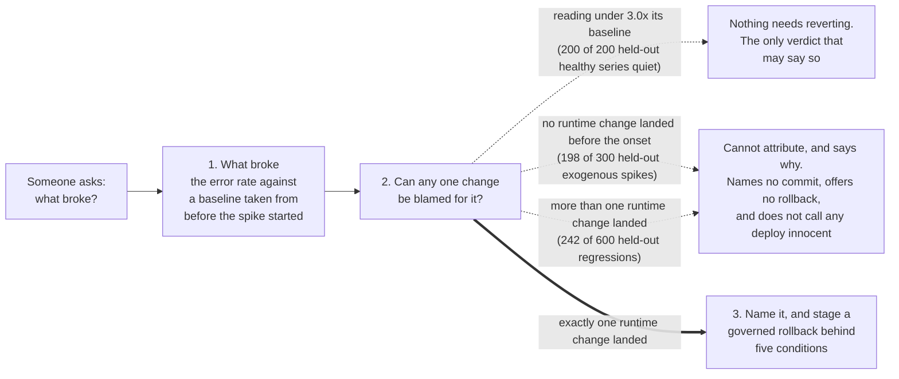
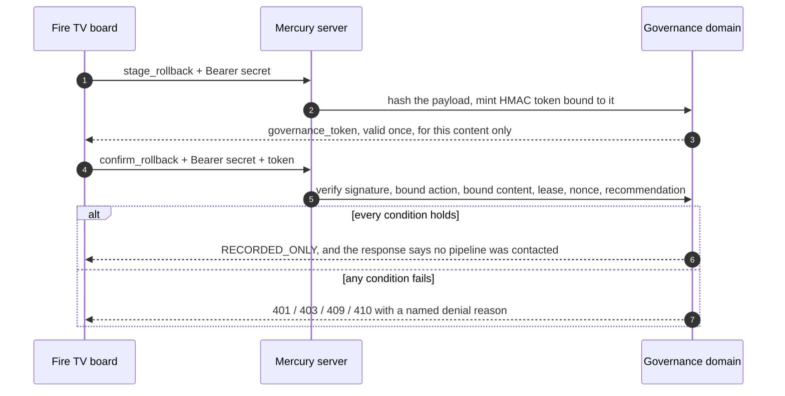

# Mercury: a Fire TV incident board that names a deploy only when it can

> **Mercury tells an on-call engineer when it cannot blame a deployment, and names one only when exactly one runtime change landed in the window.** It reads a real commit history against an error metric, publishes how often each answer is right, and renders on a Fire TV as one of its screens.

![The Mercury incident board at 1920x1080: the top bar reads Mercury, Fire TV incident board, One deploy, or why not, and API reachable; column heads read Service, Reading, Verdict and Next; the answer row for checkout-api reads 12.9x against its baseline, with a hazard-striped OFFLINE FIXTURE stamp and a dashed STAND-IN stamp for Mercury's own commits beside the figure; the verdict Attributed names one commit, the only runtime change before the spike, at 50.0% held-out precision on a synthetic corpus assuming at most 75 minutes of lag, with its commit message quoted; the next action reads Record-only rollback to the preceding commit; below are the amber Ask what changed button, Stage rollback and Confirm, and five service rows reading Attributed, Nothing to revert, Cannot attribute, Cannot attribute and Insufficient data, above a Fire TV remote key legend](docs/assets/incident-board-1920x1080.png)

*The first screen at Fire TV resolution, captured from a local run with `MERCURY_OFFLINE=1`. The metric is an offline fixture and the stamp beside the number says so. The named commit is one of this repository's own that changed server code, standing in for a deploy.*

**Status:** runs end to end on a laptop with offline fixtures and no credentials. A 170.85 s demo video is rendered but not uploaded. An Android TV emulator run (AOSP, API 34) landed in run 39334510932; public access is still pending ([details](#what-is-real-and-what-is-not)).

**What it does.** An error metric spikes during an incident and the room asks which
deploy did it. Mercury answers on the room's TV, and most of the time the honest answer
is that it cannot say: no change landed before the spike, or several did. It says which,
and never calls a deploy innocent. It counts as a deploy only a commit that changed a
runtime file, so a README edit is never blamed for a 5XX spike, and it names one only
when exactly one landed in the 75 minutes before the spike started. Beside the name it
prints how often that is right on a held-out split it was not tuned on: 50.0% (n=58
namings, synthetic corpus), under the corpus's assumption that a regression shows within
75 minutes. At longer delays it is lower: 41.5% at 90 minutes, 27.3% at 180
([table](docs/EVIDENCE.md#the-figure-depends-on-an-assumed-delay)). A named change can be
rolled back from the remote, behind five checks and a single-use token.

**Amazon technology.** Fire TV: a Leanback Android app in `app/` hosts the board in a
WebView and forwards the remote's D-pad keys to it. AWS: the server runs on Lambda
behind a function URL, keeps handoffs and spent tokens in DynamoDB, reads
CloudWatch error metrics and Cost Explorer spend when it has credentials, serves
`MCP 2025-11-25` Streamable HTTP on `POST /mcp`, and drafts an advisory brief on
`POST /mcp/tools/agent_incident_brief`. The board's agent deck calls it only when you
press **Ask the agent**; nothing runs on load or when you pick a row. The brief is
written deterministically from Mercury's own correlation unless Claude Sonnet 5
(`anthropic.claude-sonnet-5`) on Amazon Bedrock actually answers. That needs the server
flag `MERCURY_AGENT_MODEL=on` (off by default, and capped at `MERCURY_AGENT_MODEL_MAX_CALLS`
calls per process, default 100), the `anthropic` SDK (a declared dependency), AWS
credentials and Bedrock permission on the caller's role. The answer card names the engine
that wrote it, and which fields a model wrote, beside the
OFFLINE FIXTURE and record-only stamps. The deployed function sets the flag, capped at 40
calls; one owner-approved press on the deployed `e6aae2c` build came back HTTP 200 in
15.37 s with all four fields written by Claude Sonnet 5, one press and not a rate
([details](docs/EVIDENCE.md#the-agent-brief-on-the-deployed-build)). The brief's Bedrock adapter does not read
`MERCURY_OFFLINE`; the test suite keeps it off Bedrock with its own pytest guard.

| Link | What you get today |
|---|---|
| [Run it locally](#run-it-locally) | The build in the picture, with no credentials |
| [Evidence](docs/EVIDENCE.md) | The measurements with the commands that produced them, and the audit history |
| [What is real and what is not](#what-is-real-and-what-is-not) | What is measured, what is simulated, and what is still missing |
| [Friction log](docs/FRICTION_LOG.md) | Nine problems we hit building for Fire TV and AWS, each with the task, steps, expected and actual result, severity, workaround and suggestion |

[](.github/workflows/ci.yml)
[](tests/)
[](.github/workflows/ci.yml)
[](LICENSE)

The repository is **private** today, so the CI badge does not resolve outside the
organisation. The other three badges are static values that the commands in
[Evidence](docs/EVIDENCE.md#measured-numbers) reproduce.

---

## Table of Contents

1. [How it works](#how-it-works)
2. [The rollback](#the-rollback)
3. [Run it locally](#run-it-locally)
4. [What is real and what is not](#what-is-real-and-what-is-not)
5. [Who it is for and who pays](#who-it-is-for-and-who-pays)
6. [Evidence](#evidence)

---

## How it works



`POST /mcp/tools/what_changed` reads an error metric series and a commit history. It
decides whether the metric stepped up to 3.0 times a baseline taken from before the
step, then looks at the 75 minutes before the step started, counting only commits that
changed a runtime file: the server code, the board it serves, and what builds and
deploys it (the list is in [Evidence](docs/EVIDENCE.md#the-runtime-filter-v3)). A
README or test edit deploys no code and is set aside, and the answer says how many were.
**The dotted paths are the product.** On the held-out half of a synthetic labelled
corpus the correlator sees an anomaly and names nobody 90.0% of the time, because that
window usually holds no candidate or several. A refusal says which, and never claims a deploy is innocent: an
empty window says nothing about a change outside it. When it does name a change it is
right 50.0% of the time on that held-out split (29 of 58, 95% interval 38% to 62%),
and the board prints that figure next to the name with its condition: `≤75m lag`,
because the corpus assumes no regression takes longer than the window to show.

The board shows five services, one per answer. Each row is its own live response from
the server; the readings come from the offline fixture.

| Service | Verdict | What the board says |
|---|---|---|
| `checkout-api` | `ANOMALY_ATTRIBUTED` | Names the one runtime commit in the window and offers a record-only rollback |
| `payments-worker` | `NO_ANOMALY` | 1.6x its baseline, under the 3.0x threshold: nothing to revert |
| `search-indexer` | `ANOMALY_WITHOUT_ATTRIBUTION` | Cannot attribute: no change in the window, which is not proof of no deploy |
| `release-train` | `ANOMALY_WITHOUT_ATTRIBUTION` | Cannot attribute: too many runtime changes landed to name one |
| `quiet-service` | `INSUFFICIENT_DATA` | A name the fixture does not know, refused rather than invented |

The same page runs in a laptop browser, where arrow keys drive the same focus ring as
the remote.

---

## The rollback

A rollback is the one irreversible thing Mercury can do from a sofa.
`POST /mcp/tools/stage_rollback` mints an HMAC token bound to the exact payload, and
`POST /mcp/tools/confirm_rollback` spends it once.



The five conditions are the bearer secret, the content binding, single use, a
300 second lease, and a recommendation that is still current. Each has a test that
proves it refuses. The default dispatcher only records the decision. A GitHub Actions
dispatcher exists, stays disarmed unless three environment variables are set, and
has never been fired. On the
TV, the labelled demo path stages and confirms against the checked-in fixture target
only and contacts nothing outside the server.

---

## Run it locally

The repository is private today. The event's [FAQ](https://amazonappdev2026.devpost.com/details/faqs) sets the rule for that
case: "Add the Amazon and Devpost reviewers as collaborators before the submission
deadline". That is an owner step taken near submission; until then, `git clone`
works only for collaborators. The MIT [LICENSE](LICENSE) file stays in the repository
either way. If you hold the source, start at `pip install`. The install depends on your
network; one clean install here ran past ten minutes. No credentials and no AWS account
are needed.

### 1. Install

```bash
git clone https://github.com/upgradedev/mercury_amazon.git   # needs collaborator access while private
cd mercury_amazon
pip install -e ".[dev]"
```

### 2. Run the tests (optional)

```bash
python -m pytest tests/ -q
# 963 passed
```

The suite's runtime moves with machine load; every measured run is in
[Evidence](docs/EVIDENCE.md#suite-runtime).

### 3. Start the server

```bash
export MERCURY_OFFLINE=1          # never make an outbound call
python -m src.interfaces.mcp_server
```

On PowerShell use `$env:MERCURY_OFFLINE = "1"`. Without `MERCURY_ROLLBACK_SECRET`
the server generates an ephemeral secret for authenticated operator calls and prints
it to its log; the record-only TV demo needs none.

### 4. Open the board

Open `http://127.0.0.1:8002/`. The board asks on load. Press **Ask what changed**,
then **Stage rollback**, **Confirm** and **Publish handoff**. In record-only mode
these accept only the labelled fixture target and contact no deployment system, and
a spent confirmation token cannot be replayed.

### 5. Build the Fire TV APK

```bash
./gradlew :app:assembleDebug     # needs JDK 17 and the Android SDK
adb install -r app/build/outputs/apk/debug/app-debug.apk   # into a running Android TV emulator
# optional, a physical Fire TV instead: adb connect <FIRE_TV_IP>:5555 first
```

[`docs/FIRE_TV_BUILD.md`](docs/FIRE_TV_BUILD.md) covers the build and the Android TV
Emulator workflow. The target proof is an Android TV emulator run, not a physical Fire
TV. The event's [official FAQ](https://amazonappdev2026.devpost.com/details/faqs) says for Fire TV that "a physical device isn't
required at any stage of submission or judging".

---

## What is real and what is not

**Real:** the correlation engine, scored on 1160 labelled cases per side of a train and
held-out split, all synthetic; commits read from real git history, with their file lists,
wherever there is a checkout (the public board has none and shows an invented deploy feed);
the governed rollback and its refusals, each tested; the Leanback app source; an Android
TV runtime receipt from [run 39334510932](https://github.com/upgradedev/mercury_amazon/actions/runs/39334510932),
which installed the exact APK on an emulator and drove the record-only path by D-pad
(receipt: `android_tv_runtime_receipt.json`); and a live cockpit whose `/health` reports
the build SHA. Redeployed on 2026-10-19 at `e6aae2c`, the PR #67 merge, with
`MERCURY_OFFLINE=1`, `MERCURY_LIVE_CLOUDWATCH=1` and `MERCURY_AGENT_MODEL=on`, and probed
at 22:23 UTC that day by `python scripts/probe_deployment.py` (committed as
`deploy_teardown_receipt.json`), it serves the press-only agent deck, record-only; the
runtime receipt's `endpoint_health_build_sha` names the same build. It served `ddccb3e`
before that, and `e8ceae8` before that. **Live on the deployed board:** three rows read
from CloudWatch for the hackathon's own Lambda functions, stamped LIVE
([live data switches](#live-data-switches)). **Simulated:** every metric series of the
five demo services is an offline fixture, and a confirmed rollback is recorded, never
sent to a pipeline. **Built, not deployed:** a live GitHub DORA read. **Missing:**

- **A published video.** One take is rendered and not yet uploaded:
  `reviews/videos_20261006/mercury_amazon/output/mercury-demo.mp4` in the workspace,
  outside git, 163.09 s (ffprobe), 1920x1080. It opens on 23.32 s of Android TV
  emulator footage from CI run 37475795991: the debug APK on an AOSP emulator, API 34,
  loading the public demo (`ea2cff5`, record-only), from the board's first frame, at 1x
  with two static frames held longer. That is emulator footage, not a Fire TV device, and
  it does not show the app being opened from the launcher. A label names each source on
  every frame. The rest is a local run of commit `f7512bf` in a desktop browser at
  1920x1080, not the TV layout, every key sent through the D-pad bridge the Leanback app
  calls, with burned-in captions. It speaks the 50.0% held-out precision where the board
  prints it and the 58 namings over the evidence sentence, and after Confirm shows the
  board holding RECORDED, no pipeline contacted. The
  sync gate passed. Details in [video/README.md](video/README.md).
- **A public repository.** Private until the reviewers are added as collaborators; see
  [Run it locally](#run-it-locally).

| Part | On the board today | Live path |
|---|---|---|
| Error metric | Generated locally from the service name, stamped OFFLINE FIXTURE | CloudWatch via `boto3`. Run once against a real account, it returned no datapoints because no such load balancer exists. An empty or failed read now shows NO LIVE DATA and names nothing; it is never replaced with the generated series. With `MERCURY_LIVE_CLOUDWATCH=1` the board adds three rows for the hackathon's own production functions, read from `AWS/Lambda` (`Errors`, with `Invocations` beside it, last 24 hours) and stamped LIVE with the read time; the four simulated services stay fixtures. Set on the deployed function since 2026-10-19 |
| Commits | Real commits from this repository's `git log` with their file lists (a 20-commit window recorded at merge `a4ec9aa`, so a new commit cannot change the demo's verdicts), stamped STAND-IN because they stand in for a deploy feed; only one that changed a runtime file counts as a deploy. The public cockpit has no git checkout, so it shows an invented, display-only deploy feed (`src/infrastructure/fixtures/deploy_feed_fixture.json`), stamped OFFLINE FIXTURE; no published figure is computed from it | GitHub REST API with `GITHUB_TOKEN`, plus one files read per commit, so the runtime filter applies there too; a failed or capped read stays a candidate |
| Delivery velocity | A recording of a real GitHub read of `pallets/flask`, stamped OFFLINE FIXTURE | GitHub REST API. With `MERCURY_LIVE_GITHUB=1` and no token it reads this repository anonymously, cached for 15 minutes; while the repository is private that read gets HTTP 404 and the board keeps the fixture and says why. Not deployed yet |
| Cloud spend | A synthetic fixture that says it was never read from an AWS account | Cost Explorer. The maintainer ran it once against a private account; no artefact is committed, so treat that as unverified. There is deliberately no live switch for it: Cost Explorer reports the whole account's bill, so under `MERCURY_OFFLINE=1` it is always the fixture |
| Rollback | Recorded, never sent | A GitHub Actions dispatcher that has never been fired |
| Fire TV | App source, a CI build workflow and a runtime receipt | Run 39334510932 installed the exact APK on an Android TV emulator and drove the D-pad journey; receipt `android_tv_runtime_receipt.json`. The 2026-09-27 attempt stopped before install. The event FAQ does not require a physical Fire TV |

`MERCURY_OFFLINE=1` forces every data adapter (CloudWatch, Cost Explorer, GitHub) into
fixture mode. It can suppress a live call; it cannot make a fixture look live. Two narrower
switches re-open one source each on top of it; see [live data switches](#live-data-switches). The agent
brief's Bedrock adapter is the exception: it does not read the switch. It answers
deterministically unless the server sets `MERCURY_AGENT_MODEL=on`, and whenever the SDK,
credentials or permission is missing or a call fails. Nothing on the page speaks or announces on load, the page calls no agent or
model until a viewer presses Ask the agent, and it makes no request to another origin.

### Live data switches

**The deployed board sets `MERCURY_LIVE_CLOUDWATCH=1` on top of `MERCURY_OFFLINE=1`
since 2026-10-19, and does not set `MERCURY_LIVE_GITHUB`.** The committed probe's
`/health` (`deploy_teardown_receipt.json`) lists the three CloudWatch rows under
`live_sources` and reports `github_dora_and_pr_radar` false.

| Switch | Live when set | Still a fixture |
|---|---|---|
| `MERCURY_OFFLINE=1` | Nothing | Every adapter |
| `MERCURY_LIVE_CLOUDWATCH=1` on top of `MERCURY_OFFLINE=1` | Three extra board rows for the hackathon's own production functions, `mercury-wallboard-euw1-prod`, `volcan-mcp-euw1-prod` and `aletheia-provenance-euw1-prod`: `AWS/Lambda` `Errors`, with `Invocations` in the provenance, Sum per hour over the last 24 hours, each row stamped LIVE with the read time. Only those three names are ever sent to CloudWatch; a read is reused for 60 seconds | The four simulated services and `quiet-service`, whose rows gain a FIXTURE stamp. The rollback demo is unchanged |
| `MERCURY_LIVE_GITHUB=1` | The DORA report and the pull request radar, from the GitHub REST API, anonymously when no `GITHUB_TOKEN` is set, every answer (a refusal included) reused for 15 minutes | The commit feed behind the rollback demo, which still needs a token |
| none | | Cost Explorer under `MERCURY_OFFLINE=1`. It reports the whole account's bill, so it has no live switch |

Without `MERCURY_OFFLINE`, every adapter tries its live path as before: the simulated
service names then go to CloudWatch's load balancer metrics and show NO LIVE DATA, which is
why the hybrid keeps `MERCURY_OFFLINE=1` and adds the switches on top.

A live row is never attributed to a commit and never offers a rollback: no deploy feed for
those functions is connected, and every text the row carries says so rather than describing
an empty deploy window. A row whose errors rose from a zero baseline, including a run of
errors that has lasted several hours after only zeros, is reported as cannot-attribute,
never as nothing to revert. An adapter that fails puts only the
exception class, an AWS error code or HTTP status, and a short reason into the provenance;
ARNs, account ids, access key ids and request ids are removed
(`src/infrastructure/safe_errors.py`). The deployment needs one read-only grant on the
function's role, `cloudwatch:GetMetricStatistics` on `Resource: "*"` (CloudWatch metric
reads take no resource ARN, so the fixed list of three names in
`src/infrastructure/cloudwatch_adapter.py` is the only scope). That grant is applied: the inline policy
`mercury-read-own-lambda-metrics` was attached to the function's role on 2026-10-19 at
22:21 UTC, with the owner's approval and outside Terraform. Setting `MERCURY_LIVE_CLOUDWATCH=1`
changes what the TV renders, eight rows instead of five, so the Android TV runtime receipt
was re-recorded after that deploy: run 39334510932 drove the D-pad journey against the
`e6aae2c` page with the switch on, and the endpoint health in its artifact lists the three
rows under `live_sources`. Its final screenshot shows the rollback and handoff section, not
the rows. Measurements: [Evidence](docs/EVIDENCE.md#hybrid-live-data-deployed-at-e6aae2c).

The deploy sets `MERCURY_OFFLINE=1` and `MERCURY_LIVE_CLOUDWATCH=1` only. The GitHub
switch waits until the repository is public (planned for 2026-10-21): before that every
anonymous read gets HTTP 404. Known issue, not fixed here: with `MERCURY_LIVE_GITHUB=1`,
`/health` reports `github_live` true from the switch alone, even while every read gets 404,
and `video/capture-local.py` refuses to record while it is true.

The engine's limits are measured, not hidden. Every figure comes from a synthetic
corpus the authors wrote. Settings are tuned on a train split and reported on a
held-out split (a time cut of the commit stream with fixed seeds, scored by
`python scripts/attribution_split.py`). On held-out, naming recall is 4.8%: it names the
cause of about one regression in twenty-one. The runtime filter, added on 2026-09-27 as
a constraint rather than a tuned setting, moved held-out precision from 62.5% to 50.0%,
recall from 4.2% to 4.8%, refusals from 93.1% to 90.0%, and wrong namings from 15 to
29. The corpus's labels let a README edit cause a 5XX, which the filter will not name:
14 of its 16 wrong namings on regressions are such labels
([breakdown](docs/EVIDENCE.md#the-runtime-filter-v3)). The labels were not changed and
the board prints the lower figure. Before that, widening the window from 60 to 75
minutes on train had moved held-out precision from 40.8% to 62.5%. Both splits share the
generator's 75 minute delay ceiling, which the window equals, so the held-out figure
cannot test that fit: at a 180 minute ceiling the shipped engine reads 27.3%. The 52.2%
this page printed before was in-sample. A crowded window is
refused, not ranked. The full list is in
[Known limitations](docs/EVIDENCE.md#known-limitations).

---

## Who it is for and who pays

**This is a commercial hypothesis, not a finding.** Nobody has been asked yet, and the
price below is an untested hypothesis. The user is the on-call responder; the payer is
whoever owns the on-call rota, from the tooling line that already pays for paging.

| Question | Answer |
|---|---|
| Population | A ceiling, not a count of rotas: "In 2025, more than 10 million persons were employed as ICT specialists across the European Union (EU)", per [Eurostat](https://ec.europa.eu/eurostat/statistics-explained/index.php?title=ICT_specialists_in_employment). How many of them carry a pager is not measured anywhere this repository has read. |
| Price hypothesis | Untested: $20 per responder on the rota per month. It sits just under the [PagerDuty Professional](https://www.pagerduty.com/pricing/incident-management/) list price of $21 per user per month billed yearly, and level with [Grafana Assistant](https://grafana.com/pricing/) at $20 per active AI user, a comparable tool that investigates an alert. |
| Wedge | Platform teams at EU financial entities that run their own services on a rota. Since 17 January 2025 the [Digital Operational Resilience Act](https://eur-lex.europa.eu/legal-content/EN/TXT/HTML/?uri=CELEX:32022R2554) requires processes "to ensure that root causes are identified, documented and addressed". Mercury writes no report; it answers, or refuses on the record, the first question that record has to answer. |
| Why now | The same regulation, applying since 17 January 2025, and a budget line reopening: [Atlassian](https://www.atlassian.com/software/opsgenie/migration) says "Opsgenie customers have until April 5th, 2027 to complete their move to Jira Service Management." Mercury replaces no pager, but the line it would sit on is being re-decided. |
| Riskiest assumption | That incidents are worked in a room with a shared screen. The cheapest test is one question to the four rota owners on the target list: where was your last incident worked, and was a screen on? |

Every quote, the date each page was read, the command that fetched it, the other two
risky assumptions and their tests, and the first ten conversations are in
[Who would buy this, and why](docs/EVIDENCE.md#who-would-buy-this-and-why).

---

## Evidence

[`docs/EVIDENCE.md`](docs/EVIDENCE.md) holds every measurement with its command:

- `python scripts/attribution_split.py` scores the engine on a train and a held-out
  split, 1160 synthetic labelled cases each, and writes the figure the board prints;
  `python scripts/tune_attribution.py` is the train-only sweep the window was chosen from.
- `python scripts/naive_attribution_baselines.py` scores blame-the-latest-deploy and
  blame-every-deploy-in-the-window on the same held-out cases: 29 wrong namings for the
  engine against 482 and 1294, and lower recall, 4.8% against 16.7% and 56.8%.
- `python scripts/correlation_trial.py` scores the whole-stream corpus and prints the
  ablation, the threshold sweep and the density sweep.
- `python scripts/benchmark_suite.py` times every endpoint and the governance token.
- `python scripts/measure_legibility.py` measures every text size on the TV screen
  (smallest 24px).
- `python scripts/security_audit.py` runs the rollback refusal checks over HTTP.
- `python ci/readiness.py` runs the standards gates. The persona review those gates
  read is [`docs/PERSONA_REVIEW.md`](docs/PERSONA_REVIEW.md), so the score is
  reproducible in a clone.

## Contributing and licence

See [`CONTRIBUTING.md`](CONTRIBUTING.md) for the layout, the test commands and what a
pull request is checked against. Licensed under the [MIT Licence](LICENSE).
