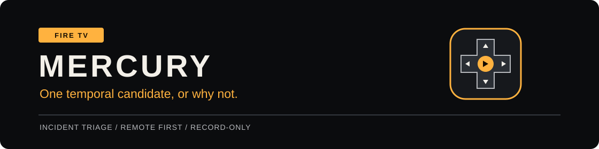
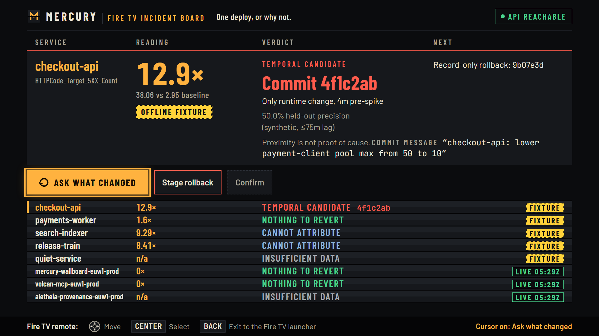
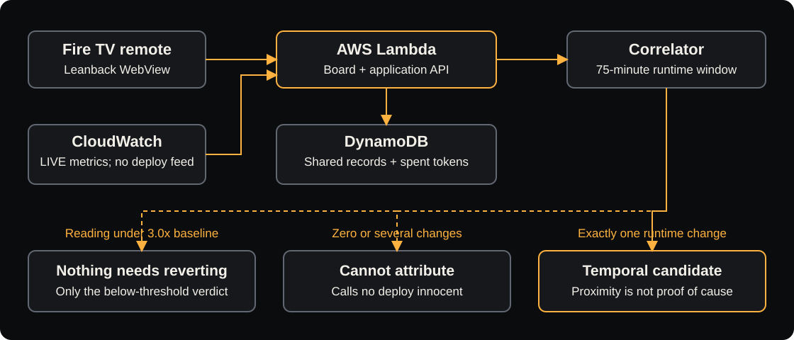
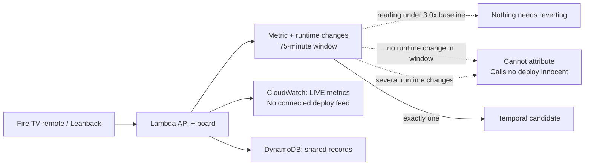
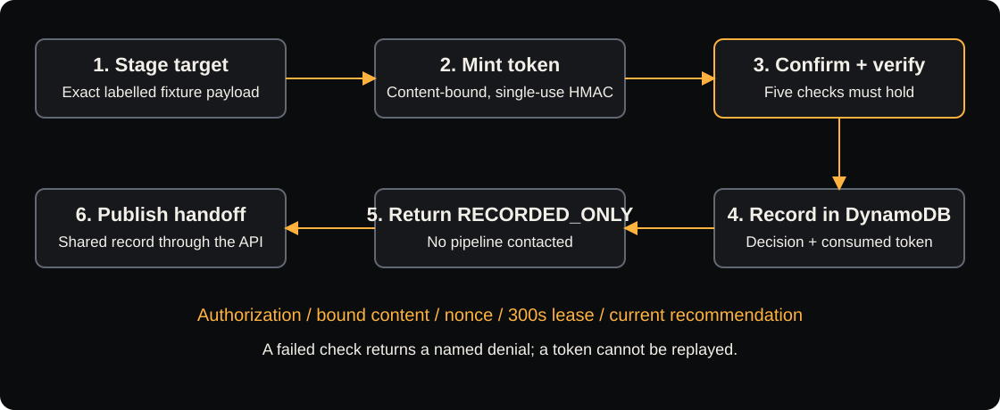

# Mercury



> **On Fire TV, Mercury names a deploy to the on-call engineer only when exactly one runtime change landed in the window, and otherwise says why.**

Built for the **Fire TV** track of the Amazon Developer Hackathon. An on-call engineer
uses the remote to investigate a spike and record a rollback decision on the room's TV.

[Live board](https://leol25sezuvokpankox5cvjopm0gtvfa.lambda-url.eu-west-1.on.aws/) ·
[Install APK](https://github.com/upgradedev/mercury_amazon/releases/tag/firetv-v1.0.1) ·
[Video](https://youtu.be/YyDAtBY5KlE) · [Submitted project](https://devpost.com/software/mercury-se4a0x) ·
[Evidence](docs/EVIDENCE.md) · [Quickstart](#run-it-locally)

[](https://github.com/upgradedev/mercury_amazon/actions/workflows/ci.yml)
[](https://github.com/upgradedev/mercury_amazon/releases/tag/firetv-v1.0.1)
[](tests/)
[](coverage_summary.json)
[](pyproject.toml)
[](LICENSE)

Source and APK assets are public. CI badges need no membership; private forks require
authorized access. Static badges are pinned to the [recorded measurements](docs/EVIDENCE.md#measured-numbers).



*Desktop Chromium capture, 20 October 2026, build `e6aae2c`: five FIXTURE rows and three
LIVE CloudWatch rows. These readings are dated, not current telemetry or a physical TV capture.*

## Table of Contents

[Try it](#four-steps-with-the-remote) · [Architecture](#how-it-works) ·
[Proof](#release-and-proof) · [Limits](#what-is-live-and-what-is-demonstrated) ·
[Quickstart](#run-it-locally) · [Docs](#documentation)

## Four steps with the remote

Open the live board or sideload the APK. Arrow keys and Enter provide the same focus
navigation in a desktop browser. The public journey needs no credentials:

1. **Ask what changed** on `checkout-api`: inspect the labelled temporal candidate.
2. **Stage rollback**: review the exact fixture target and its governance token.
3. **Confirm**: record that decision once; no deployment system is contacted.
4. **Publish handoff**: leave the next responder a shared record.

Choose `search-indexer` or `release-train` to see an empty or crowded window refused.
A refusal says **Cannot attribute** and clears nobody. Only a reading below the
anomaly threshold may say **Nothing to revert**. This journey makes no model call.
**Ask the agent** is a separate, optional model-capable action.

## How it works

Fire OS hosts the board in a Leanback WebView and forwards D-pad keys. Python use
cases run on AWS Lambda; DynamoDB stores handoffs and spent tokens. CloudWatch supplies
the three LIVE rows. The correlator looks for a 3.0x step against a pre-spike baseline
and exactly one runtime commit in the preceding 75 minutes. Proximity is not proof of cause.



<details>
<summary>Architecture diagram source (Mermaid)</summary>



</details>

`POST /mcp/tools/what_changed` computes the verdict;
`POST /mcp/tools/stage_rollback` binds a token to the exact payload;
`POST /mcp/tools/confirm_rollback` spends it once. MCP `2025-11-25` Streamable HTTP
is available on `POST /mcp`, with ten tools. Bedrock drafts advisory text only.



<details>
<summary>Governance diagram source (Mermaid)</summary>

```mermaid
sequenceDiagram
    participant TV as Fire TV
    participant API as Mercury governance
    participant DB as DynamoDB
    TV->>API: Stage exact fixture target
    API-->>TV: Content-bound, single-use HMAC token
    TV->>API: Confirm token + target
    API->>API: Verify auth, content, nonce, 300s lease, recommendation
    API->>DB: Record decision + consume token
    API-->>TV: RECORDED_ONLY; no pipeline contacted
    TV->>API: Publish handoff
    API->>DB: Store shared handoff
```

</details>

The optional GitHub Actions dispatcher **has never been fired**. Public confirmation
uses the record-only path. [Governance controls and denials](docs/EVIDENCE.md#the-rollback-is-the-point)
include rejected replay, expired tokens and changed content.

## Release and proof

| Evidence | Verified result | Source |
|---|---|---|
| Hosted runtime | `a438bf1`, deployed 23 October; exact package and health checked | [Deployment receipt](deploy_teardown_receipt.json) |
| Python CI | 963 passed; 93.77% coverage (3032 statements, 189 missed) | [Run 40000078136](https://github.com/upgradedev/mercury_amazon/actions/runs/40000078136) |
| Android CI | APK and native lifecycle JVM checks passed | [Run 40000078064](https://github.com/upgradedev/mercury_amazon/actions/runs/40000078064) |
| Android TV runtime | Normal launcher, D-pad, record-only confirmation and handoff at `a438bf1` | [Run 39961752709](https://github.com/upgradedev/mercury_amazon/actions/runs/39961752709), [receipt](android_tv_runtime_receipt.json) |
| Sideload APK | Version 1.0.1 / code 2; 9,266,535 bytes | [Public prerelease](https://github.com/upgradedev/mercury_amazon/releases/tag/firetv-v1.0.1), [SHA256SUMS](https://github.com/upgradedev/mercury_amazon/releases/download/firetv-v1.0.1/SHA256SUMS.txt) |
| Internal readiness | 47/53 gates, zero blocking; six open items | [Gate breakdown](docs/EVIDENCE.md#readiness-gates), [persona review](docs/PERSONA_REVIEW.md) |

The exact emulator-tested APK has SHA256
`6d7d097ea9c48d9e3e5f15b8c5d8ab69eee5e6805afacadd3f6c3f47ab9c30b7`.
Readiness is reproducible in a clone and is not an organizer judging score.

**Measured tradeoff:** on 1160 labelled cases in the synthetic held-out split,
29 wrong namings for the engine against 482 and 1294 for latest-deploy and every-deploy
baselines. Mercury finds fewer causes: 4.8% recall against 16.7% and 56.8%.
Precision is 50.0% (n=58 namings, 29 correct), assuming regression lag of at most
75 minutes; it falls to 41.5% at 90 minutes and 27.3% at 180 minutes.
[Method, labels and uncertainty](docs/EVIDENCE.md#how-often-it-is-right) are part of the result.
Reproduce with `python scripts/attribution_split.py` and
`python scripts/naive_attribution_baselines.py`.

<details>
<summary>Why the runtime filter lowered the published precision</summary>

The filter moved precision from 62.5% to 50.0%, recall from 4.2% to 4.8%, refusals
from 93.1% to 90.0%, and wrong namings from 15 to 29. The synthetic labels permit
a README edit to cause a 5XX: 14 of its 16 wrong namings on regressions have such
labels. Those labels were retained; the board prints the lower figure.
[Full comparison](docs/EVIDENCE.md#the-runtime-filter-v3).

</details>

## What is live and what is demonstrated

| Surface | Boundary |
|---|---|
| Five demo rows | Generated metric fixtures and an invented, labelled deploy feed; no production attribution |
| Three LIVE rows | The team's own Lambda error metrics, timestamped; no connected deploy feed, attribution or rollback |
| Agent brief | Optional Claude Sonnet 5 on Amazon Bedrock; deterministic fallback, engine labelled; cap 40 attempts per warm process, not a global budget |
| Accessibility / recovery | Polite atomic agent announcements and native focused Try again; semantic/browser and six JVM lifecycle tests, not an assistive-user or physical offline-remote trial |
| Fire TV proof | Android TV emulator is the verified path accepted by the event FAQ; no physical Fire TV validation |
| Vega | Optional CI-built packages only; no successful Mac/Vega runtime; not needed for the Android submission path |
| Video / submission | [Public demo](https://youtu.be/YyDAtBY5KlE), 2:44 with English subtitles; [submitted to Devpost](https://devpost.com/software/mercury-se4a0x) on 23 October 2026. Recording predates `a438bf1`: older Android TV emulator plus desktop footage, not proof of the new Retry or announcements |

`MERCURY_OFFLINE=1` plus `MERCURY_LIVE_CLOUDWATCH=1` produces the hosted hybrid.
The optional live GitHub switch is disabled. The separate agent adapter does not read
the offline flag: do not press **Ask the agent** for a no-model review. The successful
model response at `e6aae2c` is [dated historical evidence](docs/EVIDENCE.md#the-agent-brief-on-the-deployed-build),
not a new call or a current quality study. No Alexa integration is implemented.

## Run it locally

Python 3.11+; no AWS account or credentials for this fixture path. Installation depends
on the network. Full browser measurements additionally need Playwright; see the
[preserved setup notes](docs/EVIDENCE.md#developer-guide).

### 1. Install

```bash
git clone https://github.com/upgradedev/mercury_amazon.git
cd mercury_amazon
pip install -e ".[dev]"
```

### 2. Start without model calls

```bash
export MERCURY_OFFLINE=1
export MERCURY_AGENT_MODEL=off
python -m src.interfaces.mcp_server
```

PowerShell: set `$env:MERCURY_OFFLINE = "1"` and `$env:MERCURY_AGENT_MODEL = "off"`.

### 3. Open the board

Open `http://127.0.0.1:8002/` and follow the four-step journey above. Public fixture
confirmation needs no secret; authenticated operator APIs use `MERCURY_ROLLBACK_SECRET`.
Local state is process-local unless a persistent store is configured.

### 4. Verify or install on TV

`python -m pytest tests/ -q` collects 963 tests; browser checks skip without the optional
browser. CI passed all 963. Runtime moves with machine load; [timings](docs/EVIDENCE.md#suite-runtime)
are dated measurements. For TV, download the [APK and checksums](https://github.com/upgradedev/mercury_amazon/releases/tag/firetv-v1.0.1),
verify the digest, then use `adb install -r mercury-firetv-1.0.1-debug.apk`.
[Build and launcher instructions](docs/FIRE_TV_BUILD.md) include the official FAQ.
This is a debug sideload build, not an Amazon Appstore listing.

## Who it is for and who pays

**Commercial hypothesis, not a finding:** the user is the on-call responder; the payer
owns the rota. A price hypothesis, untested, is $20 per responder/month. No buyer has
been asked; shared-screen incident work is the first assumption to test.
[Sources and interview plan](docs/EVIDENCE.md#who-would-buy-this-and-why).

## Documentation

| Read next | Contents |
|---|---|
| [Evidence](docs/EVIDENCE.md) / [developer guide](docs/EVIDENCE.md#developer-guide) | Measurements, full setup, switches, earlier screenshots and audit history |
| [Fire TV build](docs/FIRE_TV_BUILD.md) | Exact APK, launcher, D-pad receipt and optional Vega setup |
| [Architecture and controls](docs/COMPLIANCE_AND_ARCHITECTURE.md) | Well-Architected pillars, AI Act residuals and data map |
| [Persona review](docs/PERSONA_REVIEW.md) / [friction log](docs/FRICTION_LOG.md) | Internal review and product feedback, not external user validation |
| [Contributing](CONTRIBUTING.md) | Source layout and verification commands |

Mercury and the extracted [spatial-navigation library](https://github.com/upgradedev/firetv-spatial-navigation)
are public under the [MIT Licence](LICENSE).
