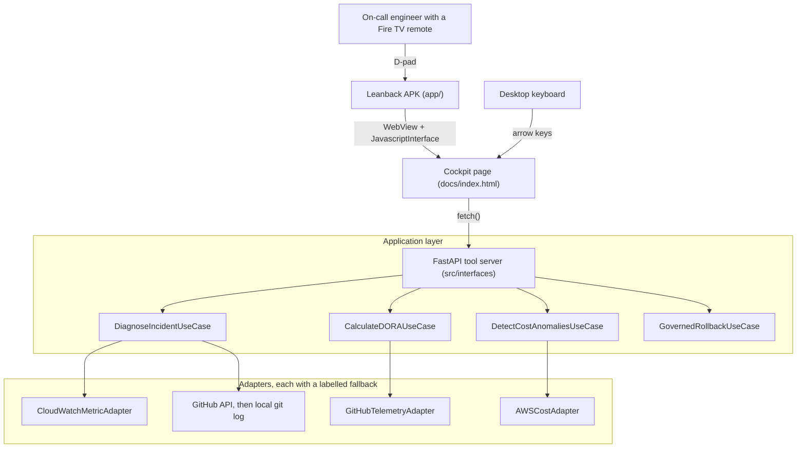

# Mercury: Fire TV Incident Commander

> **Mercury puts an on-call engineer's incident evidence on the Fire TV in the room, and takes the governed rollback from the remote.**

[](.github/workflows/android.yml)
[](.github/workflows/ci.yml)
[](tests/)
[](.github/workflows/ci.yml)
[](LICENSE)

The two Actions badges point at a repository that is currently **private**, so they
will not resolve for anyone outside the organisation until it is made public. They
are listed here because the workflows they name are in this repository and can be
read directly. The other three badges are static and describe values you can
reproduce with the commands in [Measured numbers](#measured-numbers).

---

## Table of Contents

1. [What this is](#what-this-is)
2. [What is real and what is simulated](#what-is-real-and-what-is-simulated)
3. [Architecture](#architecture)
4. [The rollback is the point](#the-rollback-is-the-point)
5. [Quickstart](#quickstart)
6. [Fire TV](#fire-tv)
7. [Measured numbers](#measured-numbers)
8. [Configuration](#configuration)
9. [Known limitations](#known-limitations)
10. [Contributing and licence](#contributing-and-licence)

---

## What this is

During a production incident the useful information is scattered across a version
control host, a metrics console and a deployment pipeline, and it is scattered
across several laptops. Mercury puts one view of it on the television that is
already in the room, and lets the person holding the remote act on it.

Three things it does:

**Answers "what changed?"** `POST /mcp/tools/what_changed` reads an error metric
series and a commit history, decides whether the newest reading is an anomaly
against its own baseline, and attributes it to the closest commit that landed
before it. When it cannot attribute the anomaly to anything, it says so and
offers no rollback. That refusal is a feature, and it has its own tests.

**Shows engineering velocity and spend.** `POST /mcp/tools/get_dora_velocity_report`,
`POST /mcp/tools/get_pr_bottlenecks` and `POST /mcp/tools/get_aws_cost_anomalies`
return DORA metrics computed from GitHub Actions runs and merged pull requests,
open pull requests past a 36 hour review SLA, and month-to-date AWS spend per
service from Cost Explorer.

**Takes a governed rollback from the D-pad.** `POST /mcp/tools/stage_rollback`
and `POST /mcp/tools/confirm_rollback` are the only state-changing endpoints, and
both require the deployment's shared secret. See
[The rollback is the point](#the-rollback-is-the-point).

---

## What is real and what is simulated

Every telemetry response carries a provenance stamp, and the cockpit prints it on
screen next to the numbers. A viewer never has to trust the server about whether
a reading is live.

| Data | Live path | What happens without it |
|---|---|---|
| DORA metrics, pull requests | GitHub REST API via `httpx`, needs `GITHUB_TOKEN` | Serves `src/infrastructure/fixtures/github_telemetry_fixture.json`, which is a **recording of a real GitHub read** of `pallets/flask` made by `python scripts/record_github_fixture.py`, labelled `offline-fixture` |
| AWS spend | `ce:GetCostAndUsage` via `boto3`, needs AWS credentials | Serves `src/infrastructure/fixtures/aws_cost_fixture.json`, which says in its own text that it is **synthetic and was never read from an AWS account**, labelled `offline-fixture` |
| Error metric series | `cloudwatch:GetMetricStatistics` via `boto3` | Generates a deterministic local series, labelled `offline-fixture`, whose provenance says it was generated and never read from CloudWatch |
| Commits for correlation | GitHub REST API | Falls back to **real commits from the local checkout** via `git log`, labelled `local-git`, never to invented commits |

The Cost Explorer path has been executed successfully against a real AWS account
during development. The CloudWatch path has been executed and returned no
datapoints, because there is no load balancer named `checkout-api` to read. The
account's actual figures are not committed to this repository.

Set `MERCURY_OFFLINE=1` to force every adapter into fixture mode whatever
credentials the machine has. That switch can only ever suppress a live call; it
can never make a fixture look live.

### The demo path, and what it does to the data

With no credentials at all, the war room still works end to end: the commits are
real ones read from your checkout, and the simulated metric series is anchored
four minutes after the newest of them so the correlation is coherent. The response
says exactly that, in the text the screen shows:

> The final reading is placed 4 minutes after the newest known commit so the
> correlation is demonstrable; the commits are real, this metric is not.

---

## Architecture



The layering is hexagonal. `src/domain` holds pure models and imports no SDK,
which gate A5 checks by reading the imports. `src/application` holds use cases
that depend on protocols. `src/infrastructure` holds the adapters that talk to
GitHub, Cost Explorer, CloudWatch and git. `src/interfaces` holds the HTTP server
and the cockpit assets.

---

## The rollback is the point

A rollback is the one irreversible thing Mercury can do from a sofa, so it is
guarded by four independent conditions. Each has a test that proves it refuses.


1. **Authorization.** Both endpoints require `Authorization: Bearer <MERCURY_ROLLBACK_SECRET>`,
   compared in constant time. Without it the request is refused with 401.
2. **Content binding.** Staging mints an HMAC over the action id and a
   length-prefixed SHA-256 hash of the rollback payload. Edit the target commit
   after staging and the token stops applying, with reason `TOKEN_CONTENT_MISMATCH`.
3. **Single use.** Each token carries a nonce consumed on the first successful
   confirm. A replay is refused with `TOKEN_ALREADY_USED`.
4. **Lease.** A staged action expires after `lease_sec` seconds, default 300, and
   then confirms with `LEASE_EXPIRED`.

**What it does not do:** Mercury ships no deployment pipeline integration. When
governance passes, the default dispatcher records the decision locally and its own
response says so verbatim: *"No deployment pipeline was contacted."* Implement the
`RollbackDispatcher` protocol in `src/application/governed_rollback_use_case.py`
to make the dispatch real.

---

## Quickstart

Time to first result on a machine with Python 3.11 and no credentials: about two
minutes, most of it `pip install`.

### 1. Install

```bash
git clone https://github.com/upgradedev/mercury_amazon.git
cd mercury_amazon
pip install -e ".[dev]"
```

### 2. Run the tests

```bash
python -m pytest tests/ -q
# 239 passed
```

### 3. Start the server

```bash
export MERCURY_ROLLBACK_SECRET="pick-any-string-for-a-local-demo"
export MERCURY_OFFLINE=1          # optional: never make an outbound call
python -m src.interfaces.mcp_server
```

Leaving `MERCURY_ROLLBACK_SECRET` unset is allowed for a local run: the server
generates an ephemeral one and prints it to its log for you to paste into the
cockpit. It changes on every restart.

### 4. Open the cockpit and use it

Open `http://127.0.0.1:8002/`. Press **Check connection** to send a real
`GET /health` and watch the state pill change from *API not checked*. Then
**Ask what changed**, paste the governance secret, **Stage governed rollback**,
and **Confirm rollback**. Confirm a second time to watch it refuse.

Arrow keys move focus to the nearest control in that direction, which is the same
code path the Fire TV remote drives.

### 5. Build the Fire TV APK

```bash
./gradlew :app:assembleDebug     # needs JDK 17 and the Android SDK
adb connect <FIRE_TV_IP>:5555
adb install -r app/build/outputs/apk/debug/app-debug.apk
```

Full device, emulator and troubleshooting instructions are in
[`docs/FIRE_TV_BUILD.md`](docs/FIRE_TV_BUILD.md).

---

## Fire TV

The app in `app/` is a Leanback Android application. `AndroidManifest.xml`
declares `android.software.leanback` as required, `android.hardware.touchscreen`
as not required, and a `LEANBACK_LAUNCHER` activity, which is what makes it a Fire
TV app rather than a phone app.

`MainActivity` hosts the cockpit in a WebView with JavaScript enabled, exposes a
small `MercuryHost` JavaScript interface, and forwards D-pad key codes into the
page. Back is resolved by asking the page first, then WebView history, then
closing the activity, so the viewer is never trapped and the war room is never
closed by accident. `CockpitUrlResolver` accepts only absolute `http` and `https`
URLs, so a hostile `COCKPIT_URL` intent extra cannot redirect the WebView.

**What has been run, and what has not.** The APK is assembled by
[`.github/workflows/android.yml`](.github/workflows/android.yml) on a runner with
the Android SDK, which also runs the Kotlin unit tests and uploads the APK as a
downloadable artifact. **It has not been built on the maintainer's machine** (no
JDK, no Android SDK; the verbatim failure is recorded in `docs/FIRE_TV_BUILD.md`)
and **it has not been installed on a physical Fire TV Stick or run in the Fire TV
emulator.** The D-pad navigation logic it drives is tested for real: 16 assertions
in `tests/e2e/spatial_nav_spec.js` execute `docs/firetv_nav.js` in Node against a
synthetic grid of bounding rectangles.

---

## Measured numbers

Every number below is produced by a committed command. Run it and it prints them.

### Latency

`python scripts/benchmark_suite.py` measures each endpoint in-process through the
ASGI application and writes `benchmarks_summary.json` with the timestamp, the
iteration count and the data mode it observed.

| Endpoint | Requests | Mean | p95 | Command |
|---|---|---|---|---|
| `get_dora_velocity_report` | 60 | 3.08 ms | 5.19 ms | `python scripts/benchmark_suite.py` |
| `get_pr_bottlenecks` | 60 | 2.50 ms | 2.95 ms | `python scripts/benchmark_suite.py` |
| `get_aws_cost_anomalies` | 60 | 2.48 ms | 2.99 ms | `python scripts/benchmark_suite.py` |
| `what_changed` | 60 | 49.51 ms | 81.11 ms | `python scripts/benchmark_suite.py` |
| Governance mint and verify | 2000 | 0.0198 ms | 0.0345 ms | `python scripts/benchmark_suite.py` |

Measured on Windows, CPython 3.11.0, with `MERCURY_OFFLINE=1`. These exclude
network transit, so they are a floor for a local run rather than a field
measurement from a Fire TV on a home network. `what_changed` is the slow one
because it shells out to `git log` for the commit fallback.

**The one comparative number:** the full four-condition governance check costs 0.0198 ms mean over 2000 cycles, against a 2.48 ms mean for the cheapest endpoint round trip measured in the same run. Guarding the rollback therefore adds about 0.8 percent to the request it guards. Baseline, margin and sample size all come from that one command.

### Tests and coverage

```bash
python -m pytest tests/ -q                                    # 239 passed
python -m pytest tests/ --cov=src --cov-report=term-missing   # 92% of 1031 statements
node tests/e2e/spatial_nav_spec.js                            # 16/16 assertions
python ci/readiness.py                                        # standards gate audit
```

### Data fixtures

```bash
python scripts/record_github_fixture.py pallets/flask   # re-record the GitHub fixture
python scripts/probe_deployment.py                      # re-probe the deployment
```

`deploy_teardown_receipt.json` is the output of that probe. It records only what
was observed, and it reports `deployed_commit_sha` as `null` because the deployed
build does not report one. Gate G2 therefore fails, correctly, and says so.

---

## Configuration

| Variable | Effect | Default |
|---|---|---|
| `MERCURY_ROLLBACK_SECRET` | Bearer secret for both rollback endpoints | An ephemeral one is generated and logged |
| `MERCURY_OFFLINE` | Force every adapter to skip its live call | off |
| `GITHUB_TOKEN` | Enables the live GitHub path | unset, fixture mode |
| `MERCURY_GITHUB_REPO` | Repository to measure | `upgradedev/mercury_amazon` |
| `MERCURY_DORA_WINDOW_DAYS` | DORA measurement window | 30 |
| `MERCURY_SIMULATE_INCIDENT` | Shape of the simulated metric series | `1`, ending in a spike |
| `MERCURY_BUILD_SHA` | Build SHA reported by `/health` | read from `git rev-parse HEAD` |
| `AWS_REGION` | Region for CloudWatch | `eu-west-1` |

### How DORA is computed

GitHub does not expose DORA, so these are proxies and they are stated rather than
implied. Deployment frequency is successful default-branch workflow runs divided
by the window in days. Lead time is the mean hours from pull request creation to
merge. Change failure rate is failed completed runs over all completed runs.
Recovery time is the mean hours from a failed run to the next successful one. A
repository with no workflow runs reports zero and says why, rather than being
given a substitute number.

---

## Known limitations

* **No deployment pipeline integration.** Governance passes, then a record is
  written locally. The response says so.
* **No device run.** The APK builds in CI and has never been installed on Fire TV
  hardware or run in the emulator.
* **The live deployment is stale.** `https://t7h6us4q0f.execute-api.eu-west-1.amazonaws.com`
  answers 200 but runs an older build and reports no build SHA, so gate G2 fails.
  Its teardown has never been tested, so gate D2 fails too.
* **No video.** Gates E2 and E4 fail for that reason.
* **No browser-driver end-to-end test.** Gate C5 fails. The Node spatial navigation
  spec is a DOM shim, not a browser, and is not counted as one.
* **Cost Explorer lags.** It aggregates daily with up to 24 hours of reporting
  delay, so a spend spike in the last hour will not appear. Sub-hour spend alerting
  needs CloudWatch metric alarms, which Mercury does not implement.
* **Anomaly detection is a threshold, not a model.** The newest reading against the
  mean of the rest, with a fixed factor. It has no seasonality and no trend.
* **Voice is browser speech synthesis.** The cockpit reads its summaries aloud with
  the browser's `speechSynthesis`. There is no Alexa skill and no Alexa integration
  in this repository.
* **In-memory state.** Staged rollbacks and spent nonces live in the server
  process, so a restart forgets them. A multi-instance deployment needs shared
  storage before the single-use guarantee holds across instances.

---

## Contributing and licence

Contributions are welcome. See [`CONTRIBUTING.md`](CONTRIBUTING.md) for the layout,
the test commands and what a pull request is checked against. Issue templates live
in [`.github/ISSUE_TEMPLATE`](.github/ISSUE_TEMPLATE).

Licensed under the [MIT Licence](LICENSE).
