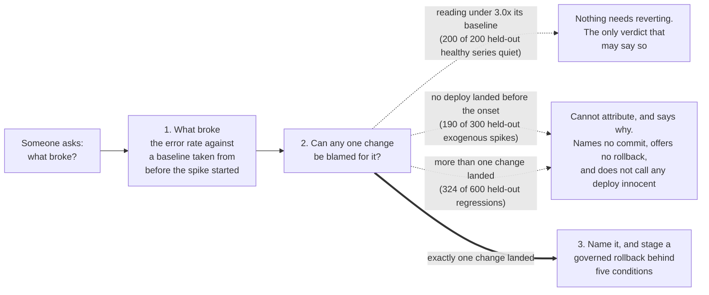
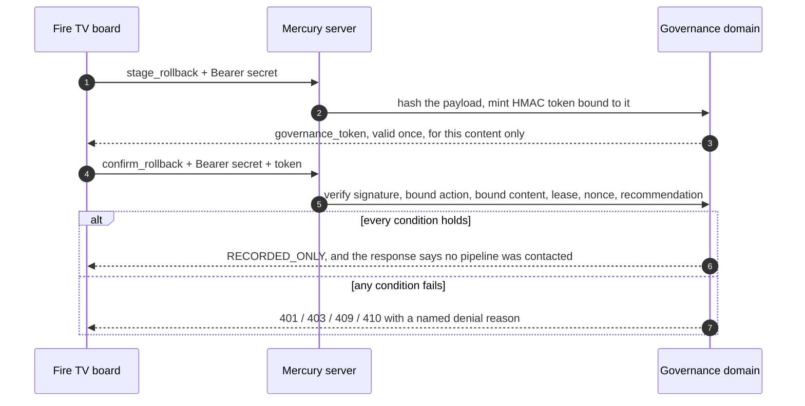

# Mercury: a Fire TV incident board that names a deploy only when it can

> **Mercury tells an on-call engineer when it cannot blame a deployment, and names one only when exactly one change landed in the window.** It reads a real commit history against an error metric, publishes how often each answer is right, and renders on a Fire TV as one of its screens.

![The Mercury incident board at 1920x1080: the top bar reads Mercury, Fire TV incident board, Names one change, or why not; column heads read Service, Reading, Verdict and Next; the answer row for checkout-api reads 12.9x against its baseline, with a hazard-striped OFFLINE FIXTURE stamp and a dashed STAND-IN stamp for Mercury's own commits beside the figure; the verdict Attributed names one commit, the only change before the spike, at 62.5% held-out precision on a synthetic corpus assuming at most 75 minutes of lag, with its labelled commit message; the next action reads Record-only rollback to the preceding commit; below are the amber Ask what changed button, Stage rollback and Confirm, and five service rows reading Attributed, Nothing to revert, Cannot attribute, Cannot attribute and Insufficient data, above a Fire TV remote key legend](docs/assets/incident-board-1920x1080.png)

*The first screen at Fire TV resolution, captured from a local run with `MERCURY_OFFLINE=1`. The metric is an offline fixture and the stamp beside the number says so. The named commit is one of this repository's own, standing in for a deploy.*

**What it does.** When an error metric spikes, Mercury answers one question on the
room's TV: can this be pinned on one change? It names a change only when exactly one
landed in the 75 minutes before the spike started, and prints beside the name how often
that is right on a held-out split it was not tuned on: 62.5% (n=40 namings, synthetic
corpus), under the corpus's assumption that a regression shows within 75 minutes. At
longer delays it is lower: 50.0% at 90 minutes, 25.0% at 180
([table](docs/EVIDENCE.md#the-figure-depends-on-an-assumed-delay)). Otherwise it says it cannot attribute, and why. A
named change can be rolled back from the remote, behind five checks and a single-use
token.

**Amazon technology.** Fire TV: a Leanback Android app in `app/` hosts the board in a
WebView and forwards the remote's D-pad keys to it. AWS: the server runs on Lambda
behind a function URL, keeps handoffs and spent tokens in DynamoDB, and reads
CloudWatch error metrics and Cost Explorer spend when it has credentials.

**Honest status.** Real: the correlation engine, scored on 1160 labelled cases per side of a train and held-out split, all synthetic; commits
read from real git history; the governed rollback and its refusals, each tested; the
Leanback app source. Simulated: every metric series on the board is an offline
fixture, and a confirmed rollback is recorded, never sent to a pipeline. Missing: a
Fire TV or Android TV runtime receipt (runtime evidence pending), a published video (a
render exists locally, pending upload), a public deployment of this build, and a public
repository.

| Link | What you get today |
|---|---|
| [Live cockpit](https://leol25sezuvokpankox5cvjopm0gtvfa.lambda-url.eu-west-1.on.aws/) | Build `6dd76bd`, probed 2026-09-26: older than this branch and the design above, and it loads Google Fonts. Its `/health` reports the build SHA |
| [Run it locally](#run-it-locally) | The build in the picture, with no credentials |
| [Evidence](docs/EVIDENCE.md) | The measurements with the commands that produced them, and the audit history |

[](.github/workflows/ci.yml)
[](tests/)
[](.github/workflows/ci.yml)
[](LICENSE)

The repository is **private** today, so the CI badge does not resolve outside the
organisation. The other three badges are static values that the commands in
[Evidence](docs/EVIDENCE.md#measured-numbers) reproduce.

---

## Table of Contents

1. [How it works](#how-it-works)
2. [The rollback](#the-rollback)
3. [Run it locally](#run-it-locally)
4. [What is real and what is not](#what-is-real-and-what-is-not)
5. [Who it is for and who pays](#who-it-is-for-and-who-pays)
6. [Evidence](#evidence)

---

## How it works



`POST /mcp/tools/what_changed` reads an error metric series and a commit history. It
decides whether the metric stepped up to 3.0 times a baseline taken from before the
step, then looks at the 75 minutes before the step started. **The dotted paths are
the product.** On the held-out half of a synthetic labelled corpus the correlator sees
an anomaly and names nobody 93.1% of the time, because that window usually holds no
change or several. A refusal says which, and never claims a deploy is innocent: an
empty window says nothing about a change outside it. When it does name a change it is
right 62.5% of the time on that held-out split (25 of 40, 95% interval 47% to 76%),
and the board prints that figure next to the name with its condition: `≤75m lag`,
because the corpus assumes no regression takes longer than the window to show.

The board shows five services, one per answer. Each row is its own live response from
the server; the readings come from the offline fixture.

| Service | Verdict | What the board says |
|---|---|---|
| `checkout-api` | `ANOMALY_ATTRIBUTED` | Names the one commit in the window and offers a record-only rollback |
| `payments-worker` | `NO_ANOMALY` | 1.6x its baseline, under the 3.0x threshold: nothing to revert |
| `search-indexer` | `ANOMALY_WITHOUT_ATTRIBUTION` | Cannot attribute: no change in the window, which is not proof of no deploy |
| `release-train` | `ANOMALY_WITHOUT_ATTRIBUTION` | Cannot attribute: too many changes landed to name one |
| `quiet-service` | `INSUFFICIENT_DATA` | A name the fixture does not know, refused rather than invented |

The same page runs in a laptop browser, where arrow keys drive the same focus ring as
the remote.

---

## The rollback

A rollback is the one irreversible thing Mercury can do from a sofa.
`POST /mcp/tools/stage_rollback` mints an HMAC token bound to the exact payload, and
`POST /mcp/tools/confirm_rollback` spends it once.



The five conditions are the bearer secret, the content binding, single use, a
300 second lease, and a recommendation that is still current. Each has a test that
proves it refuses. The default dispatcher only records the decision. A GitHub Actions
dispatcher exists, stays disarmed unless three environment variables are set, and
has never been fired. On the
TV, the labelled demo path stages and confirms against the checked-in fixture target
only and contacts nothing outside the server.

---

## Run it locally

The repository is private, so `git clone` fails for anyone outside the organisation
until it is made public. If you hold the source, start at `pip install`. The install
depends on your network; one clean install here ran past ten minutes. No credentials
and no AWS account are needed.

### 1. Install

```bash
git clone https://github.com/upgradedev/mercury_amazon.git   # fails while private
cd mercury_amazon
pip install -e ".[dev]"
```

### 2. Run the tests (optional)

```bash
python -m pytest tests/ -q
# 645 passed
```

The suite's runtime moves with machine load; every measured run is in
[Evidence](docs/EVIDENCE.md#suite-runtime).

### 3. Start the server

```bash
export MERCURY_OFFLINE=1          # never make an outbound call
python -m src.interfaces.mcp_server
```

On PowerShell use `$env:MERCURY_OFFLINE = "1"`. Without `MERCURY_ROLLBACK_SECRET`
the server generates an ephemeral secret for authenticated operator calls and prints
it to its log; the record-only TV demo needs none.

### 4. Open the board

Open `http://127.0.0.1:8002/`. The board asks on load. Press **Ask what changed**,
then **Stage rollback**, **Confirm** and **Publish handoff**. In record-only mode
these accept only the labelled fixture target and contact no deployment system, and
a spent confirmation token cannot be replayed.

### 5. Build the Fire TV APK

```bash
./gradlew :app:assembleDebug     # needs JDK 17 and the Android SDK
adb connect <FIRE_TV_IP>:5555
adb install -r app/build/outputs/apk/debug/app-debug.apk
```

[`docs/FIRE_TV_BUILD.md`](docs/FIRE_TV_BUILD.md) covers the build and the Android TV
Emulator workflow, which the event's
[official FAQ](https://amazonappdev2026.devpost.com/details/faqs) accepts in place of
hardware.

---

## What is real and what is not

| Part | On the board today | Live path |
|---|---|---|
| Error metric | Generated locally from the service name, stamped OFFLINE FIXTURE | CloudWatch via `boto3`. Run once against a real account, it returned no datapoints because no such load balancer exists |
| Commits | Real commits from this repository's `git log`, stamped STAND-IN because they stand in for a deploy feed | GitHub REST API with `GITHUB_TOKEN` |
| Delivery velocity | A recording of a real GitHub read of `pallets/flask`, stamped OFFLINE FIXTURE | GitHub REST API |
| Cloud spend | A synthetic fixture that says it was never read from an AWS account | Cost Explorer. The maintainer ran it once against a private account; no artefact is committed, so treat that as unverified |
| Rollback | Recorded, never sent | A GitHub Actions dispatcher that has never been fired |
| Fire TV | App source and a CI build workflow | **Runtime evidence pending**: no emulator or device receipt yet |

`MERCURY_OFFLINE=1` forces every adapter into fixture mode. It can suppress a live
call; it cannot make a fixture look live. Nothing on the page speaks or announces on
load, and the page makes no request to another origin.

The engine's limits are measured, not hidden. Every figure comes from a synthetic
corpus the authors wrote. Settings are now tuned on a train split and reported on a
held-out split (a time cut of the commit stream with fixed seeds, scored by
`python scripts/attribution_split.py`). On held-out, naming recall is 4.2%: it names the cause
of about one regression in twenty-four. Widening the window from 60 to 75 minutes on
2026-09-27 cut wrong namings on the held-out cases from 42 to 15 and raised held-out
precision from 40.8% to 62.5% (the 95% intervals overlap, so the size of that gain is
not settled by this sample), but it did not raise recall (4.8% before), it refuses more often (93.1%
against 87.8%), and it blames a commit for more spikes no commit caused (14 of 300
against 9). Both splits share the generator's 75 minute delay ceiling, which the new window equals, so the held-out figure cannot test that fit: at a 180 minute ceiling v2 reads 25.0% and v1 17.1%. The 52.2% this page printed before was in-sample. A crowded window is
refused, not ranked. The full list is in
[Known limitations](docs/EVIDENCE.md#known-limitations).

---

## Who it is for and who pays

**This is a commercial hypothesis, not a finding.** Nobody has been asked yet.

- **Who uses it:** the on-call responder, in a room where incidents are worked
  together and a TV is on the wall.
- **Who pays:** whoever owns the on-call rota, usually a head of platform or of
  engineering, from the tooling line that already pays for paging and observability.
- **Why now, as a hypothesis:** teams ship many small changes a day, so the hour
  before a spike often holds several. This repository shows the pattern: a 75 minute
  window ending on one of its commits holds 2.98 commits on average. A tool that says
  "I cannot tell which" is safer to act on than one that guesses.
- **What would falsify it:** responders who say the TV is the wrong screen, because
  everyone is remote, or who say the attribution is not worth reading.

There is no price and no market size here, because no figure has been read from a
dated public source yet. The buyer, the budget line, the basis for a price and the
first ten conversations are in
[Who would buy this, and why](docs/EVIDENCE.md#who-would-buy-this-and-why).

---

## Evidence

[`docs/EVIDENCE.md`](docs/EVIDENCE.md) holds every measurement with its command:

- `python scripts/attribution_split.py` scores the engine on a train and a held-out
  split, 1160 synthetic labelled cases each, and writes the figure the board prints;
  `python scripts/tune_attribution.py` is the train-only sweep the window was chosen from.
- `python scripts/correlation_trial.py` scores the whole-stream corpus and prints the
  ablation, the threshold sweep and the density sweep.
- `python scripts/benchmark_suite.py` times every endpoint and the governance token.
- `python scripts/measure_legibility.py` measures every text size on the TV screen
  (smallest 24px).
- `python scripts/security_audit.py` runs the rollback refusal checks over HTTP.
- `python ci/readiness.py` runs the standards gates. The persona review those gates
  read is [`docs/PERSONA_REVIEW.md`](docs/PERSONA_REVIEW.md), so the score is
  reproducible in a clone.

## Contributing and licence

See [`CONTRIBUTING.md`](CONTRIBUTING.md) for the layout, the test commands and what a
pull request is checked against. Licensed under the [MIT Licence](LICENSE).
