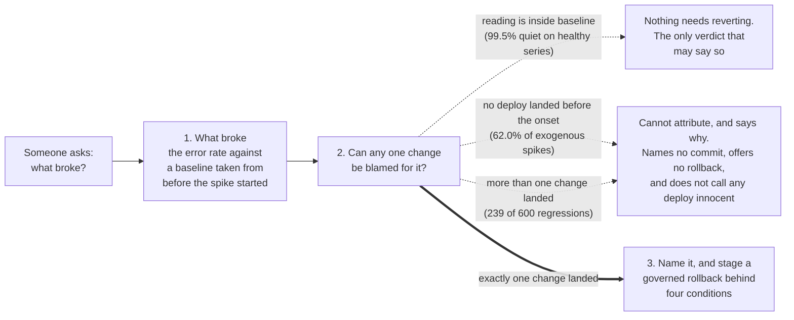
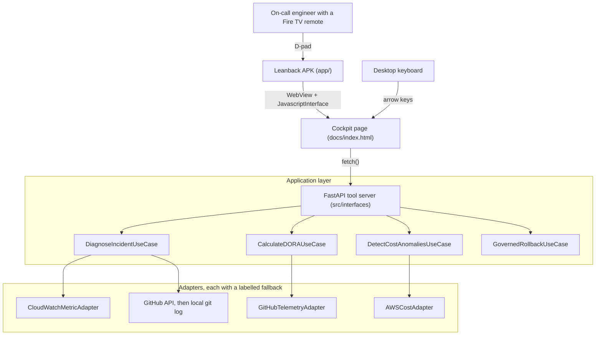
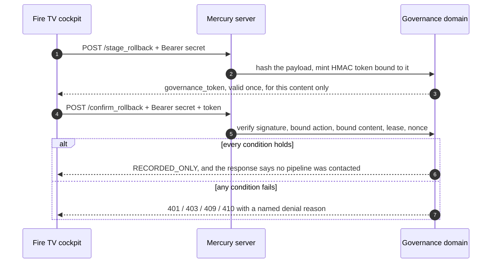

# Mercury: when a deploy cannot be named, and a governed rollback

> **Mercury tells an on-call engineer when it cannot blame a deployment, and names one only when exactly one change landed in the window.** It reads a real commit history against an error metric, publishes how often each answer is right, and renders on a Fire TV as one of its screens.


*The first screen at Fire TV resolution, captured from a local run with `MERCURY_OFFLINE=1`. Every row is its own `what_changed` response; the metric is an offline fixture and says so.*



**The dotted paths are the product.** Against 1160 labelled incidents, this
correlator sees an anomaly and names nobody 81.1% of the time, and that refusal is
stated as what it is: Mercury cannot attribute this to a change, and here is why. It
is never stated as proof that a deploy did not cause it, because an empty window says
nothing about a change that landed outside it and a crowded window says nothing about
which of its changes did it. The only verdict that says nothing needs reverting is the
one where the reading is inside its own baseline. When it does name a change, the
change it names is the one that caused the reading 52.2% of the time over 113
namings. That is a coin toss, it is published on the screen next to the name, and it
is why naming is the smaller half of this README. The numbers are in
[How often it is right](#how-often-it-is-right), which is the least flattering
section in this file and the one to read first.

Mercury answers on load. The badge saying whether a number was read live or served
from a recording renders in the board's answer row next to the number itself, and
every attribution carries its own measured precision.

### Run it

```bash
git clone https://github.com/upgradedev/mercury_amazon.git
cd mercury_amazon
pip install -e ".[dev]"
python -m pytest tests/ -q  # 591 passed
python -m src.interfaces.mcp_server
```

Open `http://127.0.0.1:8002/`. No credentials and no AWS account are needed: the
commits are read from the checkout you just cloned, the metric series is simulated
and labelled as simulated on screen, and the server prints an ephemeral governance
secret to its log for authenticated operator calls. The labelled record-only TV demo
needs no typed secret and can contact no deployment pipeline. The current green-suite timing
record spans 50.37 to 222.72 seconds across four runs of the 541-test tree on
2026-09-23: the three quiet runs landed at 50.37, 55.55 and 162.76 seconds, and the
run with 4 CPU-saturating background processes landed at 222.72 seconds. Every run
reported all 541 tests passing. It
moves with machine load and with whatever else the machine is doing: the session
before it, on the same machine while other processes were saturating the CPU,
measured 132.61–486.63 seconds over 440 tests. Both sessions come from
`python scripts/time_test_suite.py`, and [Quickstart](#quickstart) names the
machine, states the condition of every run, and says what the figure used to be.
The `pip install` before it dominates the total and depends on your
network; a clean-environment install here ran past ten minutes, so budget for that
rather than for a fast one. On PowerShell, set the secret with
`$env:MERCURY_ROLLBACK_SECRET = "pick-any-string"` before the last line if you
would rather choose it yourself. Full detail in [Quickstart](#quickstart).

[](.github/workflows/ci.yml)
[](tests/)
[](.github/workflows/ci.yml)
[](LICENSE)

**The candidate APK and runtime receipt are pending the dispatched emulator run.**
Every Android build compiles the public HTTPS cockpit endpoint into the APK. A separate
workflow installs that exact APK in Android TV Emulator, launches it normally with no
ADB URL override, drives attribution, record-only approval and handoff by D-pad, then
uploads the APK, logs, screenshot and content-addressed receipt. The event's
[official FAQ](https://amazonappdev2026.devpost.com/details/faqs) permits this route
and does not require physical hardware. Detail in [Fire TV](#fire-tv).

The CI badge points at a repository that is currently **private**, so that badge
will not resolve for anyone outside the organisation until it is made public. It is
listed here because the workflow it names is in this repository and can be read
directly. The other three badges are static and describe values you can reproduce
with the commands in [Measured numbers](#measured-numbers).

---

## Table of Contents

1. [What this is](#what-this-is)
2. [What is real and what is simulated](#what-is-real-and-what-is-simulated)
3. [How often it is right](#how-often-it-is-right)
4. [Architecture](#architecture)
5. [The rollback is the point](#the-rollback-is-the-point)
6. [Quickstart](#quickstart)
7. [Fire TV](#fire-tv)
8. [Measured numbers](#measured-numbers)
9. [Configuration](#configuration)
10. [Known limitations](#known-limitations)
11. [Who would buy this, and why](#who-would-buy-this-and-why)
12. [Contributing and licence](#contributing-and-licence)

---

## What this is

During a production incident the useful information is scattered across a version
control host, a metrics console and a deployment pipeline. The question that
matters is one question: which change did this, and can it be undone safely. The
asset in this repository is the engine that answers it, scored against a labelled
corpus rather than demonstrated once.

Scoring it changed what this product claims. The engine's reliable answer is the
refusal. It stays quiet on 199 of 200 healthy series, refuses outright on 60 of 60
telemetry gaps, and on a real anomaly it declines to name a change 81.1% of the
time, because the hour before the spike usually holds either no change or several.
Each refusal says which of those it was, and says in the same sentence what it is
not: Mercury has no way to rule a deploy out, so a refusal is never rendered as a
deploy having been cleared, and rolling back on a refusal would be a guess. Naming
one change is the smaller capability, it is right about half the times it fires, and
Mercury says so on the screen at the moment somebody would act on it.

The screen is a delivery choice, not the product. Mercury renders on a Fire TV in
a room, and on a laptop browser, from the same HTTP surface and the same page: the
D-pad ring and the arrow keys are one code path. It is entered in the Fire TV track
because the ten-foot surface is built, measured and honest about what has not been
run, and the section on it says exactly what has not.

Three things it does:

**Answers "is this a deploy, and which one?"** `POST /mcp/tools/what_changed` reads
an error metric series and a commit history, decides whether the metric has stepped
up against a baseline taken from before the step, and looks for changes in the hour
before that step started. It names one only when exactly one landed there. When
none landed it says so; when several landed it says how many and names none of
them, because nothing in a metric series says which of two changes did it. Both
refusals are the product rather than a fallback, they have their own tests, and
they are the two most common answers it gives. Both are shipped as refusals:
`attribution.refusal_statement` says Mercury cannot attribute and why,
`attribution.nothing_to_revert` is true only when the reading is inside its
baseline, and neither is ever rendered as proof that a deploy is innocent.

**Shows engineering velocity and spend.** `POST /mcp/tools/get_dora_velocity_report`,
`POST /mcp/tools/get_pr_bottlenecks` and `POST /mcp/tools/get_aws_cost_anomalies`
return DORA metrics computed from GitHub Actions runs and merged pull requests,
open pull requests past a 36 hour review SLA, and month-to-date AWS spend per
service from Cost Explorer.

**Takes a governed rollback from the D-pad.** `POST /mcp/tools/stage_rollback`
and `POST /mcp/tools/confirm_rollback` are the only state-changing endpoints, and
both require the deployment's shared secret. See
[The rollback is the point](#the-rollback-is-the-point).

---

## What is real and what is simulated

Every telemetry response carries a provenance stamp, and the cockpit prints it on
screen next to the numbers. A viewer never has to trust the server about whether
a reading is live.

| Data | Live path | What happens without it |
|---|---|---|
| DORA metrics, pull requests | GitHub REST API via `httpx`, needs `GITHUB_TOKEN` | Serves `src/infrastructure/fixtures/github_telemetry_fixture.json`, which is a **recording of a real GitHub read** of `pallets/flask` made by `python scripts/record_github_fixture.py`, labelled `offline-fixture` |
| AWS spend | `ce:GetCostAndUsage` via `boto3`, needs AWS credentials | Serves `src/infrastructure/fixtures/aws_cost_fixture.json`, which says in its own text that it is **synthetic and was never read from an AWS account**, labelled `offline-fixture` |
| Error metric series | `cloudwatch:GetMetricStatistics` via `boto3` | Generates a deterministic local series **from the SHA-256 of the service name**, labelled `offline-fixture`, whose provenance says it was generated and never read from CloudWatch. A service name the fixture does not know is refused, not invented |
| Commits for correlation | GitHub REST API | Falls back to **real commits from the local checkout** via `git log`, labelled `local-git`, never to invented commits |

The Cost Explorer path has been executed successfully against a real AWS account
during development. The CloudWatch path has been executed and returned no
datapoints, because there is no load balancer named `checkout-api` to read. The
account's actual figures are not committed to this repository.

Those two sentences are the only claims in this README that you cannot check by
running something. They describe work done against a private AWS account outside
this repository, no artefact of which is committed here, so treat them as an
unverified maintainer statement rather than as evidence. Nothing the running
product shows depends on them: without credentials every adapter serves a fixture
and says so on screen.

Set `MERCURY_OFFLINE=1` to force every adapter into fixture mode whatever
credentials the machine has. That switch can only ever suppress a live call; it
can never make a fixture look live.

### The demo path, and what it does to the data

With no credentials at all, the war room still works end to end: the commits are
real ones read from your checkout, and the simulated metric series is anchored
relative to the newest of them so the correlation is coherent. The response says
exactly that, in the text the screen shows:

> The final reading is placed 4 minutes after the newest known commit so the
> correlation is demonstrable; the commits are real, this metric is not.

### The refusals are the first thing you can press

Four of the five answers the correlator can give are refusals, so the cockpit
offers five services on the hero, one per answer. The numbers behind each are
derived from the SHA-256 of the service name, so no two services read the same
and every machine reads the same as this one.

| Press | Verdict | What it shows |
|---|---|---|
| `checkout-api` | `ANOMALY_ATTRIBUTED` | A spike four minutes after a commit that is alone in its window. Names the commit, offers the rollback, and prints the precision that naming was measured at |
| `release-train` | `ANOMALY_WITHOUT_ATTRIBUTION`, `WINDOW_TOO_CROWDED` | A spike after a burst of changes. Calls it an anomaly, then says it cannot attribute it to any one of them, names none, and offers no rollback |
| `search-indexer` | `ANOMALY_WITHOUT_ATTRIBUTION`, `NO_CANDIDATE_IN_WINDOW` | A spike placed four hours after the newest commit, outside the 60 minute attribution window. Calls it an anomaly, then says it cannot attribute it: the window is empty, which is not the same as no deploy being involved |
| `payments-worker` | `NO_ANOMALY` | A reading above its baseline but under the 3.0x threshold. The one verdict that says nothing needs reverting |
| `quiet-service` | `INSUFFICIENT_DATA` | A name the fixture does not know. Refused outright rather than given an invented spike |

Reproduce all five from a shell against a running server:

```bash
for s in checkout-api release-train search-indexer payments-worker quiet-service; do
  curl -s -X POST localhost:8002/mcp/tools/what_changed \
       -H 'Content-Type: application/json' -d "{\"service_name\":\"$s\"}" \
    | python -c "import json,sys; d=json.load(sys.stdin); print(d['service'], d['verdict'], d['attribution']['refusal_reason'])"
done
```

Where each reading is placed is itself a choice, and the response says which choice
it was. The attributing demo is anchored to the newest commit that is **alone** in
its own attribution window, and the crowded demo to the commit with the **most**
company in its window, both picked from the real `git log` of your checkout. That is
deliberate and it is disclosed in the provenance the screen renders: without it,
whether `checkout-api` named a commit or refused depended on how often somebody had
committed in the hour before HEAD, so the same repository demonstrated different
verdicts on different days.

The fixture used to be two module constants, so every service name returned the
same spike and no refusal verdict was reachable from any input a reader could
supply. `tests/integration/test_mcp_endpoints.py` now drives all five through the
endpoint the cockpit calls.

### A refusal is not an acquittal

An earlier draft of this README glossed every refusal as
`do not revert anything, this is not a deploy`, and the cockpit headline for both
refusals read `Do not revert on this.` That was an over-claim, and a reviewer caught
it: an empty window says nothing about a change that landed outside it, a crowded
window says nothing about which of its changes did it, and a missing baseline says
nothing at all. None of the three rules a deploy out, so none of them may be
rendered as one having been ruled out. The wire, the screen and every document a
judge reads now say the same thing: Mercury **cannot attribute**, and why.
`attribution.nothing_to_revert` is true only on `NO_ANOMALY`,
`attribution.refusal_statement` carries the reason and what the reason is not, the
domain publishes the forbidden certainty phrasing as `REFUSAL_MUST_NOT_CLAIM`, and
`tests/e2e/test_refusal_wording.py` scans this README, the Devpost text, the cockpit
page and the video plan for it and fails the build on any of it. The retired phrases
stay on this page in backticks, each on a single line, as the record of the
correction: the scanner strips code spans before it reads, and a span wrapped across
a line break is read as live prose, so the quotation cannot quietly become a claim.

Those five are a demonstration, not evidence. The evidence is below.

---

## How often it is right

The demo above cannot fail, and a demo that cannot fail says nothing about the
engine. So the correlator is scored against a labelled corpus it did not author:

```bash
python scripts/correlation_trial.py
# Scored 1160 labelled cases against IncidentCorrelator (3.0x threshold, 60 minute window), seed 20260908
```

It writes `correlation_trial_summary.json`, and a test compares the numbers below
against that file, so they cannot drift away from the run that produced them.

**Where the corpus comes from.** The deployment stream is this repository's own
`git log`, 59 real commits over 6.1 days, recorded once into
`src/infrastructure/fixtures/commit_stream_fixture.json` at commit `dc800ef` so a
published figure does not move every time somebody commits. The reading time of
every case with **no** cause is drawn over the span of that log and snapped to a
fixed 10 minute polling grid, with no reference at all to where individual commits
fall: that generator is handed two dates and never the commits.
`tests/unit/test_correlation_trial.py` regenerates those cases against a commit log
whose times have been shuffled inside the same span and asserts that not one
reading time moves. For a regression the reading necessarily follows its cause, but
the propagation delay is drawn from a range that reaches past the 60 minute window,
and how many polls late somebody looks at the screen is drawn separately. The error
values are generated here and were never read from a monitored service.

| Measure | Value | Over |
|---|---|---|
| Refused to name anything when it saw an anomaly | **81.1%** | the 599 anomalies it detected |
| Stayed quiet on a healthy series | **99.5%** | 200 ordinary series |
| Refused for want of data | **100%** | 60 telemetry gaps |
| Correct refusal, exogenous spikes | **69.3%** | 300 anomalies no commit caused |
| False attribution, exogenous spikes | **6.0%** | the same 300 |
| Naming precision | **52.2%** | the 113 times it named a commit |
| Naming recall | **9.8%** | 600 genuine regressions |
| Hit rate, fresh look | **11.3%** | 300 regressions seen on the first poll after onset |
| Hit rate, late look | **8.3%** | 300 regressions seen one to four polls later |

Read the table in that order, because that is the order of what this thing is good
at. The four refusal rows are the product. The naming rows are a bounded secondary
capability: when it names a change, it is right about half the time, and it names
one for fewer than one regression in ten.

**Naming a commit is a coin toss, and the screen says so.** 52.2% over 113 namings
is not a number to revert production on, so the answer carries it. Every
`what_changed` response ships `attribution.measured_accuracy`, read from
`correlation_trial_summary.json` rather than recomputed, and the cockpit prints it
under the headline the moment a commit is named. An operator reading the wall sees
the name and the odds together.

### What changed on 2026-09-08, and what it cost

The previous published numbers were a 22.0% hit rate on a fresh look, **3.3% on a
late look**, and 27.9% naming precision over 272 namings. Two defects and one
editorial decision moved them. Every row below is a run of the committed class with
different flags, printed by the same command:

```bash
python scripts/correlation_trial.py     # prints the ablation and the gate sweep
```

| Detector | Fresh look | Late look | Naming precision | Namings | Quiet on healthy |
|---|---|---|---|---|---|
| Trailing baseline, window ends at the reading (before) | 22.0% | **3.3%** | 27.9% | 272 | 99.5% |
| Pre-onset baseline, window ends at the reading | 22.3% | 9.3% | 27.1% | 350 | 99.5% |
| Pre-onset baseline, window ends at the onset | 22.0% | **18.7%** | 32.6% | 374 | 99.5% |

**The baseline no longer contains the spike.** `MetricSeries.baseline_mean` dropped
only the newest point, so a spike that had been running for three polls was most of
its own baseline and the factor collapsed. `MetricSeries.find_onset` now finds the
first reading of an elevation that is still going on, and the baseline is the mean
of the readings strictly before it. That alone took the late look from 3.3% to
9.3%. The detector is **strictly more sensitive** than the old one, because the
last index is always a candidate onset and testing it is the same arithmetic the
trailing mean did, so it fires on everything the old one fired on and on more
besides. The cost of that extra sensitivity on healthy series was measured and it
is **zero**: 199 of 200 before, 199 of 200 after. It found an onset earlier than
the newest reading in 151 cases, 150 of which were genuine regressions and one of
which was not.

**The window ends when the spike started, not when somebody looked.** A change that
lands after a spike has begun cannot have caused it, and an engineer who walks up to
the wallboard forty minutes in was dragging the whole 60 minute window off the
change that did. Anchoring the window at the onset took the late look from 9.3% to
18.7%, which is the larger half of the fix.

**Then it was told to refuse a crowded window, which cost recall to buy precision.**
Naming the closest of several changes was where the wrong names came from. The
correlator now names a commit only when exactly one landed inside the window. The
threshold was chosen from this sweep, printed by the same command, and the sweep is
published so the choice can be argued with:

| Names when at most N landed | Naming precision | Naming recall | Namings | False attribution |
|---|---|---|---|---|
| N = 1 (shipped) | **52.2%** | 9.8% | 113 | 3.6% |
| N = 2 | 47.9% | 16.8% | 211 | 5.4% |
| N = 3 | 40.6% | 19.0% | 281 | 7.2% |
| N = 5 | 38.9% | 19.7% | 303 | 7.4% |
| no gate | 32.6% | 20.3% | 374 | 8.0% |

Choosing a threshold on the corpus you then report it on is fitting, and a figure
chosen that way is worth less than it looks. So the direction was checked on two
seeds that took no part in the choice: naming precision at N=1 is **53.3%** over 92
namings at seed 19850717 and **55.7%** over 115 namings at seed 20261231, against
32.6% ungated on the reported corpus.
`tests/unit/test_correlation_trial.py::test_the_crowding_gate_holds_up_on_corpora_it_was_not_chosen_on`
runs both and fails if the gate stops buying precision.

```bash
python scripts/correlation_trial.py --no-write --seed 19850717
python scripts/correlation_trial.py --no-write --seed 20261231
```

**What it cost.** Recall fell from 20.3% to 9.8%: Mercury now names the cause of
fewer than one regression in ten, where before it named the cause of one in five
and an innocent change in three. The trade is deliberate. An on-call engineer who
reverts on a name that is wrong 67% of the time is worse off than one who is told
that Mercury cannot tell which change did it.

**The failure mode changed, which is the useful part.** Of the 36 attributions that
named the wrong commit for a regression that had a right one, **35** had the real cause
outside the 60 minute window entirely, where no rule with that window could have
named it. **0** had the cause inside the window and more than one candidate, because
those are refused now rather than guessed at, and **1** had the cause inside the window
with a single candidate. That last case is the honest residual: one case in 1160 where
the rule had the culprit alone in front of it and named the wrong thing. The other 18
wrong namings, which make 54 wrong out of 113 in all, blamed a commit for an exogenous
spike that no commit caused; there was no right commit to miss there, and they are the
6.0% false-attribution row above. This repository
commits in bursts, which is why the crowding gate refuses so often: the median gap
between commits in the recorded stream is 20.58 minutes, 42 of its 58 gaps are
under an hour, and a 60 minute window ending on a commit holds 2.78 commits on
average and 9 at the worst.

**Refusing more is not the same as judging better, so the refusals are counted
apart.** Correct refusal on exogenous spikes rose from 62.0% to 69.3%, and the
whole of that rise is the crowding gate: 62.0% is still "nothing landed in the
window", and the extra 7.3% is "too much landed". Both figures are published
separately in `correlation_trial_summary.json` under
`correct_refusal_on_exogenous_spikes_no_candidate` and
`correct_refusal_on_exogenous_spikes_window_too_crowded`, so a blunter instrument
cannot read as better judgement.

**There is a ceiling on the late look and it is arithmetic, not a defect.** The
pre-onset baseline needs at least two readings before the onset. A six point series
polled every ten minutes, looked at four polls after onset, leaves one. 65 of the
300 late-look cases are therefore undetectable by this detector whatever it does,
capping the late-look hit rate at **78.3%** and the whole-corpus hit rate at 89.2%.
That ceiling is computed from the corpus's own timestamps and published as
`detectability_ceiling`. Fixing it needs a longer series, not a better rule.

The corpus treats every commit in the log as an independently deployable change.
Real deployments often ship a burst of commits as one release, which would collapse
several of those candidate sets into a single change, refuse less often and raise
the hit rate. This is the pessimistic reading of the same log, and it is the one
published.

**The false-attribution rate is half a number without the commit density.** An
anomaly with no cause is attributed exactly when exactly one commit happens to fall
in the 60 minutes before the onset, so the rate is a joint property of the window,
the gate and the stream. `--commit-stride` thins the recorded log and the report
sweeps it:

| Commits in the stream | Commits per hour | False attribution rate | Refused as crowded | Refused as empty |
|---|---|---|---|---|
| 59 (every commit) | 0.405 | 3.6% | 22 | 187 |
| 30 (every 2nd) | 0.206 | 4.8% | 5 | 198 |
| 15 (every 4th) | 0.103 | 2.6% | 3 | 211 |
| 8 (every 8th) | 0.055 | 1.4% | 0 | 220 |

That rate is no longer monotonic in the density, and the last two columns are there
because the reason is a claim about mechanism rather than about noise, so it should
be checkable rather than plausible. Thinning a dense stream turns crowded windows,
which are refused, into single-candidate windows, which are named: the crowded
refusals collapse from 22 to 5 between the first two rows, and that is where the
rate rises. Thinning further empties the windows instead, the crowded refusals reach
zero and the rate falls. On a stream as dense as this repository's the crowding gate
is doing most of the refusing; on a sparser one the window itself is.

**What this trial is not.** Not a field trial, and not a claim about production.
No real error metric appears in it, the noise model and the severity spread are
assumptions written by the authors rather than observations, and the commits are
development commits from this repository rather than deployments of a monitored
service. `--noise-sigma` and `--seed` are there so a reader can see how much of any
figure is those assumptions.

---

## Architecture



The layering is hexagonal. `src/domain` holds pure models and imports no SDK,
which gate A5 checks by reading the imports. `src/application` holds use cases
that depend on protocols. `src/infrastructure` holds the adapters that talk to
GitHub, Cost Explorer, CloudWatch and git. `src/interfaces` holds the HTTP server
and the cockpit assets.

---

## The rollback is the point

A rollback is the one irreversible thing Mercury can do from a sofa, so it is
guarded by five independent conditions. Each has a test that proves it refuses.



1. **Authorization.** Both endpoints require `Authorization: Bearer <MERCURY_ROLLBACK_SECRET>`,
   compared in constant time. Without it the request is refused with 401.
2. **Content binding.** Staging mints an HMAC over the action id and a
   length-prefixed SHA-256 hash of the rollback payload. Edit the target commit
   after staging and the token stops applying, with reason `TOKEN_CONTENT_MISMATCH`.
3. **Single use.** Each token carries a nonce consumed on the first successful
   confirm. A token replayed against a re-staged action is refused with
   `TOKEN_ALREADY_USED`. A second confirm of an action that has already executed
   is refused one check earlier, with `NOT_PENDING`, and the cockpit does not even
   send it: after `RECORDED_ONLY` or `DISPATCH_ACCEPTED` the Confirm control goes dark and says the token is
   spent.
4. **Lease.** A staged action expires after `lease_sec` seconds, default 300, and
   then confirms with `LEASE_EXPIRED`.
5. **Current recommendation.** The same application use case registers the
   recommendation when staging and checks it before either dispatcher runs.
   The operator-authenticated `POST /mcp/tools/recommendation_liveness` accepts
   `action_id` and a finite `current_metric_value` as query parameters. A reading
   below the existing five-error threshold withdraws that registration permanently;
   a later high reading cannot reactivate it. Expired recommendation TTL or missing
   recommendation state also refuses dispatch. Re-stage and review afresh to proceed:
   an unused token from an earlier staging is refused with `TOKEN_SUPERSEDED`,
   even if the action id and payload are unchanged.

This liveness reading is operator supplied and is labelled
`OPERATOR_SUPPLIED_METRIC_NO_LIVE_REFRESH`. Mercury does not fetch fresh service
telemetry at confirmation. A separate deployment-evidence boundary now prevents
the client from choosing a SHA. `POST /mcp/tools/record_deployment_evidence`
accepts an authenticated marker only when its service, environment, revision and
artifact SHA-256 match a later healthy readback. The correlator may offer a
rollback only when that ledger contains both the incident revision and the
immediately preceding healthy deployment. Staging revalidates both marker IDs and
binds the environment and target digest into the governance hash. Missing,
retargeted or stale evidence returns `UNVERIFIED_DEPLOYMENT_TARGET`.

No real service has emitted those markers yet. A GitHub workflow acceptance is
reported as `DISPATCH_ACCEPTED`, while record-only and dry-run paths report
`RECORDED_ONLY`; neither is called executed. Workflow completion and a post-action
health readback remain open integration proof.
`tests/integration/test_recommendation_execution_boundary.py` exercises the HTTP
and direct-use-case paths with record-only or counting test dispatchers.

A refused confirmation moves the action to `REJECTED`, so it cannot be confirmed
afterwards even with the correct token. That is fail-closed on purpose: a
tampering attempt burns the action it was aimed at, and the operator stages
again. `python scripts/security_audit.py` runs 30 checks over this path against
the real HTTP surface and exits non-zero if any of them stops holding.

### What happens after governance passes

The default is unchanged and stays the default: `RecordOnlyDispatcher` writes the
decision locally, and its own response says so verbatim, *"No deployment pipeline
was contacted."* `GET /health` reports `"rollback_dispatch": "record-only"` when
that is what a confirmed rollback would reach.

One real dispatcher now exists behind that default.
`src/infrastructure/github_actions_dispatcher.py` asks a GitHub Actions workflow
to run through `POST /repos/{owner}/{repo}/actions/workflows/{file}/dispatches`,
carrying the action id, service, environment, verified target revision, artifact
digest, both deployment marker IDs, reason and payload hash as workflow inputs. It is selected only by
`MERCURY_ROLLBACK_DISPATCH=github_actions`, and being selected is not being armed:
without `MERCURY_ROLLBACK_DISPATCH_ARMED=1`, a token and a repository, it builds
the request, prints it with the token redacted, and opens no socket. A dispatch
that is attempted and does not return HTTP 204 raises, the API answers 502, and
the spent governance nonce means the action cannot be confirmed again. HTTP 204
means `DISPATCH_ACCEPTED`, not workflow success or healthy completion.

### Shared responder handoff

The incident panel can publish and refresh one bounded shared state record. It
shows the responder, current action, confirmed facts, next step, update time and
revision. Updates use optimistic concurrency, so a responder working from an old
revision receives 409 instead of overwriting newer evidence. The local store retains
at most 50 incidents and at most 10 confirmed facts per incident; the deployed Lambda
uses DynamoDB with conditional revisions. This closes the software path for handoff;
a two-responder comparison against the laptop dashboard has not been run and remains
a separate user-evidence gate.

**It has never been fired.** No request has ever been sent to github.com from this
repository: that needs a token with `actions:write` on a repository that has such
a workflow, and neither exists here. What is proved is the shape. The 15 tests in
`tests/unit/test_rollback_dispatcher.py` drive it through `httpx.MockTransport`
and assert the exact method, URL, headers and body it would send, that an unarmed
or half-configured dispatcher leaves the transport untouched, and that a refusal
raises rather than reporting success. Firing it for real is an owner action.

---

## Quickstart

Time to first result on a machine with Python 3.11 and no credentials, measured
rather than guessed. The current green-suite record for `python -m pytest tests/ -q`
spans **50.37 to 222.72 seconds** across four runs of the 541-test tree
(recorded at 2026-09-23T03:18:55Z). The three quiet runs landed at 50.37, 55.55
and 162.76 seconds. The run with **4 CPU-saturating background processes** started
and killed by the measuring script landed at **222.72 seconds**. All four runs
reported 541 passed and no skipped or failed tests. The immediately preceding
bootstrap record measured **54.97 to 113.33 seconds** over the same 541-test tree and is
retained only as the previous red-suite baseline. An older 440-test session measured
**132.61–486.63 seconds** and remains historical rather than a release claim.
That earlier session ran while other processes on this machine were saturating the
CPU: a processor-time counter sampled immediately after that older session
(`typeperf "\Processor(_Total)\% Processor Time" -sc 5 -si 1`) read 100 percent on
every one-second sample; its quiet runs landed at 132.61, 165.78 and 181.03 seconds
and its loaded run at 486.63 seconds. Starting the server and getting an answer on
screen is immediate after the
suite. The variable before any of this is `pip install`, which depends on your
network: a clean-environment install measured here ran past ten minutes, so it
dominates everything else in this section.

Measured on **Windows 11 (Windows-10-10.0.26200-SP0), CPython 3.11.0**, 8 logical
cores, by `python scripts/time_test_suite.py`. That script times the wall clock
around the pytest subprocess, which is what a reader with a stopwatch measures, and
writes every individual run to `suite_timing_summary.json` with its condition, the
machine, the background load and the collected test count. Readiness gate G1 and
`tests/e2e/test_documentation_claims.py` both compare the figures in this README
against that file, and the file records the test count they were measured over, so
adding a test makes this paragraph fail the build until the suite is re-measured,
unless the gap is disclosed in the exact phrases `ci/readiness.py` returns from
`stale_timing_disclosure`; quietly ageing is not one of the options. The published
timing record was **measured over 541 collected tests**. Additional persistence,
packaging, browser and Android TV checks were added afterward: **the suite now collects
591 tests and a re-measure on an idle machine is pending**.

**How the figure moved between sessions, published rather than re-rolled.**
`suite_timing_summary.json` carries the latest session's runs and the previous
session's headline, so a replaced number leaves a trace instead of vanishing. Every
session recorded on this tree on 2026-09-08 landed somewhere different. Earlier
sessions that day are no longer in the shipped record and are quoted here rather
than claimed: the first measured `40.28–74.56 seconds`, with the loaded run
slowest, and the next measured `33.37–37.44 seconds` across its quiet runs with
the loaded run at `37.0 seconds`, both over 440 collected tests. The session the
record now keeps as its previous one, 54.97 to 113.33 seconds over 541 tests, was
the red-documentation bootstrap. The current session is the 50.37 to 222.72 second
range above and includes the loaded condition. The spread between sessions of the same command on
the same tree is larger than the spread inside any one of them, and the loaded run
is not reliably the slowest: in one session it sat inside the quiet range and in
the current one it sits below it. That is the honest shape of this number, and it
is why the range names its runs and their conditions instead of implying a
constant.

**This is the claim that did not reproduce, and it is worth saying how.** Until
2026-09-08 this section published `24.8 to 25.7 seconds` and, two lines below it,
said the suite had grown from `11 to 18 seconds`, a figure that contradicted the one
above it. Both were typed when the suite was a fraction of its present size, both
were prose that nothing re-measured, and three readers who re-timed the command on
this machine all landed well above the published ceiling. Their figures are their own
measurements and are not reprinted here as this repository's; everything printed above
is what this repository measured, on the tree that ships, at 440 and then 507
collected tests.

### 1. Install

```bash
git clone https://github.com/upgradedev/mercury_amazon.git
cd mercury_amazon
pip install -e ".[dev]"
```

### 2. Run the tests

```bash
python -m pytest tests/ -q
# 591 passed
```

### 3. Start the server

```bash
export MERCURY_ROLLBACK_SECRET="pick-any-string-for-a-local-demo"
export MERCURY_OFFLINE=1          # optional: never make an outbound call
python -m src.interfaces.mcp_server
```

On PowerShell, which is where this repository is developed:

```powershell
$env:MERCURY_ROLLBACK_SECRET = "pick-any-string-for-a-local-demo"
$env:MERCURY_OFFLINE = "1"        # optional: never make an outbound call
python -m src.interfaces.mcp_server
```

Leaving `MERCURY_ROLLBACK_SECRET` unset is allowed for a local run: the server
generates an ephemeral one and prints it to its log for you to paste into the
cockpit. It changes on every restart.

### 4. Open the cockpit and use it

Open `http://127.0.0.1:8002/`. Press **Check connection** to send a real
`GET /health` and watch the state pill change from *API not checked*. Then
**Ask what changed**, **Stage governed rollback**, **Confirm rollback**, and
**Publish handoff**. In record-only mode these controls accept only the fixed,
labelled fixture and contact no deployment system. Authenticated operator routes use
the secret and remain separate. A spent confirmation token cannot be replayed.

Arrow keys move focus to the nearest control in that direction, which is the same
code path the Fire TV remote drives.

### 5. Build the Fire TV APK

```bash
./gradlew :app:assembleDebug     # needs JDK 17 and the Android SDK
adb connect <FIRE_TV_IP>:5555
adb install -r app/build/outputs/apk/debug/app-debug.apk
```

Build, emulator and evidence instructions are in
[`docs/FIRE_TV_BUILD.md`](docs/FIRE_TV_BUILD.md). The official event FAQ permits
Android TV Emulator or Fire TV/Vega simulator and makes a physical device optional.
`.github/workflows/android-tv-emulator.yml` performs the normal-launch D-pad journey
and writes the runtime receipt gate J4 reads.

---

## Fire TV

The app in `app/` is a Leanback Android application. `AndroidManifest.xml`
declares `android.software.leanback` as required, `android.hardware.touchscreen`
as not required, and a `LEANBACK_LAUNCHER` activity, which is what makes it a Fire
TV app rather than a phone app.

`MainActivity` hosts the cockpit in a WebView with JavaScript enabled, exposes a
small `MercuryHost` JavaScript interface, and forwards D-pad key codes into the
page. Back is resolved by asking the page first, then WebView history, then
closing the activity, so the viewer is never trapped and the war room is never
closed by accident. `CockpitUrlResolver` accepts only absolute `http` and `https`
URLs, so a hostile `COCKPIT_URL` intent extra cannot redirect the WebView.

A Fire TV stick on a home network usually reaches the cockpit over plain `http`
from a laptop, so a debug build has to permit cleartext and a release build must
not. `app/src/main/AndroidManifest.xml`, which is the only manifest a release
build merges, declares `android:usesCleartextTraffic="false"`. The permission
lives in `app/src/debug/AndroidManifest.xml` with `tools:replace`, so the merger
applies it to debug variants alone. Three tests in
`tests/unit/test_firetv_app_structure.py` assert that split, including one that
fails if any manifest outside the debug source set permits cleartext. They assert
the manifests the merger is given, while successful run `35500282701` proves that
the Android merger and compiler accepted them. The merged manifest was not retained
as a separate artifact.

### Ten-foot legibility, measured

```bash
pip install -e ".[ux]" && playwright install chromium
python scripts/measure_legibility.py
# Measured 233 visible text readings across 4 views at 1920x1080 (root font 24px)
#   smallest rendered text anywhere: 24px (floor 24px)
#   readings under the floor: 0 of 233
#   smallest operational text (reasons, provenance, pills): 25.9px over 21 readings
#   anomaly factor renders at y=189, provenance stamp at y=337, fold at y=1080
#   provenance stamps within the first viewport: 2 ['LIVE', 'OFFLINE FIXTURE']
```

That script starts the server, opens the page in Chromium at 1920x1080, drives it
until all three evidence panels have loaded content, and reports the rendered
`font-size` of every element painting text of its own. Three numbers matter and a
test holds this README to all three: the smallest size anywhere, the count under
the floor, and the smallest **operational** reading, which is the text an operator
acts on rather than the labels around it. The total number of readings is not
pinned: it moves with whatever the page rendered on the day, which includes a
commit message read from `git log`. Reproduce a failing measurement by raising the
floor: `python scripts/measure_legibility.py --floor 26` exits 1.

Three defects have been fixed here, and each was invisible while only the previous
one was measured.

**The floor.** The page set a 24px root at the television breakpoint and then wrote
every label, badge and provenance stamp in fractions of that root, so the headline
read across a room at 55.7px while the state pill under it rendered at 17.3px, the
provenance note at 18.7px and the rollback sentence at 19.7px. Commit `da99c6a`
fixed that, and the before state is still reproducible, because the page that
produced it is still in the history. Run this on a clean checkout only: it
overwrites `docs/index.html` and then throws that copy away, so commit or stash
anything uncommitted in it first.

```bash
git show 1f705a9:docs/index.html > docs/index.html   # the page before the type scale fix
python scripts/measure_legibility.py
#   smallest rendered text anywhere: 17.3px (floor 24px)
#   readings under the floor: 155 of 200
git checkout -- docs/index.html                      # put the current page back
```

Those figures describe that build and nothing since. The run at the top of this
section is the current one, and it is what the same command prints today.

**The reading order.** Clearing the floor put the sentence that says what the
D-pad is about to do at exactly the same size as the decorative wordmark caption,
because a floor says nothing about which text matters. The reason strings, the two
provenance chips and the connection pill now sit a tier above the body copy at
25.9px and 26.9px, and the measurement reports that tier separately so it cannot
quietly sink back to the floor.

**The provenance stamp was below the fold.** A floor and a reading order still say
nothing about *where* text lands, and a wallboard is never scrolled. At 1920x1080
the anomaly factor rendered at y=274 while the badge saying where that number came
from rendered in the hero's footer, below the demo buttons, outside the first 1080
pixels entirely. Worse, the badge printed the machine value `offline-fixture`
rather than the words: not one of the strings above the fold contained "OFFLINE
FIXTURE", "simulated" or "generated locally", so a viewer across a room read a
locally generated 12.9x as a production number while this README claimed every
number on the screen carried a badge saying otherwise. The badge now renders inside
the board's answer row next to the figure, at y=337 with the figure at y=189, and it
prints `display_label`. The
measurement reports both positions and the script exits 1 when no stamp lands above
the fold. Reproduce the failure on a clean checkout, which overwrites the page and
then throws the copy away, so commit or stash anything uncommitted in it first:

```bash
git show 455f60b:docs/index.html > docs/index.html   # the page before the fold fix
python scripts/measure_legibility.py
#   anomaly factor renders at y=274, provenance stamp at y=None, fold at y=1080
#   provenance stamps within the first viewport: 0 []
git checkout -- docs/index.html                      # put the current page back
```

**The setup form is off the first screen.** The API URL and the governance secret
were two text inputs in the top bar, which is a form standing between a viewer and
the incident and the worst thing in this product to operate with a D-pad. They are
now behind a `Setup` toggle in the Connection section at the foot of the page, hidden on load, and the D-pad ring skips hidden
controls so the remote cannot land in them. The API defaults to the origin the page
was served from, and pressing **Stage governed rollback** with no secret opens the
setup row by itself and says why. The first screen is the incident.

The floor is a CSS pixel floor at a 1920x1080 CSS viewport. A target that reports a
smaller CSS viewport at the same physical resolution is not covered by this browser
measurement. The separate emulator workflow records the Android TV viewport.

**What has been run, and what has not.** Be clear about this, because it is the
weakest part of the submission.

**Runtime evidence pending.** The candidate adds a normal-launch Android TV workflow
that builds with the intended public endpoint, installs the exact APK, drives the
same D-pad bridge as a remote, and validates native journey events for attribution,
single-use record-only confirmation and shared handoff. It uploads the APK, install
and launch logs, logcat, screenshot and receipt as one artifact. This paragraph will
be replaced with its run URL and digests only after that workflow succeeds.

The manifest declarations, Gradle wiring and key handling contract are checked by 30 structural tests
plus Kotlin tests. `docs/firetv_nav.js` also runs in Node against a synthetic grid,
17 assertions in `tests/e2e/spatial_nav_spec.js`, and a Playwright end-to-end test
walks the browser form of the same golden path. None of those substitutes for the
pending Android TV receipt.

---

## Measured numbers

Every number below is produced by a committed command. Run it and it prints them.

### Latency

`python scripts/benchmark_suite.py` measures each endpoint in-process through the
ASGI application and writes `benchmarks_summary.json` with the timestamp, the
iteration count and the data mode it observed.

| Endpoint | Requests | Mean | p95 | Command |
|---|---|---|---|---|
| `get_dora_velocity_report` | 60 | 3.21 ms | 5.46 ms | `python scripts/benchmark_suite.py` |
| `get_pr_bottlenecks` | 60 | 2.48 ms | 3.17 ms | `python scripts/benchmark_suite.py` |
| `get_aws_cost_anomalies` | 60 | 2.35 ms | 2.75 ms | `python scripts/benchmark_suite.py` |
| `what_changed` | 60 | 52.09 ms | 77.03 ms | `python scripts/benchmark_suite.py` |
| Governance mint and verify | 2000 | 0.0335 ms | 0.0451 ms | `python scripts/benchmark_suite.py` |

Measured on Windows, CPython 3.11.0, with `MERCURY_OFFLINE=1`. These exclude
network transit, so they are a floor for a local run rather than a field
measurement from a Fire TV on a home network. `what_changed` is the slow one
because it shells out to `git log` for the commit fallback.

**The one comparative number:** the full four-condition governance check costs 0.0335 ms mean over 2000 cycles, against a 2.35 ms mean for the cheapest endpoint round trip measured in the same run. Guarding the rollback therefore adds 1.43 percent to the request it guards. Baseline, margin and sample size all come from that one command.

### Tests and coverage

```bash
python -m pytest tests/ -q                                    # 591 passed
python -m pytest tests/ --cov=src --cov-report=term-missing   # 92% of 1922 statements
node tests/e2e/spatial_nav_spec.js                            # 17/17 assertions
python scripts/correlation_trial.py                           # 1160 labelled cases scored
python scripts/measure_legibility.py                          # needs the ux extra
python ci/readiness.py                                        # standards gate audit
```

### Readiness gates

```bash
python ci/readiness.py
# SUMMARY: 45/53 PASSED, 8/53 FAILED (0 of them blocking)
```

**45/53 readiness gates**. J4 is
the gate that asks whether the sponsor product is load-bearing, and Mercury is
entered in the Fire TV track, so J4 is the gate that matters most here. It passed
on `bool(readme_terms) and 'LEANBACK_LAUNCHER' in manifest`, which is a grep over
two text files, while the [Fire TV](#fire-tv) section two screens away said no APK
had ever been built. It was the one gate in the file that could not fail on the
axis it exists to test.

It now accepts either `android_tv_runtime_receipt.json` from the dispatched Android
TV workflow or the legacy `firetv_build_receipt.json` from physical hardware. The
emulator receipt binds the full Git SHA, APK digest, compiled HTTPS endpoint, normal
Leanback launch, D-pad journey events, logs and screenshot to one Actions artifact.
The file does not exist yet, so **J4 fails**. `docs/FIRE_TV_BUILD.md` carries the
receipt's shape, and `tests/unit/test_readiness_gates.py` drives both passing routes
and every refusal through the predicate.

**The same score in a clone.** Four of these gates, I1 to I4, used to read a
coordination file that lives in the workspace above this repository. They passed
here and would have failed for anyone who cloned the repository on its own, so the
45 above was a number only this machine could reproduce and the audit said so in its
own output. They read `docs/PERSONA_REVIEW.md` now, which is a restatement of the
persona review in this repository's own voice: the procedure that ran first, the
three lenses, who owned each row, thirteen findings of which four are failures, and
the questions nobody could close. The gates check its structure and open every file
it cites, so deleting a lens or citing a test that is not there turns one of them
red. `python ci/readiness.py` prints the same 45/53 from a bare clone, and the
coordination file itself stays out of this repository, where the workspace protocol
requires it to stay.

### Data fixtures

```bash
python scripts/record_github_fixture.py pallets/flask   # re-record the GitHub fixture
python scripts/correlation_trial.py --record            # re-record the commit stream from git log
python scripts/probe_deployment.py                      # re-probe the deployment
```

`src/infrastructure/fixtures/commit_stream_fixture.json` is the output of that
second command: 59 real commits from `git log`, recorded at `dc800ef`, with the
head it was recorded at written into the file. It is a recording rather than a live
read so that the accuracy figures above stay attached to the corpus that produced
them instead of moving on every commit.

`deploy_teardown_receipt.json` is the output of that probe. It records only what
was observed, including the immutable `build_sha` published by `/health`. The public
cockpit is `https://leol25sezuvokpankox5cvjopm0gtvfa.lambda-url.eu-west-1.on.aws/`.

---

## Configuration

| Variable | Effect | Default |
|---|---|---|
| `MERCURY_ROLLBACK_SECRET` | Bearer secret for both rollback endpoints | An ephemeral one is generated and logged |
| `MERCURY_OFFLINE` | Force every adapter to skip its live call | off |
| `GITHUB_TOKEN` | Enables the live GitHub path | unset, fixture mode |
| `MERCURY_GITHUB_REPO` | Repository to measure | `upgradedev/mercury_amazon` |
| `MERCURY_DORA_WINDOW_DAYS` | DORA measurement window | 30 |
| `MERCURY_SIMULATE_INCIDENT` | `0` flattens every simulated service. It cannot make an unknown service known | `1`, each service takes its own shape |
| `MERCURY_BUILD_SHA` | Build SHA reported by `/health` | read from `git rev-parse HEAD` |
| `AWS_REGION` | Region for CloudWatch | `eu-west-1` |
| `MERCURY_ROLLBACK_DISPATCH` | `github_actions` selects the real dispatcher | unset, record only |
| `MERCURY_ROLLBACK_DISPATCH_ARMED` | `1` lets the dispatcher open a socket. Without it, dry run | unset, dry run |
| `MERCURY_ROLLBACK_REPO` | `owner/name` holding the rollback workflow | unset, cannot arm |
| `MERCURY_ROLLBACK_WORKFLOW` | Workflow file to dispatch | `rollback.yml` |
| `MERCURY_ROLLBACK_REF` | Git ref the workflow runs on | `main` |

### How DORA is computed

GitHub does not expose DORA, so these are proxies and they are stated rather than
implied. Deployment frequency is successful default-branch workflow runs divided
by the window in days. Lead time is the mean hours from pull request creation to
merge. Change failure rate is failed completed runs over all completed runs.
Recovery time is the mean hours from a failed run to the next successful one. A
repository with no workflow runs reports zero and says why, rather than being
given a substitute number.

---

## Known limitations

* **No rollback dispatch has ever been fired.** The default dispatcher records the
  decision locally and its response says so. A GitHub Actions dispatcher exists
  and is shape-tested against a mock transport, but no request has ever left this
  repository, and it stays disarmed unless three environment variables are set.
* **The simulated metric series is still simulated.** It is derived from the
  service name rather than from a constant, which makes the four verdicts
  reachable and reproducible, but it is generated locally and every surface that
  shows it says so.
* **Runtime evidence pending.** The Android TV workflow is wired to compile the
  public endpoint, install the exact APK, launch without an ADB URL override and drive
  the record-only path by D-pad. No receipt is claimed until that workflow succeeds.
* **Public cockpit deployment.** The judge-facing Fire TV web cockpit is live at
  `https://leol25sezuvokpankox5cvjopm0gtvfa.lambda-url.eu-west-1.on.aws/` and `/health`
  publishes its build SHA. It runs in labelled offline-fixture mode until real telemetry
  credentials are configured. The APK still requires the separate allowed-target receipt below.
* **No video.** Gates E2 and E4 fail for that reason.
* **The browser path is not Android TV evidence.** Playwright now drives the whole
  record-only journey, but J4 stays red until the APK itself completes it in the emulator.
* **Cost Explorer lags.** It aggregates daily with up to 24 hours of reporting
  delay, so a spend spike in the last hour will not appear. Sub-hour spend alerting
  needs CloudWatch metric alarms, which Mercury does not implement.
* **Anomaly detection is a threshold, not a model.** A step up against the mean of
  the readings before the step, with a fixed factor. It has no seasonality and no
  trend, and a service whose error rate is legitimately ten times higher at nine in
  the morning than at four will be called an anomaly every day.
* **Naming a change is right about half the time.** **52.2%** precision over 113
  namings. That is published, it travels with every answer in
  `attribution.measured_accuracy`, and it is why the headline of this README is the
  refusal rather than the name. It is not good enough to revert on unaided.
* **Naming a change fires rarely.** **9.8%** recall over 600 genuine regressions.
  The other nine in ten get a refusal or a miss. Recall was 20.3% before the
  crowding gate, at 32.6% precision; the gate traded the first for the second on
  purpose and the whole sweep is published.
* **The detector cannot see a spike that started five polls ago.** It needs at least
  two readings before the onset, and a six point series polled every ten minutes
  does not have them once the spike has been running for forty minutes. **65 of 300**
  late-look cases are unreachable for that reason alone, capping that stratum at
  **78.3%**. A longer series would lift the cap; no rule can.
* **Requiring the elevation to persist is an assumption, and it is partly fitted.**
  An onset only counts when every reading from it onward stays elevated, which is
  what stops a single noisy sample reading as an incident. The corpus generates its
  regressions the same way, applying the multiplier from onset to the end, so some
  of that suppression is fitted to the generator rather than earned against a real
  metric. A production spike that has already half recovered is not detected here.
* **The crowding gate was chosen on the corpus it is reported on.** N=1 came from a
  sweep over this seed. The direction was checked on two held-out seeds and held
  (53.3% and 55.7% precision), but the exact 52.2% is an in-sample figure.
* **A crowded window is refused, not ranked.** Mercury says how many changes landed
  and names none of them. It does not rank them, diff them, or look at what they
  touched, all of which would be better than refusing and none of which is here.
* **The delivery-channel premise is an assumption, not a finding.** That an on-call
  engineer is in a room with a television during an incident has never been tested
  with a responder. Nobody has been asked. If they are all remote, the ten-foot
  surface is the wrong surface and the engine is what survives, which is why the
  engine is what this README leads with.
* **Voice is browser speech synthesis.** The cockpit reads its summaries aloud with
  the browser's `speechSynthesis`. There is no Alexa skill and no Alexa integration
  in this repository, and nothing listens: the TV surface takes D-pad input and
  shows a screen, and that is the whole of it.
* **Local quickstart state is in memory.** When `MERCURY_STATE_TABLE` is absent,
  local runs reset markers, handoffs and staged actions on restart. The deployed
  Lambda uses DynamoDB conditional writes and a global spent-nonce record so cold
  starts and concurrent instances cannot replay a confirmation.

---

## Who would buy this, and why

**This section is a commercial hypothesis, not a finding.** Nothing in it has been
tested against a buyer. There is no price in it, no market size, no revenue
projection and no conversion rate, because no figure of that kind exists here that
was produced by anything, and an invented one would be worth less than the gap it
fills.

**The buyer.** An engineering organisation that carries on-call: one production
service, a paging rota, and someone whose week is worse when an incident runs long.
The signing name is whoever owns that rota, usually a head of platform or of
engineering. The user is the responder answering the page at two in the morning,
and the two are not the same person.

**What is being sold, and what is being assumed.** What is being sold is a second
opinion on the first question of an incident: is this a deploy at all. Mercury
mostly answers no, with a reason, and when it does name a change it says on the
screen how often naming is right. Both rates are in
[How often it is right](#how-often-it-is-right), and they are not restated here
because this section is a hypothesis and the measured figures should be read where
the commands that produced them are. What is being assumed is that a television is
a screen that responder is near. The first is measurable and is measured above; the
second is a guess about where this work happens, and it has never been checked with
a responder. Those two are not the same kind of claim and this section does not
treat them as one.

**The budget line.** The engineering tooling line that already carries the on-call
paging subscription and the observability subscription. Mercury is not asking for a
new line: it sits on the screen those two tools are already read on, and its claim
is about the minutes between the page and the rollback, which is what that line is
bought to shorten.

**The willingness-to-pay basis.** These organisations already pay per seat for
incident management and paging, and per host or per ingested gigabyte for metrics
and logs. The comparable line items, with list prices their vendors publish openly,
are PagerDuty and Atlassian Opsgenie or Jira Service Management for paging, and
Datadog and Grafana Cloud for observability. Those published pages are the basis a
price should be argued from, and the honest state of it is that **no figure from
them is restated here, because none has been read and recorded against a date by
anyone working on this repository.** Doing that, and writing down the date the page
was read, is the next step and is not one that can be faked from memory.

**The first ten conversations.** A target list, not a pipeline. None of these has
been contacted, and no one has agreed to anything.

1. Upgrade (`upgrade.net.gr`), the maintainer's own consultancy: its own on-call
   rota, and the only place where the access to install this already exists.
2. to 4. The three client engineering organisations Upgrade already runs production
   services for. Deliberately unnamed here, because none of them has been asked and
   naming a client as a prospect before asking is not a thing to do in public.
5. Engineering teams in Greece and Cyprus that publish a public status page. The
   status page is the checkable signal: a company that runs one has a rota.
6. The AWS Partner Network consultancies in Athens whose practice is already
   observability and cost work, approached as a channel rather than as a customer.
7. Organisations whose postmortems appear in the public `danluu/post-mortems`
   collection: a team that writes postmortems in the open already spends money on
   the tooling around them.
8. Responders met at SREcon EMEA, which is where this buyer goes on purpose.
9. Maintainers of the open-source on-call and status page tooling Mercury would sit
   beside, approached about an integration rather than a sale.
10. Amazon's Fire TV developer relations, as a distribution conversation rather
    than a revenue one.

**What would falsify it.** Two different things, and they fail differently.

If responders say the television is the wrong screen, because everyone is remote
and the room is empty, then the delivery premise is wrong and no price fixes it.
That is the first question to ask and it has not been asked. It would cost the
surface, not the product: the same page and the same HTTP surface already render
on a laptop, and the four-condition governance path does not care what screen
confirmed it.

If responders say the attribution is not worth reading, that is fatal, and the
measured hit rate in [How often it is right](#how-often-it-is-right) is the reason
to take that seriously: on the evidence there, the engine is not a product yet.
What would make it one is a baseline drawn from before the onset and a ranked
candidate set instead of a single closest name, both of which the corpus points
straight at. No commercial claim here rests on a figure that has not been
measured, and none of the figures above is a commercial figure.

---

## Contributing and licence

Contributions are welcome. See [`CONTRIBUTING.md`](CONTRIBUTING.md) for the layout,
the test commands and what a pull request is checked against. Issue templates live
in [`.github/ISSUE_TEMPLATE`](.github/ISSUE_TEMPLATE).

Licensed under the [MIT Licence](LICENSE).
