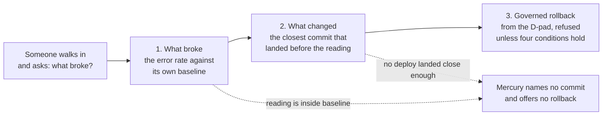
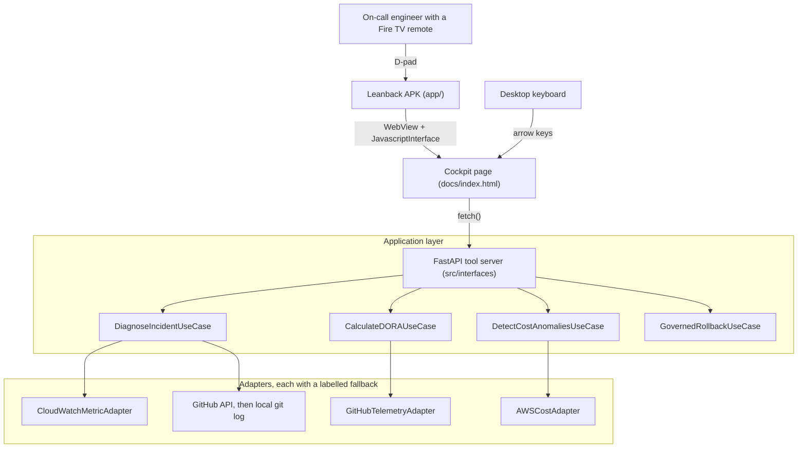

# Mercury: Fire TV Incident Commander

> **Mercury puts an on-call engineer's incident evidence on the Fire TV in the room, and takes the governed rollback from the remote.**



The dotted paths are the point as much as the solid one. Mercury answers on load,
and when it cannot attribute the anomaly to a change it says so and offers nothing
to press. Each number on the screen carries a badge saying whether it was read
live or served from a recording.

### Run it

```bash
git clone https://github.com/upgradedev/mercury_amazon.git
cd mercury_amazon
pip install -e ".[dev]"
python -m pytest tests/ -q
python -m src.interfaces.mcp_server
```

Open `http://127.0.0.1:8002/`. No credentials and no AWS account are needed: the
commits are read from the checkout you just cloned, the metric series is simulated
and labelled as simulated on screen, and the server prints an ephemeral governance
secret to its log for you to paste into the cockpit. The test run takes 11 to 18
seconds (three wall-clock runs of `python -m pytest tests/ -q` on the development
machine). The `pip install` before it dominates the total and depends on your
network; a clean-environment install here ran past ten minutes, so budget for that
rather than for a fast one. On PowerShell, set the secret with
`$env:MERCURY_ROLLBACK_SECRET = "pick-any-string"` before the last line if you
would rather choose it yourself. Full detail in [Quickstart](#quickstart).

[](.github/workflows/android.yml)
[](.github/workflows/ci.yml)
[](tests/)
[](.github/workflows/ci.yml)
[](LICENSE)

The two Actions badges point at a repository that is currently **private**, so they
will not resolve for anyone outside the organisation until it is made public. They
are listed here because the workflows they name are in this repository and can be
read directly. The other three badges are static and describe values you can
reproduce with the commands in [Measured numbers](#measured-numbers).

---

## Table of Contents

1. [What this is](#what-this-is)
2. [What is real and what is simulated](#what-is-real-and-what-is-simulated)
3. [Architecture](#architecture)
4. [The rollback is the point](#the-rollback-is-the-point)
5. [Quickstart](#quickstart)
6. [Fire TV](#fire-tv)
7. [Measured numbers](#measured-numbers)
8. [Configuration](#configuration)
9. [Known limitations](#known-limitations)
10. [Who would buy this, and why](#who-would-buy-this-and-why)
11. [Contributing and licence](#contributing-and-licence)

---

## What this is

During a production incident the useful information is scattered across a version
control host, a metrics console and a deployment pipeline, and it is scattered
across several laptops. Mercury puts one view of it on the television that is
already in the room, and lets the person holding the remote act on it.

Three things it does:

**Answers "what changed?"** `POST /mcp/tools/what_changed` reads an error metric
series and a commit history, decides whether the newest reading is an anomaly
against its own baseline, and attributes it to the closest commit that landed
before it. When it cannot attribute the anomaly to anything, it says so and
offers no rollback. That refusal is a feature, and it has its own tests.

**Shows engineering velocity and spend.** `POST /mcp/tools/get_dora_velocity_report`,
`POST /mcp/tools/get_pr_bottlenecks` and `POST /mcp/tools/get_aws_cost_anomalies`
return DORA metrics computed from GitHub Actions runs and merged pull requests,
open pull requests past a 36 hour review SLA, and month-to-date AWS spend per
service from Cost Explorer.

**Takes a governed rollback from the D-pad.** `POST /mcp/tools/stage_rollback`
and `POST /mcp/tools/confirm_rollback` are the only state-changing endpoints, and
both require the deployment's shared secret. See
[The rollback is the point](#the-rollback-is-the-point).

---

## What is real and what is simulated

Every telemetry response carries a provenance stamp, and the cockpit prints it on
screen next to the numbers. A viewer never has to trust the server about whether
a reading is live.

| Data | Live path | What happens without it |
|---|---|---|
| DORA metrics, pull requests | GitHub REST API via `httpx`, needs `GITHUB_TOKEN` | Serves `src/infrastructure/fixtures/github_telemetry_fixture.json`, which is a **recording of a real GitHub read** of `pallets/flask` made by `python scripts/record_github_fixture.py`, labelled `offline-fixture` |
| AWS spend | `ce:GetCostAndUsage` via `boto3`, needs AWS credentials | Serves `src/infrastructure/fixtures/aws_cost_fixture.json`, which says in its own text that it is **synthetic and was never read from an AWS account**, labelled `offline-fixture` |
| Error metric series | `cloudwatch:GetMetricStatistics` via `boto3` | Generates a deterministic local series **from the SHA-256 of the service name**, labelled `offline-fixture`, whose provenance says it was generated and never read from CloudWatch. A service name the fixture does not know is refused, not invented |
| Commits for correlation | GitHub REST API | Falls back to **real commits from the local checkout** via `git log`, labelled `local-git`, never to invented commits |

The Cost Explorer path has been executed successfully against a real AWS account
during development. The CloudWatch path has been executed and returned no
datapoints, because there is no load balancer named `checkout-api` to read. The
account's actual figures are not committed to this repository.

Those two sentences are the only claims in this README that you cannot check by
running something. They describe work done against a private AWS account outside
this repository, no artefact of which is committed here, so treat them as an
unverified maintainer statement rather than as evidence. Nothing the running
product shows depends on them: without credentials every adapter serves a fixture
and says so on screen.

Set `MERCURY_OFFLINE=1` to force every adapter into fixture mode whatever
credentials the machine has. That switch can only ever suppress a live call; it
can never make a fixture look live.

### The demo path, and what it does to the data

With no credentials at all, the war room still works end to end: the commits are
real ones read from your checkout, and the simulated metric series is anchored
relative to the newest of them so the correlation is coherent. The response says
exactly that, in the text the screen shows:

> The final reading is placed 4 minutes after the newest known commit so the
> correlation is demonstrable; the commits are real, this metric is not.

### The refusals are the first thing you can press

Three of the four answers the correlator can give are refusals, so the cockpit
offers four services on the hero, one per answer. The numbers behind each are
derived from the SHA-256 of the service name, so no two services read the same
and every machine reads the same as this one.

| Press | Verdict | What it shows |
|---|---|---|
| `checkout-api` | `ANOMALY_ATTRIBUTED` | A spike four minutes after a real commit. Names the commit, offers the rollback |
| `payments-worker` | `NO_ANOMALY` | A reading above its baseline but under the 3.0x threshold. Names nothing, offers nothing |
| `search-indexer` | `ANOMALY_WITHOUT_ATTRIBUTION` | A spike placed four hours after the newest commit, outside the 60 minute attribution window. Calls it an anomaly, then declines to blame anything |
| `quiet-service` | `INSUFFICIENT_DATA` | A name the fixture does not know. Refused outright rather than given an invented spike |

Reproduce all four from a shell against a running server:

```bash
for s in checkout-api payments-worker search-indexer quiet-service; do
  curl -s -X POST localhost:8002/mcp/tools/what_changed \
       -H 'Content-Type: application/json' -d "{\"service_name\":\"$s\"}" \
    | python -c "import json,sys; d=json.load(sys.stdin); print(d['service'], d['verdict'], d['metric'])"
done
```

The fixture used to be two module constants, so every service name returned the
same spike and neither refusal verdict was reachable from any input a reader
could supply. `tests/integration/test_mcp_endpoints.py` now drives all four
through the endpoint the cockpit calls.

---

## Architecture



The layering is hexagonal. `src/domain` holds pure models and imports no SDK,
which gate A5 checks by reading the imports. `src/application` holds use cases
that depend on protocols. `src/infrastructure` holds the adapters that talk to
GitHub, Cost Explorer, CloudWatch and git. `src/interfaces` holds the HTTP server
and the cockpit assets.

---

## The rollback is the point

A rollback is the one irreversible thing Mercury can do from a sofa, so it is
guarded by four independent conditions. Each has a test that proves it refuses.


1. **Authorization.** Both endpoints require `Authorization: Bearer <MERCURY_ROLLBACK_SECRET>`,
   compared in constant time. Without it the request is refused with 401.
2. **Content binding.** Staging mints an HMAC over the action id and a
   length-prefixed SHA-256 hash of the rollback payload. Edit the target commit
   after staging and the token stops applying, with reason `TOKEN_CONTENT_MISMATCH`.
3. **Single use.** Each token carries a nonce consumed on the first successful
   confirm. A replay is refused with `TOKEN_ALREADY_USED`.
4. **Lease.** A staged action expires after `lease_sec` seconds, default 300, and
   then confirms with `LEASE_EXPIRED`.

A refused confirmation moves the action to `REJECTED`, so it cannot be confirmed
afterwards even with the correct token. That is fail-closed on purpose: a
tampering attempt burns the action it was aimed at, and the operator stages
again. `python scripts/security_audit.py` runs 28 checks over this path against
the real HTTP surface and exits non-zero if any of them stops holding.

### What happens after governance passes

The default is unchanged and stays the default: `RecordOnlyDispatcher` writes the
decision locally, and its own response says so verbatim, *"No deployment pipeline
was contacted."* `GET /health` reports `"rollback_dispatch": "record-only"` when
that is what a confirmed rollback would reach.

One real dispatcher now exists behind that default.
`src/infrastructure/github_actions_dispatcher.py` asks a GitHub Actions workflow
to run through `POST /repos/{owner}/{repo}/actions/workflows/{file}/dispatches`,
carrying the action id, the target service, the target commit, the reason and the
payload hash as workflow inputs. It is selected only by
`MERCURY_ROLLBACK_DISPATCH=github_actions`, and being selected is not being armed:
without `MERCURY_ROLLBACK_DISPATCH_ARMED=1`, a token and a repository, it builds
the request, prints it with the token redacted, and opens no socket. A dispatch
that is attempted and does not return HTTP 204 raises, the API answers 502, and
the spent governance nonce means the action cannot be confirmed again.

**It has never been fired.** No request has ever been sent to github.com from this
repository: that needs a token with `actions:write` on a repository that has such
a workflow, and neither exists here. What is proved is the shape. The 15 tests in
`tests/unit/test_rollback_dispatcher.py` drive it through `httpx.MockTransport`
and assert the exact method, URL, headers and body it would send, that an unarmed
or half-configured dispatcher leaves the transport untouched, and that a refusal
raises rather than reporting success. Firing it for real is an owner action.

---

## Quickstart

Time to first result on a machine with Python 3.11 and no credentials, measured
rather than guessed: `python -m pytest tests/ -q` takes 11 to 18 seconds over
three wall-clock runs, and starting the server and getting an answer on screen is
immediate after that. The variable is `pip install`, which depends on your
network. A clean-environment install measured here ran past ten minutes, so it
dominates everything else in this section.

### 1. Install

```bash
git clone https://github.com/upgradedev/mercury_amazon.git
cd mercury_amazon
pip install -e ".[dev]"
```

### 2. Run the tests

```bash
python -m pytest tests/ -q
# 312 passed
```

### 3. Start the server

```bash
export MERCURY_ROLLBACK_SECRET="pick-any-string-for-a-local-demo"
export MERCURY_OFFLINE=1          # optional: never make an outbound call
python -m src.interfaces.mcp_server
```

On PowerShell, which is where this repository is developed:

```powershell
$env:MERCURY_ROLLBACK_SECRET = "pick-any-string-for-a-local-demo"
$env:MERCURY_OFFLINE = "1"        # optional: never make an outbound call
python -m src.interfaces.mcp_server
```

Leaving `MERCURY_ROLLBACK_SECRET` unset is allowed for a local run: the server
generates an ephemeral one and prints it to its log for you to paste into the
cockpit. It changes on every restart.

### 4. Open the cockpit and use it

Open `http://127.0.0.1:8002/`. Press **Check connection** to send a real
`GET /health` and watch the state pill change from *API not checked*. Then
**Ask what changed**, paste the governance secret, **Stage governed rollback**,
and **Confirm rollback**. Confirm a second time to watch it refuse.

Arrow keys move focus to the nearest control in that direction, which is the same
code path the Fire TV remote drives.

### 5. Build the Fire TV APK

```bash
./gradlew :app:assembleDebug     # needs JDK 17 and the Android SDK
adb connect <FIRE_TV_IP>:5555
adb install -r app/build/outputs/apk/debug/app-debug.apk
```

Full device, emulator and troubleshooting instructions are in
[`docs/FIRE_TV_BUILD.md`](docs/FIRE_TV_BUILD.md).

---

## Fire TV

The app in `app/` is a Leanback Android application. `AndroidManifest.xml`
declares `android.software.leanback` as required, `android.hardware.touchscreen`
as not required, and a `LEANBACK_LAUNCHER` activity, which is what makes it a Fire
TV app rather than a phone app.

`MainActivity` hosts the cockpit in a WebView with JavaScript enabled, exposes a
small `MercuryHost` JavaScript interface, and forwards D-pad key codes into the
page. Back is resolved by asking the page first, then WebView history, then
closing the activity, so the viewer is never trapped and the war room is never
closed by accident. `CockpitUrlResolver` accepts only absolute `http` and `https`
URLs, so a hostile `COCKPIT_URL` intent extra cannot redirect the WebView.

A Fire TV stick on a home network usually reaches the cockpit over plain `http`
from a laptop, so a debug build has to permit cleartext and a release build must
not. `app/src/main/AndroidManifest.xml`, which is the only manifest a release
build merges, declares `android:usesCleartextTraffic="false"`. The permission
lives in `app/src/debug/AndroidManifest.xml` with `tools:replace`, so the merger
applies it to debug variants alone. Three tests in
`tests/unit/test_firetv_app_structure.py` assert that split, including one that
fails if any manifest outside the debug source set permits cleartext. They assert
the manifests the merger is given, not its output: no merged manifest has been
produced here, for the same reason no APK has.

### Ten-foot legibility, measured

```bash
pip install -e ".[ux]" && playwright install chromium
python scripts/measure_legibility.py
# Measured 222 visible text readings across 4 views at 1920x1080 (root font 24px)
#   smallest rendered text anywhere: 24px (floor 24px)
#   readings under the floor: 0 of 222
```

That script starts the server, opens the page in Chromium at 1920x1080, drives it
until all three evidence panels have loaded content, and reports the rendered
`font-size` of every element painting text of its own. The two numbers that
matter are the smallest size and the count under the floor, and a test holds this
README to both. The total number of readings is not pinned: it moves with
whatever the page rendered on the day, which includes a commit message read from
`git log`. Before the fix it reported
173 of 226 readings under 24px, with the smallest at 17.3px: the page set a 24px
root at the television breakpoint and then wrote every label, badge and provenance
stamp in fractions of that root, so the headline read across a room while the
evidence under it did not. Reproduce the failing measurement by raising the floor:
`python scripts/measure_legibility.py --floor 26` exits 1.

The floor is a CSS pixel floor at a 1920x1080 CSS viewport. A Fire TV device that
reports a smaller CSS viewport at the same physical resolution is not covered by
this measurement, and nothing here has been measured on Fire TV hardware.

**What has been run, and what has not.** Be clear about this, because it is the
weakest part of the submission.

**No APK exists.** [`.github/workflows/android.yml`](.github/workflows/android.yml)
is written and committed to assemble one on a runner with the Android SDK, run the
Kotlin unit tests, and upload the APK as an artifact. It **has never executed**:
nothing has been pushed since it was added, so there are zero runs and zero
artifacts. The repository is private, so its Actions tab is not visible externally
either. It has also **not been built on the maintainer's machine** (no JDK, no
Android SDK; the verbatim failure is recorded in `docs/FIRE_TV_BUILD.md`), and it
**has never been installed on a physical Fire TV Stick or run in the Fire TV
emulator**.

What *is* verified: the manifest declarations, the Gradle wiring and the key
handling contract are checked by 28 structural tests, and the D-pad navigation
logic the APK drives is tested by executing `docs/firetv_nav.js` in Node against
a synthetic grid, 17 assertions in `tests/e2e/spatial_nav_spec.js`. The Kotlin
itself has unit tests written but never compiled or run.

---

## Measured numbers

Every number below is produced by a committed command. Run it and it prints them.

### Latency

`python scripts/benchmark_suite.py` measures each endpoint in-process through the
ASGI application and writes `benchmarks_summary.json` with the timestamp, the
iteration count and the data mode it observed.

| Endpoint | Requests | Mean | p95 | Command |
|---|---|---|---|---|
| `get_dora_velocity_report` | 60 | 3.13 ms | 4.07 ms | `python scripts/benchmark_suite.py` |
| `get_pr_bottlenecks` | 60 | 3.02 ms | 3.71 ms | `python scripts/benchmark_suite.py` |
| `get_aws_cost_anomalies` | 60 | 2.91 ms | 3.55 ms | `python scripts/benchmark_suite.py` |
| `what_changed` | 60 | 40.38 ms | 59.50 ms | `python scripts/benchmark_suite.py` |
| Governance mint and verify | 2000 | 0.0238 ms | 0.0419 ms | `python scripts/benchmark_suite.py` |

Measured on Windows, CPython 3.11.0, with `MERCURY_OFFLINE=1`. These exclude
network transit, so they are a floor for a local run rather than a field
measurement from a Fire TV on a home network. `what_changed` is the slow one
because it shells out to `git log` for the commit fallback.

**The one comparative number:** the full four-condition governance check costs 0.0238 ms mean over 2000 cycles, against a 2.91 ms mean for the cheapest endpoint round trip measured in the same run. Guarding the rollback therefore adds 0.82 percent to the request it guards. Baseline, margin and sample size all come from that one command.

### Tests and coverage

```bash
python -m pytest tests/ -q                                    # 312 passed
python -m pytest tests/ --cov=src --cov-report=term-missing   # 93% of 1210 statements
node tests/e2e/spatial_nav_spec.js                            # 17/17 assertions
python scripts/measure_legibility.py                          # needs the ux extra
python ci/readiness.py                                        # standards gate audit
```

### Data fixtures

```bash
python scripts/record_github_fixture.py pallets/flask   # re-record the GitHub fixture
python scripts/probe_deployment.py                      # re-probe the deployment
```

`deploy_teardown_receipt.json` is the output of that probe. It records only what
was observed, and it reports `deployed_commit_sha` as `null` because the deployed
build does not report one. Gate G2 therefore fails, correctly, and says so.

---

## Configuration

| Variable | Effect | Default |
|---|---|---|
| `MERCURY_ROLLBACK_SECRET` | Bearer secret for both rollback endpoints | An ephemeral one is generated and logged |
| `MERCURY_OFFLINE` | Force every adapter to skip its live call | off |
| `GITHUB_TOKEN` | Enables the live GitHub path | unset, fixture mode |
| `MERCURY_GITHUB_REPO` | Repository to measure | `upgradedev/mercury_amazon` |
| `MERCURY_DORA_WINDOW_DAYS` | DORA measurement window | 30 |
| `MERCURY_SIMULATE_INCIDENT` | `0` flattens every simulated service. It cannot make an unknown service known | `1`, each service takes its own shape |
| `MERCURY_BUILD_SHA` | Build SHA reported by `/health` | read from `git rev-parse HEAD` |
| `AWS_REGION` | Region for CloudWatch | `eu-west-1` |
| `MERCURY_ROLLBACK_DISPATCH` | `github_actions` selects the real dispatcher | unset, record only |
| `MERCURY_ROLLBACK_DISPATCH_ARMED` | `1` lets the dispatcher open a socket. Without it, dry run | unset, dry run |
| `MERCURY_ROLLBACK_REPO` | `owner/name` holding the rollback workflow | unset, cannot arm |
| `MERCURY_ROLLBACK_WORKFLOW` | Workflow file to dispatch | `rollback.yml` |
| `MERCURY_ROLLBACK_REF` | Git ref the workflow runs on | `main` |

### How DORA is computed

GitHub does not expose DORA, so these are proxies and they are stated rather than
implied. Deployment frequency is successful default-branch workflow runs divided
by the window in days. Lead time is the mean hours from pull request creation to
merge. Change failure rate is failed completed runs over all completed runs.
Recovery time is the mean hours from a failed run to the next successful one. A
repository with no workflow runs reports zero and says why, rather than being
given a substitute number.

---

## Known limitations

* **No rollback dispatch has ever been fired.** The default dispatcher records the
  decision locally and its response says so. A GitHub Actions dispatcher exists
  and is shape-tested against a mock transport, but no request has ever left this
  repository, and it stays disarmed unless three environment variables are set.
* **The simulated metric series is still simulated.** It is derived from the
  service name rather than from a constant, which makes the four verdicts
  reachable and reproducible, but it is generated locally and every surface that
  shows it says so.
* **No APK and no device run.** The Android CI workflow is configured but has
  never executed, so no APK has been produced. Nothing has been installed on Fire
  TV hardware or run in the emulator, and the Kotlin has never been compiled.
* **The live deployment is stale.** `https://t7h6us4q0f.execute-api.eu-west-1.amazonaws.com`
  answers 200 but runs an older build and reports no build SHA, so gate G2 fails.
  Its teardown has never been tested, so gate D2 fails too.
* **No video.** Gates E2 and E4 fail for that reason.
* **No browser-driver end-to-end test.** Gate C5 fails. The Node spatial navigation
  spec is a DOM shim, not a browser, and is not counted as one.
* **Cost Explorer lags.** It aggregates daily with up to 24 hours of reporting
  delay, so a spend spike in the last hour will not appear. Sub-hour spend alerting
  needs CloudWatch metric alarms, which Mercury does not implement.
* **Anomaly detection is a threshold, not a model.** The newest reading against the
  mean of the rest, with a fixed factor. It has no seasonality and no trend.
* **Voice is browser speech synthesis.** The cockpit reads its summaries aloud with
  the browser's `speechSynthesis`. There is no Alexa skill and no Alexa integration
  in this repository.
* **In-memory state.** Staged rollbacks and spent nonces live in the server
  process, so a restart forgets them. A multi-instance deployment needs shared
  storage before the single-use guarantee holds across instances.

---

## Who would buy this, and why

**This section is a commercial hypothesis, not a finding.** Nothing in it has been
tested against a buyer. There is no price in it, no market size, no revenue
projection and no conversion rate, because no figure of that kind exists here that
was produced by anything, and an invented one would be worth less than the gap it
fills.

**The buyer.** An engineering organisation that carries on-call: one production
service, a paging rota, and someone whose week is worse when an incident runs long.
The signing name is whoever owns that rota, usually a head of platform or of
engineering. The user is the responder holding the remote at two in the morning,
and the two are not the same person.

**The budget line.** The engineering tooling line that already carries the on-call
paging subscription and the observability subscription. Mercury is not asking for a
new line: it sits on the screen those two tools are already read on, and its claim
is about the minutes between the page and the rollback, which is what that line is
bought to shorten.

**The willingness-to-pay basis.** These organisations already pay per seat for
incident management and paging, and per host or per ingested gigabyte for metrics
and logs. The comparable line items, with list prices their vendors publish openly,
are PagerDuty and Atlassian Opsgenie or Jira Service Management for paging, and
Datadog and Grafana Cloud for observability. Those published pages are the basis a
price should be argued from, and the honest state of it is that **no figure from
them is restated here, because none has been read and recorded against a date by
anyone working on this repository.** Doing that, and writing down the date the page
was read, is the next step and is not one that can be faked from memory.

**The first ten conversations.** A target list, not a pipeline. None of these has
been contacted, and no one has agreed to anything.

1. Upgrade (`upgrade.net.gr`), the maintainer's own consultancy: its own on-call
   rota, and the only place where the access to install this already exists.
2. to 4. The three client engineering organisations Upgrade already runs production
   services for. Deliberately unnamed here, because none of them has been asked and
   naming a client as a prospect before asking is not a thing to do in public.
5. Engineering teams in Greece and Cyprus that publish a public status page. The
   status page is the checkable signal: a company that runs one has a rota.
6. The AWS Partner Network consultancies in Athens whose practice is already
   observability and cost work, approached as a channel rather than as a customer.
7. Organisations whose postmortems appear in the public `danluu/post-mortems`
   collection: a team that writes postmortems in the open already spends money on
   the tooling around them.
8. Responders met at SREcon EMEA, which is where this buyer goes on purpose.
9. Maintainers of the open-source on-call and status page tooling Mercury would sit
   beside, approached about an integration rather than a sale.
10. Amazon's Fire TV developer relations, as a distribution conversation rather
    than a revenue one.

**What would falsify it.** If responders say the television is the wrong screen,
because everyone is remote and the room is empty, then the premise is wrong and no
price fixes it. That is the first question to ask, and it has not been asked.

---

## Contributing and licence

Contributions are welcome. See [`CONTRIBUTING.md`](CONTRIBUTING.md) for the layout,
the test commands and what a pull request is checked against. Issue templates live
in [`.github/ISSUE_TEMPLATE`](.github/ISSUE_TEMPLATE).

Licensed under the [MIT Licence](LICENSE).
