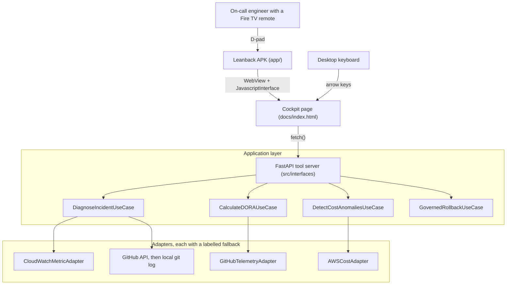
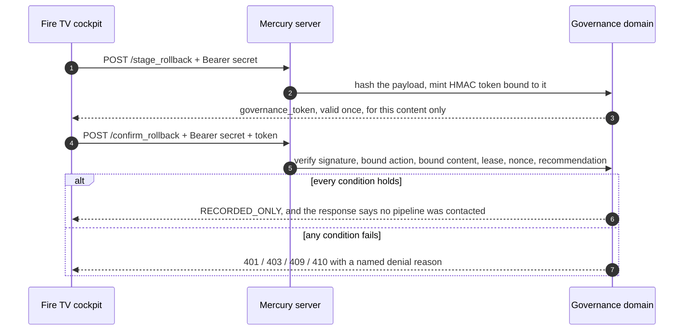

# Mercury: evidence, measurements and history

This is the long form behind the [README](../README.md): the measurements with the
commands that produced them, and the audit history of what was measured, what was
wrong and what changed. Tests in `tests/` compare the headline figures on this page
(the correlation trial, benchmarks, coverage, test counts, legibility, suite runtime
and readiness score) against the files their commands write, so those cannot drift
without the build failing. Some figures are not pinned that way: the ablation and
sweep tables are what `python scripts/correlation_trial.py` prints, and a reader
checks them by running it, and a few, such as how long one clean install took, are observations
with no command behind them and are worded as such.

## Contents

1. [What this is](#what-this-is)
2. [What is real and what is simulated](#what-is-real-and-what-is-simulated)
3. [How often it is right](#how-often-it-is-right)
4. [Architecture](#architecture)
5. [The rollback is the point](#the-rollback-is-the-point)
6. [Suite runtime](#suite-runtime)
7. [Fire TV](#fire-tv)
8. [Measured numbers](#measured-numbers)
9. [Configuration](#configuration)
10. [Known limitations](#known-limitations)
11. [Who would buy this, and why](#who-would-buy-this-and-why)

---

## What this is

During a production incident the useful information is scattered across a version
control host, a metrics console and a deployment pipeline. The question that
matters is one question: which change did this, and can it be undone safely. The
asset in this repository is the engine that answers it, scored against a labelled
corpus rather than demonstrated once.

Scoring it changed what this product claims. The engine's reliable answer is the
refusal. On a held-out split of a synthetic, self-authored corpus that no setting was
tuned on, it stays quiet on 200 of 200 healthy series, and on a real anomaly it
declines to name a change 90.0% of the time, because the window before the spike
usually holds either no deploy candidate or several; it refuses outright on every telemetry
gap. Each refusal says which of those it was, and says in the same sentence what it
is not: Mercury has no way to rule a deploy out, so a refusal is never rendered as a
deploy having been cleared, and rolling back on a refusal would be a guess. Naming
one change is the smaller capability: on that held-out split it is right 50.0% of
the 58 times it fires (95% interval 37.5% to 62.5%), and Mercury prints that figure
on the screen at the moment somebody would act on it. Since 2026-09-27 only a commit
that changed a file the server is built from counts as a deploy candidate, so a
documentation-only commit is never named for a 5XX spike; on this corpus's labels that
filter lowered the figure from 62.5%, for reasons [counted below](#the-runtime-filter-v3).
That figure holds only under the corpus's assumption that a regression shows within 75
minutes of its commit, which is also the shipped window and which both splits share; if
regressions can take up to 90 minutes the same engine reads 41.5%, and at 180 minutes
27.3% ([table](#the-figure-depends-on-an-assumed-delay)).

The screen is a delivery choice, not the product. Mercury renders on a Fire TV in
a room, and on a laptop browser, from the same HTTP surface and the same page: the
D-pad ring and the arrow keys are one code path. It is entered in the Fire TV track
because the ten-foot surface is built, measured and honest about what has not been
run, and the section on it says exactly what has not.

Three things it does:

**Answers "is this a deploy, and which one?"** `POST /mcp/tools/what_changed` reads
an error metric series and a commit history, decides whether the metric has stepped
up against a baseline taken from before the step, and looks for changes in the 75
minutes before that step started (60 until 2026-09-27). It names one only when exactly one landed there. When
none landed it says so; when several landed it says how many and names none of
them, because nothing in a metric series says which of two changes did it. Both
refusals are the product rather than a fallback, they have their own tests, and
they are the two most common answers it gives. Both are shipped as refusals:
`attribution.refusal_statement` says Mercury cannot attribute and why,
`attribution.nothing_to_revert` is true only when the reading is under the 3.0x
anomaly threshold, and neither is ever rendered as proof that a deploy is innocent.

**Shows engineering velocity and spend.** `POST /mcp/tools/get_dora_velocity_report`,
`POST /mcp/tools/get_pr_bottlenecks` and `POST /mcp/tools/get_aws_cost_anomalies`
return DORA metrics computed from GitHub Actions runs and merged pull requests,
open pull requests past a 36 hour review SLA, and month-to-date AWS spend per
service from Cost Explorer.

**Takes a governed rollback from the D-pad.** Outside the labelled record-only
demo, `POST /mcp/tools/stage_rollback` and `POST /mcp/tools/confirm_rollback` are
the state-changing rollback endpoints, and both require the deployment's shared
secret, as do the operator handoff routes. The `demo_*` routes the TV's D-pad path
calls take no secret, and they do change state: they stage and confirm a rollback
to the checked-in fixture target only, and publish a fixed handoff with a revision
number. They are refused whenever a dispatcher that can reach a pipeline is
selected, and they contact nothing outside the server. See
[The rollback is the point](#the-rollback-is-the-point).

---

## What is real and what is simulated

Every telemetry response carries a provenance stamp, and the cockpit prints it on
screen next to the numbers. A viewer never has to trust the server about whether
a reading is live.

| Data | Live path | What happens without it |
|---|---|---|
| DORA metrics, pull requests | GitHub REST API via `httpx`, needs `GITHUB_TOKEN` | Serves `src/infrastructure/fixtures/github_telemetry_fixture.json`, which is a **recording of a real GitHub read** of `pallets/flask` made by `python scripts/record_github_fixture.py`, labelled `offline-fixture` |
| AWS spend | `ce:GetCostAndUsage` via `boto3`, needs AWS credentials | Serves `src/infrastructure/fixtures/aws_cost_fixture.json`, which says in its own text that it is **synthetic and was never read from an AWS account**, labelled `offline-fixture` |
| Error metric series | `cloudwatch:GetMetricStatistics` via `boto3` | Generates a deterministic local series **from the SHA-256 of the service name**, labelled `offline-fixture`, whose provenance says it was generated and never read from CloudWatch. A service name the fixture does not know is refused, not invented |
| Commits for correlation | GitHub REST API | Falls back to **real commits from the local checkout** via `git log`, labelled `local-git`, never to invented commits |

The Cost Explorer path has been executed successfully against a real AWS account
during development. The CloudWatch path has been executed and returned no
datapoints, because there is no load balancer named `checkout-api` to read. The
account's actual figures are not committed to this repository.

Those two sentences are the only claims in the README or this document that you cannot check by
running something. They describe work done against a private AWS account outside
this repository, no artefact of which is committed here, so treat them as an
unverified maintainer statement rather than as evidence. Nothing the running
product shows depends on them: without credentials every adapter serves a fixture
and says so on screen.

Set `MERCURY_OFFLINE=1` to force every adapter into fixture mode whatever
credentials the machine has. That switch can only ever suppress a live call; it
can never make a fixture look live.

### The demo path, and what it does to the data

With no credentials at all, the war room still works end to end: the commits are
real ones from this repository's `git log`, a 20-commit window recorded at merge
`a4ec9aa` in `src/infrastructure/fixtures/local_git_window.json` and served wherever a
git checkout exists (on the public Lambda, which has no checkout, they are the invented
deploy feed in
`src/infrastructure/fixtures/deploy_feed_fixture.json`), and the simulated metric
series is anchored after one of them so the correlation is coherent. The metric text
does not vouch for the commits; it defers to the commit stamp beside the answer. The
checkout-api response says so in the provenance text the evidence panel shows
(`CloudWatchMetricAdapter._simulated_series` in `src/infrastructure/cloudwatch_adapter.py`):

> The final reading is placed 4 minutes after the newest commit that is alone in its
> 75 minute attribution window, chosen from the commit log so the attribution is
> demonstrable and does not change with the last hour of somebody's commit history;
> the commits are whatever the commit stamp beside this answer says they are, and
> this metric is generated.

### The refusals are the first thing you can press

The correlator returns four verdict codes, and one of them,
`ANOMALY_WITHOUT_ATTRIBUTION`, carries two refusal reasons, so there are five answers.
Four of the five name no change. The cockpit offers five services on the board, one
per answer. The numbers behind each are
derived from the SHA-256 of the service name, so no two services read the same
and every machine reads the same as this one.

| Press | Verdict | What it shows |
|---|---|---|
| `checkout-api` | `ANOMALY_ATTRIBUTED` | A spike four minutes after a commit that is alone in its window. Names the commit, offers the rollback, and prints the precision that naming was measured at |
| `release-train` | `ANOMALY_WITHOUT_ATTRIBUTION`, `WINDOW_TOO_CROWDED` | A spike after a burst of changes. Calls it an anomaly, then says it cannot attribute it to any one of them, names none, and offers no rollback |
| `search-indexer` | `ANOMALY_WITHOUT_ATTRIBUTION`, `NO_CANDIDATE_IN_WINDOW` | A spike placed four attribution windows (five hours) after the newest commit, outside the 75 minute attribution window. Calls it an anomaly, then says it cannot attribute it: the window is empty, which is not the same as no deploy being involved |
| `payments-worker` | `NO_ANOMALY` | A reading above its baseline but under the 3.0x threshold. The one verdict that says nothing needs reverting |
| `quiet-service` | `INSUFFICIENT_DATA` | A name the fixture does not know. Refused outright rather than given an invented spike |

Reproduce all five from a shell against a running server:

```bash
for s in checkout-api release-train search-indexer payments-worker quiet-service; do
  curl -s -X POST localhost:8002/mcp/tools/what_changed \
       -H 'Content-Type: application/json' -d "{\"service_name\":\"$s\"}" \
    | python -c "import json,sys; d=json.load(sys.stdin); print(d['service'], d['verdict'], d['attribution']['refusal_reason'])"
done
```

Where each reading is placed is itself a choice, and the response says which choice
it was. The attributing demo is anchored to the newest commit that is **alone** in
its own attribution window, and the crowded demo to the commit with the **most**
company in its window, both picked from that recorded window of this repository's
real `git log`. That is deliberate and it is disclosed in the provenance the screen
renders: without it, whether `checkout-api` named a commit or refused depended on how
often somebody had committed in the hour before HEAD, so the same repository
demonstrated different verdicts on different days. The window itself is pinned for the
same reason. The server used to read `git log -20` at HEAD, and a stack of docs and
receipt commits pushed every runtime change out of those 20, so the crowded window
behind `release-train` emptied and the refusal became an attribution (CI run
37579019212, six failed tests). `python scripts/record_local_git_window.py --check`
compares the recording to `git log`. `tests/unit/test_local_git_window.py` builds a temp repo of 25 lone
runtime commits, where `git log` at HEAD flips `release-train`, and the pinned window keeps all five.

The fixture used to be two module constants, so every service name returned the
same spike and no refusal verdict was reachable from any input a reader could
supply. `tests/integration/test_mcp_endpoints.py` now drives all five through the
endpoint the cockpit calls.

### A refusal is not an acquittal

An earlier draft of the README glossed every refusal as
`do not revert anything, this is not a deploy`, and the cockpit headline for both
refusals read `Do not revert on this.` That was an over-claim, and a reviewer caught
it: an empty window says nothing about a change that landed outside it, a crowded
window says nothing about which of its changes did it, and a missing baseline says
nothing at all. None of the three rules a deploy out, so none of them may be
rendered as one having been ruled out. The wire, the screen and every document a
judge reads now say the same thing: Mercury **cannot attribute**, and why.
`attribution.nothing_to_revert` is true only on `NO_ANOMALY`,
`attribution.refusal_statement` carries the reason and what the reason is not, the
domain publishes the forbidden certainty phrasing as `REFUSAL_MUST_NOT_CLAIM`, and
`tests/e2e/test_refusal_wording.py` scans the README, this document, the Devpost text, the cockpit
page and the video plan for it and fails the build on any of it. The retired phrases
stay on this page in backticks, each on a single line, as the record of the
correction: the scanner strips code spans before it reads, and a span wrapped across
a line break is read as live prose, so the quotation cannot quietly become a claim.

Those five are a demonstration, not evidence. The evidence is below.

---

## How often it is right

The demo above cannot fail, and a demo that cannot fail says nothing about the
engine. So the correlator is scored against a labelled corpus. Every figure in this
section is measured on that corpus, and the corpus is **synthetic and self-authored**:
the commits are real, the metric values, delays and truth labels are generated by code
written by the same authors as the engine.

### The held-out figures, which are the ones the screen shows

Until 2026-09-27 the figures published here came from one corpus, and the crowding
gate below was chosen on that same corpus, so the headline 52.2% was in-sample. The
engine is now tuned on one part of the data and reported on another:

```bash
python scripts/attribution_split.py    # scores every engine on train and held-out
python scripts/tune_attribution.py     # the train-only sweep the settings were chosen from
```

**The split rule.** The recorded commit stream is cut in time at 2026-09-04 21:00 UTC,
inside a 14.7 hour (881.7 minute) idle gap. The 42 commits before the cut are TRAIN,
the 17 after it are HELD-OUT. The gap is longer than any window considered (at most
180 minutes), so no case on one side can see a commit from the other. Each side builds
its own corpus with the unchanged generator described below: regression causes drawn
from that side's commits, uncaused reading times drawn over that side's span, 1160
cases per side, seed 20260908 for train and 20260927 for held-out. No case was
relabelled, deleted or regenerated. The held-out side is the newer and burstier part of
the log (median gap between commits 5.66 minutes, against 28.95 on train), so its
figures differ from train, and both sides are published in
`attribution_holdout_summary.json`. `tests/unit/test_attribution_split.py` checks the
cut, that no window can cross it, and that each side draws only its own commits. It also
imports the tuning script in a fresh interpreter and fails if any loaded module is
`attribution_split` or defines the held-out builder or seed: the train side lives in
`scripts/attribution_train.py`, which has neither. That is an import-level guard inside
one repository, not a sandbox.

**How the setting was chosen.** `scripts/tune_attribution.py` scores every window of
45, 60, 75, 90, 120 and 150 minutes, every gate of 1, 2 and 3, with and without the
file-list scope described below, on three pooled train seeds (20260908, 20260909,
20260910). The rule is stated in the script that produced the choice: highest train
recall among the settings whose train precision is at least the shipped engine's and
whose false attribution on exogenous spikes is no higher. The rule, the sweep and its
summary were committed together (5987fbe), so the history cannot show that the rule came
first. The chosen setting also has the highest pooled train precision of all 36, so a
precision-first rule would have made the same choice. It picked a **75 minute window,
gate 1, no scope** (pooled train precision 52.4% to 64.1%, recall 12.1% to 12.5%).
`python scripts/tune_attribution.py --check` re-runs the sweep in CI and compares every
field of `attribution_tuning_summary.json` except its timestamp. That engine was frozen
and then scored on held-out beside the engine it replaced. Held-out was scored in steps,
all recorded in git: v1 alone (dc01f11), then v1 and the frozen v2 (9b9ac1a). Three
later runs changed no engine and no earlier figure: one added the breakdown fields
(93960ed), one the delay-ceiling rows below (8dffcb8), and one the 20 seed spread
(6a101e7). A sixth recorded run (7bd8b41) added the runtime filter as engine v3, with
its cost breakdown and the assumption variant, and changed no earlier figure. Before
that commit the filter was also scored on held-out in scratch runs that were not
recorded, under the published labels and under runtime-only causes. Including the
filter was set as a constraint of what a deploy is, not chosen from those figures, and
the headline shipped is the lower of the figures seen. That is six recorded held-out
scoring runs in all, plus those scratch runs.

| Held-out, synthetic corpus | v1: 60 minute window (2026-09-08) | v2: 75 minute window (shipped until the runtime filter) |
|---|---|---|
| Held-out naming precision | 40.8% (29 of 71, 95% CI 30.2% to 52.5%) | **62.5%** (25 of 40, 95% CI 47.0% to 75.8%) |
| Held-out naming recall | 4.8% (29 of 600) | **4.2%** (25 of 600) |
| Held-out refusal to name, on anomalies it saw | 87.8% (511 of 582) | **93.1%** (542 of 582) |
| Held-out false attribution on exogenous spikes | 3.0% (9 of 300) | **4.7%** (14 of 300) |
| Held-out quiet on healthy series | 100% (200 of 200) | **100%** (200 of 200) |
| Wrong namings in all | 42 | **15** |

**Read both sides of that trade.** The sturdiest result is the count of wrong names on
the same held-out cases: 42 under v1, 15 under v2. Precision rose by 21.7 points, but
the two 95% intervals overlap between 47.0% and 52.5%, so this sample alone does not
fix the size of that gain, and the recall change (29 to 25 correct namings, intervals
3.4% to 6.9% and 2.8% to 6.1%) is inside the noise. Recall did not rise: it fell by four correct namings, the refusal
rate rose by 5.3 points, and false attribution on exogenous spikes rose from 9 to 14 of
300, because a wider window finds a lone commit in front of some spikes that no commit
caused. Of the 15 wrong namings, 14 are those; 1 blamed the wrong commit for a
regression that had a right one, against 33 under v1. The v1 row is also the answer to
how much the old 52.2% owed to being chosen where it was reported: the same engine
reads 40.8% on data it was not chosen on.

**Why 75 minutes won, which limits what it means.** The generator draws a regression's
propagation delay from 1 to 75 minutes and the metric is polled every 10, so a cause
can sit up to 85 minutes before the first elevated reading. A 75 minute window catches
most of those, which is why it won on train. That is a fit to the authors' delay
assumption as much as a property of the engine, and the held-out split cannot detect
it, because both splits come from the same generator with the same ceiling. On a real
service the window should come from that service's measured rollout delay, not from
this corpus.

#### The runtime filter (v3)

A commit that changes no file the server is built from deploys no code, so it cannot be
the deploy behind a 5XX spike. v2 could still name one, and on 2026-09-27 the board did:
it named a commit that edited only `README.md` and two documents. The shipped engine, v3
(`v3_2026_09_27_runtime`), is v2 with one constraint: a commit counts as a deploy
candidate only when its file list touches a runtime path. The runtime paths are defined
in `src/domain/change_scope.py` from what ships: the files the `Dockerfile` copies into
the image and `scripts/build_lambda_package.py` packs into the Lambda zip, plus the files
that define how that artefact is built and deployed.

| Runtime paths (fnmatch, `*` crosses `/`) | Why |
|---|---|
| `src/*` | The server code |
| `docs/index.html`, `docs/firetv_nav.js`, `docs/webmcp_bridge.js`, `docs/manifest.json`, `docs/*.woff2`, `docs/OFL-*.txt` | The board the server serves |
| `correlation_trial_summary.json`, `attribution_holdout_summary.json` | Read by the server at run time |
| `pyproject.toml`, `Dockerfile`, `docker-compose.yml`, `scripts/build_lambda_package.py`, `scripts/terraform_cycle.py`, `infra/*`, `.github/workflows/terraform-cycle.yml` | How the artefact is built and deployed |

Everything else is not a runtime path for this server: the README and the other
documents, tests, CI, the video plan and the Fire TV client in `app/`. A commit whose
file list is unknown stays a candidate, so missing data never makes Mercury more willing
to name a change. Local git and the GitHub path supply file lists at run time; the GitHub
path reads each commit's files with one extra call per commit, and a failed or capped
read stays a candidate. The public board's invented deploy feed carries no file lists,
so every one of its records stays a candidate. The trial reads the checked-in
recording's file lists from `src/infrastructure/fixtures/commit_paths_fixture.json`. A commit set aside is
counted on the wire (`attribution.commits_set_aside`) and in the refusal wording, which
says it is a reading of file lists, not a finding that those changes are harmless.
`tests/unit/test_change_scope.py` parses the Dockerfile and the packager and fails if
either ships a path the set does not cover.

The train sweep did not choose the filter: its rule picked no filter, for the reason
below. So the filter is imposed as a constraint of what a deploy is, the window and gate
stay as chosen on train, and nothing was re-tuned. Held-out, same split, same seeds, same
unchanged generator and labels, `python scripts/attribution_split.py`:

| Held-out, synthetic corpus | v2: 75 minute window | v3: v2 plus the runtime filter (shipped) |
|---|---|---|
| Held-out naming precision | 62.5% (25 of 40, 95% CI 47.0% to 75.8%) | **50.0%** (29 of 58, 95% CI 37.5% to 62.5%) |
| Held-out naming recall | 4.2% (25 of 600) | **4.8%** (29 of 600) |
| Held-out refusal to name, on anomalies it saw | 93.1% (542 of 582) | **90.0%** (524 of 582) |
| Held-out false attribution on exogenous spikes | 4.7% (14 of 300) | **4.3%** (13 of 300) |
| Held-out quiet on healthy series | 100% (200 of 200) | **100%** (200 of 200) |
| Wrong commit named for a regression | 1 | **16** |

**The filter costs precision on these labels, and the cost is counted, not argued.**
The generator draws a regression's cause from every commit, so its labels say a README
edit can raise the server's 5XX rate; the filter refuses to believe that and is scored
wrong each time. The summary's `runtime_filter_cost_on_published_labels` block counts
it: of v3's 16 wrong namings on regressions, 14 are cases the generator labels as caused
by a commit that touched no runtime file, and all 6 correct namings v2 made and v3 does
not are such labels. The labels were not changed. Over the 20 other held-out seeds
below, v3 averages 62.0% (sd 6.4 points) against v2's 81.7% and is more precise on 1 of
20, so the cost is not one seed's draw.

**An assumption variant, not a measured gain.** The summary's
`runtime_cause_assumption_variant` rebuilds only the held-out regression cases with the
cause drawn from the 9 of 17 held-out commits that touch a runtime path, and keeps every
uncaused case. There v2 reads 66.7% (28 of 42) and v3 75.8% (47 of 62), recall 4.7% to
7.8%. That encodes the filter's own premise, so it cannot test the filter; it is not on
the board and nothing was chosen from it.

The board prints 50.0%. The trade is deliberate: a 5XX spike blamed on a documentation
commit is a wrong answer on its face, and a figure earned by allowing it is not one to
show beside a name.

#### The figure depends on an assumed delay

`python scripts/attribution_split.py` also re-scores every frozen engine on held-out
corpora that differ from the published one only in the delay ceiling (same seed, same
commits, same floor of 1 minute), and `--check` holds the rows to the record. Nothing
was chosen from this table and no engine was changed after it was run. Synthetic,
self-authored corpus:

| Delay ceiling (minutes) | v1 held-out precision | v2 held-out precision | v3 held-out precision (shipped) | v3 wrong commit on a regression |
|---|---|---|---|---|
| 60 | 56.9% (37 of 65) | 69.6% (32 of 46) | 54.0% (27 of 50) | 10 |
| **75 (published)** | **40.8% (29 of 71)** | **62.5% (25 of 40)** | **50.0% (29 of 58)** | **16** |
| 90 | 27.5% (22 of 80) | 50.0% (20 of 40) | 41.5% (22 of 53) | 18 |
| 120 | 26.3% (15 of 57) | 38.8% (19 of 49) | 38.6% (17 of 44) | 14 |
| 180 | 17.1% (6 of 35) | 25.0% (8 of 32) | 27.3% (9 of 33) | 11 |

v2 is more precise than v1 in all five rows. v3 is below v2 at every ceiling up to 120
minutes, for the labelling reason in the section above, and above it at 180; it is below
v1 at 60. The level falls for all three as the ceiling rises: v3's 50.0% is the figure
for a world where no regression takes longer than the window to show, and it falls to
27.3% if some take three hours. The single wrong commit v2 names for a regression at the
published ceiling (against 33 for v1) is the same effect: when no delay exceeds the
window, the cause is almost always inside it.

The same command also scores both engines on 20 other held-out seeds (20261001 to
20261020, first run by the audit of this change, none tuned on), recorded as
`held_out_seed_spread`. v2 is more precise than v1 on all 20, averaging 81.7% (sd 6.5
points, range 66.7% to 92.6%) against 44.4% (sd 7.0 points). Correct namings are flat
on average (30.95 against 30.6) and false attributions on exogenous spikes rise (6.45
against 5.7 of 300), so the gain is fewer namings, not more right ones. The published
seed gives v2 a lower precision than any of the 20, so 62.5% is the conservative draw.
The shipped v3 on the same 20 seeds is averaging 62.0% (sd 6.4 points, range 47.1% to
71.0%); the published seed's 50.0% is again near the bottom of that range.
That seed spread is not in the 95% interval above, which covers the namings of one
seed only, and every row still assumes the 75 minute ceiling.

**How the train sweep scored the file list, and why it did not pick it.** `src/domain/change_scope.py`
reads the files each commit changed (recorded from `git show` into
`src/infrastructure/fixtures/commit_paths_fixture.json` by
`python scripts/record_commit_paths.py`) against the files the server is built from,
derived from the `Dockerfile` and the Lambda packager and checked against both by
`tests/unit/test_change_scope.py`. A commit that changed only tests, prose, CI or the
Fire TV client is then not counted as a candidate, and the answer says how many were
set aside and that this is not a finding that they are harmless. 22 of the 59 recorded
commits changed nothing the server is built from. On train it failed the precision
floor: at 75 minutes it named more (recall 12.5% to 17.1%) and more wrongly (precision
64.1% to 46.5%, false attribution on exogenous spikes 12.2% to 16.4%). The reason is
the labels: the generator draws a cause uniformly from every commit, so under this
corpus a README edit is as likely to raise the server's error rate as a change to
`src/`, and the scope is marked wrong whenever that is the draw. The labels were not
changed to suit it. Instead, on train only, the script rebuilds the regression strata
with causes drawn inside the scope except for a leaked share, which encodes the
authors' assumption and is published as that, never as a gain:

| Train only, assumption variant | Scope off | Scope on |
|---|---|---|
| No cause outside the scope | 71.0% precision, 16.6% recall | 74.3% precision, 27.3% recall |
| 25% of causes outside the scope | 68.3% precision, 15.2% recall | 67.2% precision, 24.5% recall |
| 50% of causes outside the scope | 66.5% precision, 14.0% recall | 60.8% precision, 22.2% recall |
| False attribution on exogenous spikes, every row | 12.2% | 16.4% |

So the scope raises recall by about two thirds if changes outside the service
rarely break it, it costs precision once a quarter of causes are outside it, and on
train it blames more innocent commits for spikes nothing caused (on held-out, 13 of 300
against 14). The sweep's rule therefore left it off. Since 2026-09-27 it is on anyway,
as a constraint rather than a tuned choice, with its held-out cost published in
[the runtime filter (v3)](#the-runtime-filter-v3) above.

**What the fixture does not carry.** The corpus is one service, and the stream has no
deploy markers: every commit is treated as its own deploy. Per-service ownership and
release boundaries would be stronger signals than either change above, and neither
can be measured here. Closeness to the onset is not used to rank candidates: the
generator's delay is uniform, so any gain from it would be fitted to that choice.

#### Against two naive rules

The tables above compare Mercury's engines with each other. A responder without Mercury
does not refuse; they blame a change. Two such rules are scored on exactly the held-out
cases above (same split, seed 20260927, commits and labels; the corpus fingerprint is in
the summary), and the corpus and the engine are unchanged:

```bash
python scripts/naive_attribution_baselines.py           # writes attribution_baselines_summary.json
python scripts/naive_attribution_baselines.py --check   # what CI runs
```

- **Baseline A, blame the latest deploy:** the newest commit at or before the onset,
  however long before it.
- **Baseline B, blame every deploy in the window:** every commit in the 75 minutes ending
  at the onset (the shipped window), with no file filter and no crowding gate.

Each rule sees the anomalies the shipped detector sees and is asked to name a change only
where that detector found an onset, so the rows differ only in the attribution rule.
Every commit counts as a deploy, as in the corpus. A naming is one commit named as the
cause, so B can make several for one anomaly. Recall is the share of the 600 regressions
whose causing commit was among those named. Synthetic, self-authored corpus:

| Held-out, 582 anomalies seen | Mercury v3 (shipped) | A: latest deploy | B: every deploy in the window |
|---|---|---|---|
| Namings attempted | 58 | 582 | 1635 (over 375 anomalies) |
| Correct namings | 29 | 100 | 341 |
| Wrong namings (an innocent change named) | **29** | 482 | 1294 |
| Of them, on exogenous spikes no commit caused | 13 | 215 | 52 |
| Naming precision | **50.0%** (95% CI 37.5% to 62.5%) | 17.2% (95% CI 14.3% to 20.5%) | 20.9% (95% CI 19.0% to 22.9%) |
| Naming recall on regressions | 4.8% (29 of 600) | 16.7% (100 of 600) | **56.8%** (341 of 600) |
| Refusals | 524 | 0 | 207 |

**What it means.** Against A, the shipped engine names 453 fewer innocent changes and
gives up 71 correct namings. Against B, it names 1265 fewer and gives up 312. Per naming
it is right about three times as often as A, and the 95% intervals do not overlap. Over
the 20 other held-out seeds of `held_out_seed_spread` it makes fewer wrong namings than
each baseline on 20 of 20 (mean 17.65, against 467.65 for A and 1280.9 for B). The
published 50.0% is the same figure as above; nothing here moves it.

**Where the baselines are better, plainly.** Both find more causes. A names the cause of
100 regressions, 3.4 times the engine's 29. B has the cause among its names for 341
regressions, which is 341 of the 375 anomalies it named anything for (90.9%), but
beside 4.36 commits on average, so a responder still has to choose among them. If the
goal is a short list that usually contains the cause, B does that and Mercury does not.
Mercury's claim is the other one: when it names a single commit as the thing to roll
back, that name is wrong half the time on this corpus, against 482 of 582 (82.8%) for
A. The baselines also carry no runtime filter, which costs Mercury precision on these
labels (see [the runtime filter (v3)](#the-runtime-filter-v3)); they still come out lower.

On the train side of the same split the order holds and the gap is smaller: precision
44.0% for the engine, 27.7% for A and 26.8% for B, recall 16.7%, 27.2% and 55.8%, with
299 and 789 wrong namings avoided. On the held-out corpora of the delay-ceiling table,
same seed and commits, B keeping the 75 minute window:

| Delay ceiling (minutes) | Mercury v3 precision, wrong namings | A precision, wrong namings | B precision, wrong namings |
|---|---|---|---|
| 60 | 54.0% (27 of 50), 23 | 18.2% (106 of 582), 476 | 21.1% (366 of 1735), 1369 |
| **75 (published)** | **50.0% (29 of 58), 29** | **17.2% (100 of 582), 482** | **20.9% (341 of 1635), 1294** |
| 90 | 41.5% (22 of 53), 31 | 16.7% (97 of 582), 485 | 19.5% (279 of 1431), 1152 |
| 120 | 38.6% (17 of 44), 27 | 16.0% (93 of 582), 489 | 18.9% (213 of 1124), 911 |
| 180 | 27.3% (9 of 33), 24 | 14.6% (85 of 582), 497 | 18.1% (137 of 756), 619 |

The lead narrows as the assumed delay grows. At a 180 minute ceiling the engine is 9.2
points above B on 33 namings, a gap the sample cannot pin down, and its recall there is
1.5% against B's 22.8%.

What this does not show: the corpus is synthetic, the generator draws a cause uniformly
from the commits and a delay uniformly up to its ceiling, and no responder was asked
whether 29 wrong names and 29 right ones beat 482 and 100. It measures the trade, not
its value to a team.

### The whole-stream trial

```bash
python scripts/correlation_trial.py
# Scored 1160 labelled cases against IncidentCorrelator (3.0x threshold, 75 minute window), seed 20260908
```

It writes `correlation_trial_summary.json`, and a test compares the numbers below
against that file, so they cannot drift away from the run that produced them. This
corpus is built from all 59 commits, so it shares 42 of them with the train side: its
figures are the detailed breakdown, **not** a held-out measurement, and the screen
does not show them.

**Where the corpus comes from.** The deployment stream is this repository's own
`git log`, 59 real commits over 6.1 days, recorded once into
`src/infrastructure/fixtures/commit_stream_fixture.json` at commit `dc800ef` so a
published figure does not move every time somebody commits. The reading time of
every case with **no** cause is drawn over the span of that log and snapped to a
fixed 10 minute polling grid, with no reference at all to where individual commits
fall: that generator is handed two dates and never the commits.
`tests/unit/test_correlation_trial.py` regenerates those cases against a commit log
whose times have been shuffled inside the same span and asserts that not one
reading time moves. For a regression the reading necessarily follows its cause, but
the propagation delay is drawn from a range (1 to 75 minutes) that reached past the
60 minute window the corpus was built against and, with the 10 minute polling grid,
still reaches past the 75 minute window shipped since, and how many polls late somebody looks at the screen is drawn separately. The error
values are generated here and were never read from a monitored service.

| Measure | Value | Over | Until 2026-09-27 (60 minute window) |
|---|---|---|---|
| Refused to name anything when it saw an anomaly | **84.8%** | the 599 anomalies it detected | 81.1% |
| Stayed quiet on a healthy series | **99.5%** | 200 ordinary series | 99.5% |
| Refused for want of data | **100%** | 60 telemetry gaps | 100% |
| Correct refusal, exogenous spikes | **69.0%** | 300 anomalies no commit caused | 69.3% |
| False attribution, exogenous spikes | **6.3%** | the same 300 | 6.0% |
| Naming precision | **72.5%** | the 91 times it named a commit | 52.2% over 113 |
| Naming recall | **11.0%** | 600 genuine regressions | 9.8% |
| Hit rate, fresh look | **13.0%** | 300 regressions seen on the first poll after onset | 11.3% |
| Hit rate, late look | **9.0%** | 300 regressions seen one to four polls later | 8.3% |

The right-hand column is the history, reproduced by
`python scripts/correlation_trial.py --attribution-window 60 --no-write`. This trial
scores the engine without the runtime filter (v2's settings). The 72.5% is higher than
v2's held-out 62.5% for the reason the held-out split exists: the window was chosen on
train corpora that share most of these commits.

Read the table in that order, because that is the order of what this thing is good
at. The four refusal rows are the product. The naming rows are a bounded secondary
capability: when it names a change it is right more often than not, and it names one
for about one regression in ten on this corpus and one in twenty-one on held-out with
the runtime filter.

**Naming a commit is still far from certain, and the screen says so.** 50.0% over 58
held-out namings, with an interval reaching down to 37.5% and a level that assumes
every regression shows within the 75 minute window, is not a number to revert
production on unaided, so the answer carries it, with that assumption in its note. Every `what_changed` response ships
`attribution.measured_accuracy`, read from `attribution_holdout_summary.json` rather
than recomputed, and the cockpit prints it under the headline the moment a commit is
named. Until 2026-09-27 the page printed the in-sample 52.2% from
`correlation_trial_summary.json` instead. An operator reading the wall sees the name
and the held-out odds together.

### What changed on 2026-09-08, and what it cost

The previous published numbers were a 22.0% hit rate on a fresh look, **3.3% on a
late look**, and 27.9% naming precision over 272 namings. Two defects and one
editorial decision moved them. Every row below is a run of the committed class with
different flags, printed by the same command:

```bash
python scripts/correlation_trial.py     # prints the ablation and the gate sweep
```

| Detector | Fresh look | Late look | Naming precision | Namings | Quiet on healthy |
|---|---|---|---|---|---|
| Trailing baseline, window ends at the reading (before) | 22.0% | **3.3%** | 27.9% | 272 | 99.5% |
| Pre-onset baseline, window ends at the reading | 22.3% | 9.3% | 27.1% | 350 | 99.5% |
| Pre-onset baseline, window ends at the onset | 22.0% | **18.7%** | 32.6% | 374 | 99.5% |

**The baseline no longer contains the spike.** `MetricSeries.baseline_mean` dropped
only the newest point, so a spike that had been running for three polls was most of
its own baseline and the factor collapsed. `MetricSeries.find_onset` now finds the
first reading of an elevation that is still going on, and the baseline is the mean
of the readings strictly before it. That alone took the late look from 3.3% to
9.3%. The detector is **strictly more sensitive** than the old one, because the
last index is always a candidate onset and testing it is the same arithmetic the
trailing mean did, so it fires on everything the old one fired on and on more
besides. The cost of that extra sensitivity on healthy series was measured and it
is **zero**: 199 of 200 before, 199 of 200 after. It found an onset earlier than
the newest reading in 151 cases, 150 of which were genuine regressions and one of
which was not.

**The window ends when the spike started, not when somebody looked.** A change that
lands after a spike has begun cannot have caused it, and an engineer who walks up to
the wallboard forty minutes in was dragging the whole 60 minute window off the
change that did. Anchoring the window at the onset took the late look from 9.3% to
18.7%, which is the larger half of the fix.

**Then it was told to refuse a crowded window, which cost recall to buy precision.**
Naming the closest of several changes was where the wrong names came from. The
correlator now names a commit only when exactly one landed inside the window. The
threshold was chosen on 2026-09-08 from this sweep, at the 60 minute window of the time,
and the sweep is published so the choice can be argued with. It is history: the default
command now runs at 75 minutes, so this table is reproduced by
`python scripts/correlation_trial.py --attribution-window 60 --no-write`:

| Names when at most N landed (60 minutes, 2026-09-08) | Naming precision | Naming recall | Namings | False attribution |
|---|---|---|---|---|
| N = 1 (chosen) | **52.2%** | 9.8% | 113 | 3.6% |
| N = 2 | 47.9% | 16.8% | 211 | 5.4% |
| N = 3 | 40.6% | 19.0% | 281 | 7.2% |
| N = 5 | 38.9% | 19.7% | 303 | 7.4% |
| no gate | 32.6% | 20.3% | 374 | 8.0% |

At the shipped 75 minute window, `python scripts/correlation_trial.py --no-write` prints
the same sweep as: N = 1 72.5% over 91 namings (recall 11.0%), N = 2 56.0% over 191,
N = 3 46.6% over 275, N = 5 42.7% over 307, no gate 34.6% over 407. The ordering is the
same. This whole-stream corpus shares 42 commits with the train split the window was
chosen on, so none of those rows is held out.

Choosing a threshold on the corpus you then report it on is fitting, and a figure
chosen that way is worth less than it looks. So the direction was checked on two
seeds that took no part in the choice: with the 2026-09-08 engine (60 minute window),
naming precision at N=1 is **53.3%** over 92 namings at seed 19850717 and **55.7%** over
115 namings at seed 20261231, against 32.6% ungated on the reported corpus. With the
shipped 75 minute window the same seeds read 71.6% over 67 and 65.5% over 84 (drop the
flag from the commands below).
`tests/unit/test_correlation_trial.py::test_the_crowding_gate_holds_up_on_corpora_it_was_not_chosen_on`
runs both and fails if the gate stops buying precision.

```bash
python scripts/correlation_trial.py --no-write --seed 19850717 --attribution-window 60
python scripts/correlation_trial.py --no-write --seed 20261231 --attribution-window 60
```

**What it cost.** Recall fell from 20.3% to 9.8%: Mercury now names the cause of
fewer than one regression in ten, where before it named the cause of one in five
and an innocent change in three. The trade is deliberate. An on-call engineer who
reverts on a name that is wrong 67% of the time is worse off than one who is told
that Mercury cannot tell which change did it.

**The failure mode changed, which is the useful part.** At the 60 minute window on
2026-09-08, 36 attributions named the wrong commit for a regression that had a right
one, and 35 of them had the real cause outside the window. With the 75 minute window,
of the 6 attributions that named the wrong commit for a regression that had a right
one, **5** had the real cause outside the 75 minute window ending at the reading, where
no rule with that window could have named it. **0** had the cause inside the window
and more than one candidate, because those are refused rather than guessed at, and
**1** had the cause inside the window with a single candidate. That last case is the
honest residual: one case in 1160 where the rule had the culprit alone in front of it
and named the wrong thing. The other 19 wrong namings, which make 25 wrong out of 91
in all (54 of 113 before), blamed a commit for an exogenous spike that no commit
caused; there was no right commit to miss there, and they are the 6.3%
false-attribution row above. This repository commits in bursts, which is why the
crowding gate refuses so often: the median gap between commits in the recorded stream
is 20.58 minutes, 42 of its 58 gaps are under the window, and a 75 minute window
ending on a commit holds 2.98 commits on average and 9 at the worst (2.78 on average
for the 60 minute window).

**Refusing more is not the same as judging better, so the refusals are counted
apart.** Correct refusal on exogenous spikes rose from 62.0% to 69.3%, and the
whole of that rise is the crowding gate: 62.0% is still "nothing landed in the
window", and the extra 7.3% is "too much landed". At the 75 minute window the split
is 60.3% empty and 8.7% crowded, 69.0% in all. Both figures are published
separately in `correlation_trial_summary.json` under
`correct_refusal_on_exogenous_spikes_no_candidate` and
`correct_refusal_on_exogenous_spikes_window_too_crowded`, so a blunter instrument
cannot read as better judgement.

**There is a ceiling on the late look and it is arithmetic, not a defect.** The
pre-onset baseline needs at least two readings before the onset. A six point series
polled every ten minutes, looked at four polls after onset, leaves one. 65 of the
300 late-look cases are therefore undetectable by this detector whatever it does,
capping the late-look hit rate at **78.3%** and the whole-corpus hit rate at 89.2%.
That ceiling is computed from the corpus's own timestamps and published as
`detectability_ceiling`. Fixing it needs a longer series, not a better rule.

The corpus treats every commit in the log as an independently deployable change.
Real deployments often ship a burst of commits as one release, which would collapse
several of those candidate sets into a single change, refuse less often and raise
the hit rate. This is the pessimistic reading of the same log, and it is the one
published.

**The false-attribution rate is half a number without the commit density.** An
anomaly with no cause is attributed exactly when exactly one commit happens to fall
in the window before the onset, so the rate is a joint property of the window, the
gate and the stream. `--commit-stride` thins the recorded log and the report sweeps
it, at the shipped 75 minute window (the 60 minute figures of 2026-09-08 are in the
last column):

| Commits in the stream | Commits per hour | False attribution rate | Refused as crowded | Refused as empty | At 60 minutes |
|---|---|---|---|---|---|
| 59 (every commit) | 0.405 | 3.8% | 26 | 182 | 3.6% |
| 30 (every 2nd) | 0.206 | 6.0% | 5 | 192 | 4.8% |
| 15 (every 4th) | 0.103 | 3.2% | 3 | 208 | 2.6% |
| 8 (every 8th) | 0.055 | 1.6% | 1 | 218 | 1.4% |

That rate is no longer monotonic in the density, and the last two columns are there
because the reason is a claim about mechanism rather than about noise, so it should
be checkable rather than plausible. Thinning a dense stream turns crowded windows,
which are refused, into single-candidate windows, which are named: the crowded
refusals collapse from 26 to 5 between the first two rows, and that is where the
rate rises. Thinning further empties the windows instead, the crowded refusals fall
to one and the rate falls. On a stream as dense as this repository's the crowding gate
is doing most of the refusing; on a sparser one the window itself is.

**What this trial is not.** Not a field trial, and not a claim about production.
No real error metric appears in it, the noise model and the severity spread are
assumptions written by the authors rather than observations, and the commits are
development commits from this repository rather than deployments of a monitored
service. `--noise-sigma` and `--seed` are there so a reader can see how much of any
figure is those assumptions.

---

## Architecture



The layering is hexagonal. `src/domain` holds pure models and imports no SDK,
which gate A5 checks by reading the imports. `src/application` holds use cases
that depend on protocols. `src/infrastructure` holds the adapters that talk to
GitHub, Cost Explorer, CloudWatch and git. `src/interfaces` holds the HTTP server
and the cockpit assets.

---

## The rollback is the point

A rollback is the one irreversible thing Mercury can do from a sofa, so it is
guarded by five independent conditions. Each has a test that proves it refuses.



1. **Authorization.** Both endpoints require `Authorization: Bearer <MERCURY_ROLLBACK_SECRET>`,
   compared in constant time. Without it the request is refused with 401.
2. **Content binding.** Staging mints an HMAC over the action id and a
   length-prefixed SHA-256 hash of the rollback payload. Edit the target commit
   after staging and the token stops applying, with reason `TOKEN_CONTENT_MISMATCH`.
3. **Single use.** Each token carries a nonce consumed on the first successful
   confirm. A token replayed against a re-staged action is refused with
   `TOKEN_ALREADY_USED`. A second confirm of an action that has already executed
   is refused one check earlier, with `NOT_PENDING`, and the cockpit does not even
   send it: after `RECORDED_ONLY` or `DISPATCH_ACCEPTED` the Confirm control goes dark and says the token is
   spent.
4. **Lease.** A staged action expires after `lease_sec` seconds, default 300, and
   then confirms with `LEASE_EXPIRED`.
5. **Current recommendation.** The same application use case registers the
   recommendation when staging and checks it before either dispatcher runs.
   The operator-authenticated `POST /mcp/tools/recommendation_liveness` accepts
   `action_id` and a finite `current_metric_value` as query parameters. A reading
   below the existing five-error threshold withdraws that registration permanently;
   a later high reading cannot reactivate it. Expired recommendation TTL or missing
   recommendation state also refuses dispatch. Re-stage and review afresh to proceed:
   an unused token from an earlier staging is refused with `TOKEN_SUPERSEDED`,
   even if the action id and payload are unchanged.

This liveness reading is operator supplied and is labelled
`OPERATOR_SUPPLIED_METRIC_NO_LIVE_REFRESH`. Mercury does not fetch fresh service
telemetry at confirmation. A separate deployment-evidence boundary now prevents
the client from choosing a SHA. `POST /mcp/tools/record_deployment_evidence`
accepts an authenticated marker only when its service, environment, revision and
artifact SHA-256 match a later healthy readback. The correlator may offer a
rollback only when that ledger contains both the incident revision and the
immediately preceding healthy deployment. Staging revalidates both marker IDs and
binds the environment and target digest into the governance hash. Missing,
retargeted or stale evidence returns `UNVERIFIED_DEPLOYMENT_TARGET`.

No real service has emitted those markers yet. A GitHub workflow acceptance is
reported as `DISPATCH_ACCEPTED`, while record-only and dry-run paths report
`RECORDED_ONLY`; neither is called executed. Workflow completion and a post-action
health readback remain open integration proof.
`tests/integration/test_recommendation_execution_boundary.py` exercises the HTTP
and direct-use-case paths with record-only or counting test dispatchers.

A refused confirmation moves the action to `REJECTED`, so it cannot be confirmed
afterwards even with the correct token. That is fail-closed on purpose: a
tampering attempt burns the action it was aimed at, and the operator stages
again. `python scripts/security_audit.py` runs 30 checks over this path against
the real HTTP surface and exits non-zero if any of them stops holding.

### What happens after governance passes

The default is unchanged and stays the default: `RecordOnlyDispatcher` writes the
decision locally, and its own response says so verbatim, *"No deployment pipeline
was contacted."* `GET /health` reports `"rollback_dispatch": "record-only"` when
that is what a confirmed rollback would reach.

One real dispatcher now exists behind that default.
`src/infrastructure/github_actions_dispatcher.py` asks a GitHub Actions workflow
to run through `POST /repos/{owner}/{repo}/actions/workflows/{file}/dispatches`,
carrying the action id, service, environment, verified target revision, artifact
digest, both deployment marker IDs, reason and payload hash as workflow inputs. It is selected only by
`MERCURY_ROLLBACK_DISPATCH=github_actions`, and being selected is not being armed:
without `MERCURY_ROLLBACK_DISPATCH_ARMED=1`, a token and a repository, it builds
the request, prints it with the token redacted, and opens no socket. A dispatch
that is attempted and does not return HTTP 204 raises, the API answers 502, and
the spent governance nonce means the action cannot be confirmed again. HTTP 204
means `DISPATCH_ACCEPTED`, not workflow success or healthy completion.

### Shared responder handoff

The incident panel can publish and refresh one bounded shared state record. It
shows the responder, current action, confirmed facts, next step, update time and
revision. Updates use optimistic concurrency, so a responder working from an old
revision receives 409 instead of overwriting newer evidence. The local store retains
at most 50 incidents and at most 10 confirmed facts per incident; the deployed Lambda
uses DynamoDB with conditional revisions. This closes the software path for handoff;
a two-responder comparison against the laptop dashboard has not been run and remains
a separate user-evidence gate.

**It has never been fired.** No request has ever been sent to github.com from this
repository: that needs a token with `actions:write` on a repository that has such
a workflow, and neither exists here. What is proved is the shape. The 15 tests in
`tests/unit/test_rollback_dispatcher.py` drive it through `httpx.MockTransport`
and assert the exact method, URL, headers and body it would send, that an unarmed
or half-configured dispatcher leaves the transport untouched, and that a refusal
raises rather than reporting success. Firing it for real is an owner action.

---

## Suite runtime

Time to first result on a machine with Python 3.11 and no credentials, measured
rather than guessed. The figure moves with machine load and with the size of the
suite, so every run below names its condition. The current green-suite record for `python -m pytest tests/ -q`
spans **50.37 to 222.72 seconds** across four runs of the 541-test tree
(recorded at 2026-09-23T03:18:55Z). The three quiet runs landed at 50.37, 55.55
and 162.76 seconds. The run with **4 CPU-saturating background processes** started
and killed by the measuring script landed at **222.72 seconds**. All four runs
reported 541 passed and no skipped or failed tests. The immediately preceding
bootstrap record measured **54.97 to 113.33 seconds** over the same 541-test tree and is
retained only as the previous red-suite baseline. An older 440-test session measured
**132.61–486.63 seconds** and remains historical rather than a release claim.
That earlier session ran while other processes on this machine were saturating the
CPU: a processor-time counter sampled immediately after that older session
(`typeperf "\Processor(_Total)\% Processor Time" -sc 5 -si 1`) read 100 percent on
every one-second sample; its quiet runs landed at 132.61, 165.78 and 181.03 seconds
and its loaded run at 486.63 seconds. Starting the server and getting an answer on
screen is immediate after the
suite. The variable before any of this is `pip install`, which depends on your
network: a clean-environment install measured here ran past ten minutes, so it
dominates everything else in this section.

Measured on **Windows 11 (Windows-10-10.0.26200-SP0), CPython 3.11.0**, 8 logical
cores, by `python scripts/time_test_suite.py`. That script times the wall clock
around the pytest subprocess, which is what a reader with a stopwatch measures, and
writes every individual run to `suite_timing_summary.json` with its condition, the
machine, the background load and the collected test count. Readiness gate G1 and
`tests/e2e/test_documentation_claims.py` both compare the figures in this document
against that file, and the file records the test count they were measured over, so
adding a test makes this paragraph fail the build until the suite is re-measured,
unless the gap is disclosed in the exact phrases `ci/readiness.py` returns from
`stale_timing_disclosure`; quietly ageing is not one of the options. The published
timing record was **measured over 541 collected tests**. Additional persistence,
packaging, browser and Android TV checks were added afterward: **the suite now collects
737 tests and a re-measure on an idle machine is pending**.

**How the figure moved between sessions, published rather than re-rolled.**
`suite_timing_summary.json` carries the latest session's runs and the previous
session's headline, so a replaced number leaves a trace instead of vanishing. Every
session recorded on this tree on 2026-09-08 landed somewhere different. Earlier
sessions that day are no longer in the shipped record and are quoted here rather
than claimed: the first measured `40.28–74.56 seconds`, with the loaded run
slowest, and the next measured `33.37–37.44 seconds` across its quiet runs with
the loaded run at `37.0 seconds`, both over 440 collected tests. The session the
record now keeps as its previous one, 54.97 to 113.33 seconds over 541 tests, was
the red-documentation bootstrap. The current session is the 50.37 to 222.72 second
range above and includes the loaded condition. The spread between sessions of the same command on
the same tree is larger than the spread inside any one of them, and the loaded run
is not reliably the slowest: in one session it sat inside the quiet range and in
the current one it sits below it. That is the honest shape of this number, and it
is why the range names its runs and their conditions instead of implying a
constant.

**This is the claim that did not reproduce, and it is worth saying how.** Until
2026-09-08 this section published `24.8 to 25.7 seconds` and, two lines below it,
said the suite had grown from `11 to 18 seconds`, a figure that contradicted the one
above it. Both were typed when the suite was a fraction of its present size, both
were prose that nothing re-measured, and three readers who re-timed the command on
this machine all landed well above the published ceiling. Their figures are their own
measurements and are not reprinted here as this repository's; everything printed above
is what this repository measured, on the tree that ships, at 440 and then 507
collected tests.

The short form of these steps is in the [README](../README.md#run-it-locally). The
long form, with the PowerShell variant and the operator secret, follows.

#### Step 1: Install

```bash
git clone https://github.com/upgradedev/mercury_amazon.git   # needs collaborator access while the repository is private
cd mercury_amazon
pip install -e ".[dev]"
```

#### Step 2: Run the tests

```bash
python -m pytest tests/ -q
# 737 passed
```

#### Step 3: Start the server

```bash
export MERCURY_ROLLBACK_SECRET="pick-any-string-for-a-local-demo"
export MERCURY_OFFLINE=1          # optional: never make an outbound call
python -m src.interfaces.mcp_server
```

On PowerShell, which is where this repository is developed:

```powershell
$env:MERCURY_ROLLBACK_SECRET = "pick-any-string-for-a-local-demo"
$env:MERCURY_OFFLINE = "1"        # optional: never make an outbound call
python -m src.interfaces.mcp_server
```

Leaving `MERCURY_ROLLBACK_SECRET` unset is allowed for a local run: the server
generates an ephemeral one and prints it to its log for you to paste into the
cockpit. It changes on every restart.

#### Step 4: Open the cockpit and use it

Open `http://127.0.0.1:8002/`. The board asks on load. Press **Check** in the
Connection section to send a real `GET /health` and read its status and latency
there (on a TV-sized screen the state pill in the top bar shows it too). Then
**Ask what changed**, **Stage rollback**, **Confirm**, and **Publish handoff**. In record-only mode these controls accept only the fixed,
labelled fixture and contact no deployment system. Authenticated operator routes use
the secret and remain separate. A spent confirmation token cannot be replayed.

Arrow keys move focus to the nearest control in that direction, which is the same
code path the Fire TV remote drives.

#### Step 5: Build the Fire TV APK

```bash
./gradlew :app:assembleDebug     # needs JDK 17 and the Android SDK
adb install -r app/build/outputs/apk/debug/app-debug.apk   # into a running Android TV emulator
# optional, a physical Fire TV instead: adb connect <FIRE_TV_IP>:5555 first
```

Build, emulator and evidence instructions are in
[`docs/FIRE_TV_BUILD.md`](FIRE_TV_BUILD.md). The target proof is an Android TV
emulator run, not a physical Fire TV. For Fire TV the event's
[official FAQ](https://amazonappdev2026.devpost.com/details/faqs) says that "an
emulator (Android TV Emulator or the Fire TV/Vega simulator) is fine - a physical
device isn't required at any stage of submission or judging".
`.github/workflows/android-tv-emulator.yml` performs the normal-launch D-pad journey
and writes the runtime receipt gate J4 reads.

---

## Fire TV

The app in `app/` is a Leanback Android application. `AndroidManifest.xml`
declares `android.software.leanback` as required, `android.hardware.touchscreen`
as not required, and a `LEANBACK_LAUNCHER` activity, which is what makes it a Fire
TV app rather than a phone app.

`MainActivity` hosts the cockpit in a WebView with JavaScript enabled, exposes a
small `MercuryHost` JavaScript interface, and forwards D-pad key codes into the
page. Back is resolved by asking the page first, then WebView history, then
closing the activity, so the viewer is never trapped and the war room is never
closed by accident. `CockpitUrlResolver` accepts only absolute `http` and `https`
URLs, so a hostile `COCKPIT_URL` intent extra cannot redirect the WebView.

A Fire TV stick on a home network usually reaches the cockpit over plain `http`
from a laptop, so a debug build has to permit cleartext and a release build must
not. `app/src/main/AndroidManifest.xml`, which is the only manifest a release
build merges, declares `android:usesCleartextTraffic="false"`. The permission
lives in `app/src/debug/AndroidManifest.xml` with `tools:replace`, so the merger
applies it to debug variants alone. Three tests in
`tests/unit/test_firetv_app_structure.py` assert that split, including one that
fails if any manifest outside the debug source set permits cleartext. They assert
the manifests the merger is given, while successful run `35500282701` proves that
the Android merger and compiler accepted them. The merged manifest was not retained
as a separate artifact.

### Ten-foot legibility, measured

```bash
pip install -e ".[ux]" && playwright install chromium
python scripts/measure_legibility.py
# Measured 244 visible text readings across 4 views at 1920x1080 (root font 24px)
#   smallest rendered text anywhere: 24px (floor 24px)
#   readings under the floor: 0 of 244
#   smallest operational text (reasons, provenance, pills): 25.9px over 21 readings
#   anomaly factor renders at y=189, provenance stamp at y=337, fold at y=1080
#   provenance stamps within the first viewport: 2 ['OFFLINE FIXTURE', 'STAND-IN']
```

That script starts the server, opens the page in Chromium at 1920x1080, drives it
until all three evidence panels have loaded content, and reports the rendered
`font-size` of every element painting text of its own. Three numbers matter and a
test holds this document to all three: the smallest size anywhere, the count under
the floor, and the smallest **operational** reading, which is the text an operator
acts on rather than the labels around it. The total number of readings is not
pinned: it moves with whatever the page rendered on the day, which includes a
commit message read from `git log`. Reproduce a failing measurement by raising the
floor: `python scripts/measure_legibility.py --floor 26` exits 1.

Three defects have been fixed here, and each was invisible while only the previous
one was measured.

**The floor.** The page set a 24px root at the television breakpoint and then wrote
every label, badge and provenance stamp in fractions of that root, so the headline
read across a room at 55.7px while the state pill under it rendered at 17.3px, the
provenance note at 18.7px and the rollback sentence at 19.7px. Commit `da99c6a`
fixed that, and the before state is still reproducible, because the page that
produced it is still in the history. Run this on a clean checkout only: it
overwrites `docs/index.html` and then throws that copy away, so commit or stash
anything uncommitted in it first.

```bash
git show 1f705a9:docs/index.html > docs/index.html   # the page before the type scale fix
python scripts/measure_legibility.py
#   smallest rendered text anywhere: 17.3px (floor 24px)
#   readings under the floor: 155 of 200
git checkout -- docs/index.html                      # put the current page back
```

Those figures describe that build and nothing since. The run at the top of this
section is the current one, and it is what the same command prints today.

**The reading order.** Clearing the floor put the sentence that says what the
D-pad is about to do at exactly the same size as the decorative wordmark caption,
because a floor says nothing about which text matters. The reason strings, the two
provenance chips and the connection pill now sit a tier above the body copy at
25.9px and 26.9px, and the measurement reports that tier separately so it cannot
quietly sink back to the floor.

**The provenance stamp was below the fold.** A floor and a reading order still say
nothing about *where* text lands, and a wallboard is never scrolled. At 1920x1080
the anomaly factor rendered at y=274 while the badge saying where that number came
from rendered in the hero's footer, below the demo buttons, outside the first 1080
pixels entirely. Worse, the badge printed the machine value `offline-fixture`
rather than the words: not one of the strings above the fold contained "OFFLINE
FIXTURE", "simulated" or "generated locally", so a viewer across a room read a
locally generated 12.9x as a production number while the README claimed every
number on the screen carried a badge saying otherwise. The badge now renders inside
the board's answer row next to the figure, at y=337 with the figure at y=189, and it
prints `display_label`. The
measurement reports both positions and the script exits 1 when no stamp lands above
the fold. Reproduce the failure on a clean checkout, which overwrites the page and
then throws the copy away, so commit or stash anything uncommitted in it first:

```bash
git show 455f60b:docs/index.html > docs/index.html   # the page before the fold fix
python scripts/measure_legibility.py
#   anomaly factor renders at y=274, provenance stamp at y=None, fold at y=1080
#   provenance stamps within the first viewport: 0 []
git checkout -- docs/index.html                      # put the current page back
```

**The setup form is off the first screen.** The API URL and the governance secret
were two text inputs in the top bar, which is a form standing between a viewer and
the incident and the worst thing in this product to operate with a D-pad. They are
now behind a `Setup` toggle in the Connection section at the foot of the page, hidden on load, and the D-pad ring skips hidden
controls so the remote cannot land in them. The API defaults to the origin the page
was served from, and pressing **Stage rollback** with no secret opens the
setup row by itself and says why. The first screen is the incident.

The floor is a CSS pixel floor at a 1920x1080 CSS viewport. A target that reports a
smaller CSS viewport at the same physical resolution is not covered by this browser
measurement. The separate emulator workflow records the Android TV viewport.

**What has been run, and what has not.** Be clear about this, because it is the
weakest part of the submission.

**Android TV emulator run landed.** Actions run [38808232691](https://github.com/upgradedev/mercury_amazon/actions/runs/38808232691)
built APK `998fd25c1f20efa7` (9,261,223 B) from `fdb5f56`, installed it on AOSP TV
(Android 14 / API 34), launched through the normal Leanback path with no URL
override, and drove page load, attribution, record-only approval and handoff by
D-pad against the PR #50 page, served by the Lambda redeployed at `fdb5f56` on
2026-10-15. The receipt is checked in as
`android_tv_runtime_receipt.json`; the run's retained artifact holds the APK,
install and launch logs, logcat, screenshot and receipt together. The run it
replaced, [37464864870](https://github.com/upgradedev/mercury_amazon/actions/runs/37464864870),
built APK `c9a3f99cec750fc0` from `ea2cff5` over the same journey against the PR #42
page; its receipt went stale on 2026-10-15 when PR #50 moved `docs/index.html` after
the receipt build. Run [36922314984](https://github.com/upgradedev/mercury_amazon/actions/runs/36922314984)
built APK `ceab28455a239aa2` from `e0a857a` over the same journey against the clamped
page and went stale on 2026-10-06 when PR #42 moved `docs/index.html`. Run 36798893479 (APK `352f98d7fea0459d` from `1bc8cd5`) went stale
on 2026-10-01 when the hero-cause clamp moved the same file, and the run before that,
36669903334, went stale the same day the hosted UI files joined the invalidation set.

The manifest declarations, Gradle wiring and key handling contract are checked by 31 structural tests
plus Kotlin tests. `docs/firetv_nav.js` also runs in Node against a synthetic grid,
32 assertions in `tests/e2e/spatial_nav_spec.js`, and a Playwright end-to-end test
walks the browser form of the same golden path. None of those substitutes for the
Android TV receipt above; they complement it.

---

## Measured numbers

Every number below is produced by a committed command. Run it and it prints them.

### Latency

`python scripts/benchmark_suite.py` measures each endpoint in-process through the
ASGI application and writes `benchmarks_summary.json` with the timestamp, the
iteration count and the data mode it observed.

| Endpoint | Requests | Mean | p95 | Command |
|---|---|---|---|---|
| `get_dora_velocity_report` | 60 | 3.21 ms | 5.46 ms | `python scripts/benchmark_suite.py` |
| `get_pr_bottlenecks` | 60 | 2.48 ms | 3.17 ms | `python scripts/benchmark_suite.py` |
| `get_aws_cost_anomalies` | 60 | 2.35 ms | 2.75 ms | `python scripts/benchmark_suite.py` |
| `what_changed` | 60 | 52.09 ms | 77.03 ms | `python scripts/benchmark_suite.py` |
| Governance mint and verify | 2000 | 0.0335 ms | 0.0451 ms | `python scripts/benchmark_suite.py` |

Measured on Windows, CPython 3.11.0, with `MERCURY_OFFLINE=1`. These exclude
network transit, so they are a floor for a local run rather than a field
measurement from a Fire TV on a home network. `what_changed` is the slow one
because it shells out to `git log` for the commit fallback.

**The one comparative number:** the token half of the governance check costs 0.0335 ms mean over 2000 cycles, against a 2.35 ms mean for the cheapest endpoint round trip measured in the same run. Guarding the rollback therefore adds 1.43 percent to the request it guards, for the token checks: minting the content-bound token, then verifying its signature, bound action and bound content. The bearer comparison, the lease, the nonce and the recommendation check are not inside that timing. Baseline, margin and sample size all come from that one command.

### Tests and coverage

```bash
python -m pytest tests/ -q                                    # 737 passed
python -m pytest tests/ --cov=src --cov-report=term-missing   # 92% of 2144 statements
node tests/e2e/spatial_nav_spec.js                            # 32/32 assertions
python scripts/correlation_trial.py                           # 1160 labelled cases scored
python scripts/attribution_split.py                           # train and held-out, 1160 cases each
python scripts/naive_attribution_baselines.py                 # two naive rules on the same held-out cases
python scripts/tune_attribution.py                            # the train-only sweep
python scripts/measure_legibility.py                          # needs the ux extra
python ci/readiness.py                                        # standards gate audit
```

### Readiness gates

```bash
python ci/readiness.py
# SUMMARY: 46/53 PASSED, 7/53 FAILED (0 of them blocking)
```

**46/53 readiness gates** (45 while PR #50 had moved `docs/index.html` after run 37464864870's build, 45 while PR #42 had moved it after run 36922314984's build, and 45 at `b99b154`, when the hero-cause clamp had moved the same file; each time the next emulator run re-drove the journey against the moved page and restored green, most recently run 38808232691 at `fdb5f56`). J4 is
the gate that asks whether the sponsor product is load-bearing, and Mercury is
entered in the Fire TV track, so J4 is the gate that matters most here. It passed
on `bool(readme_terms) and 'LEANBACK_LAUNCHER' in manifest`, which is a grep over
two text files, while the [Fire TV](#fire-tv) section two screens away said no APK
had ever been built. It was the one gate in the file that could not fail on the
axis it exists to test.

It now accepts either `android_tv_runtime_receipt.json` from the dispatched Android
TV workflow or the legacy `firetv_build_receipt.json` from physical hardware. The
emulator receipt binds the full Git SHA, APK digest, compiled HTTPS endpoint, normal
Leanback launch, D-pad journey events, logs and screenshot to one Actions artifact.
The file exists at the repository root; run 38808232691 wrote the current one from
build `fdb5f56`, and this checkout changes no live runtime path after that build,
so J4 passes on a journey the receipt actually saw. On a checkout where a live
runtime path changed after the receipt was written, the gate fails and names the
stale file instead of passing on a journey the receipt never saw: that happened
twice on 2026-10-01, first because `docs/index.html` carried the candidate language
the 2026-09-30 receipt predated, and then because the hero-cause clamp moved the
same file after run 36798893479, a third time on 2026-10-06, when PR #42 moved
it after run 36922314984, and a fourth time on 2026-10-15, when PR #50 moved it
after run 37464864870. Each time the red named the file until the next
emulator receipt landed; the red was the fix working, not a regression.
`docs/FIRE_TV_BUILD.md` carries the receipt's shape, and
`tests/unit/test_readiness_gates.py` asserts the checked-in receipt's contents and
drives every refusal through the predicate.

**The same score in a clone.** Four of these gates, I1 to I4, used to read a
coordination file that lives in the workspace above this repository. They passed
here and would have failed for anyone who cloned the repository on its own, so the
score above was a number only this machine could reproduce and the audit said so in its
own output. They read `docs/PERSONA_REVIEW.md` now, which is a restatement of the
persona review in this repository's own voice: the procedure that ran first, the
three lenses, who owned each row, thirteen findings of which three are failures, and
the questions nobody could close. The gates check its structure and open every file
it cites, so deleting a lens or citing a test that is not there turns one of them
red. `python ci/readiness.py` prints the same 46/53 from a bare clone, and the
coordination file itself stays out of this repository, where the workspace protocol
requires it to stay.

### Data fixtures

```bash
python scripts/record_github_fixture.py pallets/flask   # re-record the GitHub fixture
python scripts/correlation_trial.py --record            # re-record the commit stream from git log
python scripts/probe_deployment.py                      # re-probe the deployment
```

`src/infrastructure/fixtures/commit_stream_fixture.json` is the output of that
second command: 59 real commits from `git log`, recorded at `dc800ef`, with the
head it was recorded at written into the file. It is a recording rather than a live
read so that the accuracy figures above stay attached to the corpus that produced
them instead of moving on every commit.

`deploy_teardown_receipt.json` is the output of that probe. It records only what
was observed, including the immutable `build_sha` published by `/health` and the local
HEAD at the moment of the probe, so `deployed_matches_local_head` describes that
moment and no later commit. The public cockpit is
`https://leol25sezuvokpankox5cvjopm0gtvfa.lambda-url.eu-west-1.on.aws/`, and it serves `fdb5f56`, the PR #50 head, since a 2026-10-15 code deploy the owner authorised before merge, so the emulator receipt could run against the exact build. `/health` reported `fdb5f56`, record-only, and the runtime receipt's `endpoint_health_build_sha` records the same SHA. That deploy put PR #50's runtime changes live (service-specific handoff templates, declared observability gap panel and spend tile sync, 1080p hero compact fit above the sticky keybar, explicit spacing in heroCause and row-verdict, and split-flap race cancellation) on top of the 2026-10-06 deploy at `ea2cff5` (PR #42: the operator handoff's candidate wording, the invented deploy feed on the public board, NO LIVE DATA on an empty or failed CloudWatch read, the single fixture stripe and the qualifier-first hero cause). Before that, `e0a857a` was served from the 2026-10-01 env-only SHA move (PR #38; the rebuilt zip was byte-identical to the `b99b154` one, so only `MERCURY_BUILD_SHA` moved, with the rollback secret preserved) to the 2026-10-06 deploy, and a re-probe on 2026-10-05 still reported it; `b99b154` was the code deploy before that (PR #37, clamp verified live by re-downloading the zip), then `1bc8cd5` (PR #34, candidate wording), then `b2f7868`. The commits after `fdb5f56` touch only the runtime receipt, docs and tests, so the live behavior matches HEAD. The 2026-10-15 deploy's own probe record stays in the workspace outside git and the committed `deploy_teardown_receipt.json` was not refreshed, so G2 still fails; see [Known limitations](#known-limitations).

---

## Configuration

| Variable | Effect | Default |
|---|---|---|
| `MERCURY_ROLLBACK_SECRET` | Bearer secret for both rollback endpoints | An ephemeral one is generated and logged |
| `MERCURY_OFFLINE` | Force every adapter to skip its live call | off |
| `GITHUB_TOKEN` | Enables the live GitHub path | unset, fixture mode |
| `MERCURY_GITHUB_REPO` | Repository to measure | `upgradedev/mercury_amazon` |
| `MERCURY_DORA_WINDOW_DAYS` | DORA measurement window | 30 |
| `MERCURY_SIMULATE_INCIDENT` | `0` flattens every simulated service. It cannot make an unknown service known | `1`, each service takes its own shape |
| `MERCURY_BUILD_SHA` | Build SHA reported by `/health` | read from `git rev-parse HEAD` |
| `AWS_REGION` | Region for CloudWatch | `eu-west-1` |
| `MERCURY_ROLLBACK_DISPATCH` | `github_actions` selects the real dispatcher | unset, record only |
| `MERCURY_ROLLBACK_DISPATCH_ARMED` | `1` lets the dispatcher open a socket. Without it, dry run | unset, dry run |
| `MERCURY_ROLLBACK_REPO` | `owner/name` holding the rollback workflow | unset, cannot arm |
| `MERCURY_ROLLBACK_WORKFLOW` | Workflow file to dispatch | `rollback.yml` |
| `MERCURY_ROLLBACK_REF` | Git ref the workflow runs on | `main` |

### How DORA is computed

GitHub does not expose DORA, so these are proxies and they are stated rather than
implied. Deployment frequency is successful default-branch workflow runs divided
by the window in days. Lead time is the mean hours from pull request creation to
merge. Change failure rate is failed completed runs over all completed runs.
Recovery time is the mean hours from a failed run to the next successful one. A
repository with no workflow runs reports zero and says why, rather than being
given a substitute number.

---

## Known limitations

* **No rollback dispatch has ever been fired.** The default dispatcher records the
  decision locally and its response says so. A GitHub Actions dispatcher exists
  and is shape-tested against a mock transport, but no request has ever left this
  repository, and it stays disarmed unless three environment variables are set.
* **The simulated metric series is still simulated.** It is derived from the
  service name rather than from a constant, which makes all five answers (four
  verdict codes, one with two refusal reasons) reachable and reproducible, but it is generated locally and every surface that
  shows it says so.
* **Six green emulator runs.** Runs 36661614006, 36669903334, 36798893479, 36922314984, 37464864870 and 38808232691 each compiled the public endpoint, installed
  the exact APK, launched without an ADB URL override and drove the record-only path
  by D-pad; the latest receipt is checked in as `android_tv_runtime_receipt.json`. Six runs
  prove the path works and repeats, not that it is flake-free. The event FAQ does not require a physical Fire TV.
* **The public deployment tracks HEAD.** The cockpit at
  `https://leol25sezuvokpankox5cvjopm0gtvfa.lambda-url.eu-west-1.on.aws/` reports its
  `build_sha` from `/health`; every merge ships a deploy verified byte-identical: a full code deploy, or an env-only SHA move over a proven-identical zip (an env-only label bump once shipped stale code under a fresh SHA, so the live zip is re-downloaded and compared after every deploy).
  Readiness gate G2 pins the deployed build against the committed receipt: it passes when the deployed SHA is HEAD or an ancestor with unchanged live runtime files, and fails naming the files that moved after the deploy. It runs in labelled offline-fixture
  mode. The allowed-target receipt above covers the APK.
* **No published video.** One 163.09 s take, which opens on the Android TV emulator
  footage from CI run 37475795991 and then a local desktop run of `f7512bf` with the
  figures this build prints, is rendered locally and not yet uploaded (see
  `video/README.md`).
  Gates E2 and E4 fail until it is public.
* **The browser path is not Android TV evidence.** Playwright now drives the whole
  record-only journey, but the J4 evidence is the APK completing it in the emulator,
  which run 38808232691 recorded.
* **Cost Explorer lags.** It aggregates daily with up to 24 hours of reporting
  delay, so a spend spike in the last hour will not appear. Sub-hour spend alerting
  needs CloudWatch metric alarms, which Mercury does not implement.
* **Anomaly detection is a threshold, not a model.** A step up against the mean of
  the readings before the step, with a fixed factor. It has no seasonality and no
  trend, and a service whose error rate is legitimately ten times higher at nine in
  the morning than at four will be called an anomaly every day.
* **Naming a change is right half the time.** **50.0%**
  precision over 58 namings on the held-out split (95% interval 37.5% to 62.5%), on a
  synthetic, self-authored corpus whose labels let a documentation-only commit cause a
  server regression, which the shipped runtime filter refuses to name. That is
  published, it travels with every answer in `attribution.measured_accuracy`, and it
  is why the README's headline is the refusal rather than the name. It is not good
  enough to revert on unaided. Until 2026-09-27 the figure shown was an in-sample
  52.2% over 113 namings; the same engine read 40.8% on held-out.
* **Naming a change fires rarely.** **4.8%** recall over 600 genuine regressions on
  held-out (11.0% on the whole-stream corpus, without the filter). The rest get a
  refusal or a miss. Recall was 20.3% before the crowding gate, at 32.6% precision; the
  gate traded the first for the second on purpose and the whole sweep is published.
* **The window was fitted to the corpus's delay assumption.** 75 minutes won on train
  because the generator's propagation delay reaches 75 minutes. A real service's
  window should come from its measured rollout delay.
* **The detector cannot see a spike that started five polls ago.** It needs at least
  two readings before the onset, and a six point series polled every ten minutes
  does not have them once the spike has been running for forty minutes. **65 of 300**
  late-look cases are unreachable for that reason alone, capping that stratum at
  **78.3%**. A longer series would lift the cap; no rule can.
* **Requiring the elevation to persist is an assumption, and it is partly fitted.**
  An onset only counts when every reading from it onward stays elevated, which is
  what stops a single noisy sample reading as an incident. The corpus generates its
  regressions the same way, applying the multiplier from onset to the end, so some
  of that suppression is fitted to the generator rather than earned against a real
  metric. A production spike that has already half recovered is not detected here.
* **The crowding gate was chosen on the whole-stream corpus.** N=1 came from a
  sweep over seed 20260908 on 2026-09-08. Since 2026-09-27 the published figure is
  measured on a held-out split instead, but the held-out side is small: 17 commits
  and 58 namings, so its interval is wide.
* **A crowded window is refused, not ranked.** Mercury says how many changes landed
  and names none of them. It does not rank or diff them. It does read which files they
  touched (`src/domain/change_scope.py`) and counts only commits that touched a
  runtime path; with a `GITHUB_TOKEN` the file lists are unknown and every commit counts.
* **The delivery-channel premise is an assumption, not a finding.** That an on-call
  engineer is in a room with a television during an incident has never been tested
  with a responder. Nobody has been asked. If they are all remote, the ten-foot
  surface is the wrong surface and the engine is what survives, which is why the
  engine is what the README leads with.
* **Voice is browser speech synthesis.** The cockpit reads its summaries aloud with
  the browser's `speechSynthesis`. There is no Alexa skill and no Alexa integration
  in this repository, and nothing listens: the TV surface takes D-pad input and
  shows a screen, and that is the whole of it.
* **Local quickstart state is in memory.** When `MERCURY_STATE_TABLE` is absent,
  local runs reset markers, handoffs and staged actions on restart. The deployed
  Lambda uses DynamoDB conditional writes and a global spent-nonce record so cold
  starts and concurrent instances cannot replay a confirmation.

---

## Who would buy this, and why

**This section is a commercial hypothesis, not a finding.** Nothing in it has been
tested against a buyer. It carries three kinds of figure and keeps them apart: a
figure quoted from a public page that was fetched and read on 2026-09-28, with the
link and the exact sentence; a price hypothesis, which is untested and says so; and
one piece of arithmetic on an assumed rota size, labelled ESTIMATE. There is no
revenue projection and no conversion rate, because nothing here has produced one.

**How the pages were read.** Each page below was fetched on 2026-09-28 with
`curl -sL -A "<desktop Chrome user agent>" -o page.html "<url>"`, its tags were
stripped to plain text, and the quoted sentence was copied from that text. A page that
could not be fetched contributes no figure; the two that failed are named below.

**The buyer.** An engineering organisation that carries on-call: one production
service, a paging rota, and someone whose week is worse when an incident runs long.
The signing name is whoever owns that rota, usually a head of platform or of
engineering. The user is the responder answering the page at two in the morning,
and the two are not the same person.

**What is being sold, and what is being assumed.** What is being sold is a second
opinion on the first question of an incident: can this be pinned on one change.
Mercury mostly answers that it cannot say, and why, which clears no deploy; when it
does name a change it says on the screen how often naming is right. Both rates are in
[How often it is right](#how-often-it-is-right), and they are not restated here
because this section is a hypothesis and the measured figures should be read where
the commands that produced them are. What is being assumed is that a television is
a screen that responder is near. The first is measurable and is measured above; the
second is a guess about where this work happens, and it has never been checked with
a responder. Those two are not the same kind of claim and this section does not
treat them as one.

### The population

The one population figure read from a primary source this session is Eurostat's
count of ICT specialists in the EU, from
[ICT specialists in employment](https://ec.europa.eu/eurostat/statistics-explained/index.php?title=ICT_specialists_in_employment)
(the page says "Data extracted in April 2026"):

> "In 2025, more than 10 million persons were employed as ICT specialists across the European Union (EU)."
> ([Eurostat](https://ec.europa.eu/eurostat/statistics-explained/index.php?title=ICT_specialists_in_employment), read 2026-09-28)

It is a ceiling, not the buyer. Eurostat's own definition is wide: "ICT specialists
are defined as persons who have the ability to develop, operate and maintain ICT
systems and for whom ICTs constitute the main part of their job", and its occupation
list includes ICT sales professionals, graphic and multimedia designers and IT
trainers, none of whom carries a pager. How many of the ten million sit on an on-call
rota is not measured by any source read here, and that gap is part of the second
riskiest assumption below.

Two sources were tried and give no figure:

- The United States Bureau of Labor Statistics. `www.bls.gov` and `download.bls.gov`
  both answered 403 to this fetch. The public API at `api.bls.gov` returned a single
  value for a series identifier, but the page that says what that identifier counts
  could not be read, so the value is not used.
- The ECB's list of supervised banks, which would have counted the largest part of
  the wedge below. The connection failed, so the wedge is **not counted**.

**Distribution context, not buyers.** Amazon's
[Fire TV developer page](https://developer.amazon.com/fire-tv) says "Develop for the
leading streaming devices with over 250 million Fire TV devices worldwide." That says
the screen Mercury renders on is common and cheap to put on a wall. It says nothing
about whether incidents are worked in front of one.

### The willingness-to-pay basis

**The budget line.** The engineering tooling line that already carries the on-call
paging subscription and the observability subscription. Mercury is not asking for a
new line: it sits on the screen those two tools are already read on, and its claim
is about the minutes between the page and the rollback, which is what that line is
bought to shorten.

The comparable list prices, read from the vendors' own pricing pages on 2026-09-28:

- **Paging.** [PagerDuty incident management pricing](https://www.pagerduty.com/pricing/incident-management/)
  shows the Professional plan as "$21 per user /month" on yearly billing and $25 on
  monthly billing, and the Business plan as $41 yearly and $49 monthly. Its free plan
  covers "up to 5 users".
- **An assistant that investigates an alert.** [Grafana's pricing page](https://grafana.com/pricing/)
  lists Grafana Assistant Pro as "Starts at $20.00 / active AI user" with a "Platform
  fee of $19 per month". The same page describes an investigation as a task where you
  "point it at an alert, incident, or question" and it returns a report with findings.
  This is the nearest published price for the job Mercury does.
- **Observability seats.** The same Grafana page says a Cloud Pro account without
  Enterprise plugins "is priced at $8 per active user per month".

### The price hypothesis

**Price hypothesis, untested: $20 per responder on the rota per month, billed
yearly.** Nobody has been shown this number. The reasoning:

1. Mercury is a second opinion that sits beside the pager, not a replacement for it,
   so it should not cost more than the pager seat the buyer already pays, which is
   $21 per user per month on
   [PagerDuty's Professional plan](https://www.pagerduty.com/pricing/incident-management/).
2. [Grafana](https://grafana.com/pricing/) charges $20 per active AI user for an
   assistant that is pointed at an alert and reports what it found. That is the published going rate for the same
   question, asked by a vendor the buyer may already use.
3. It is priced per responder on the rota, not per viewer, because the television is
   shared and the rota is the unit the buyer already counts and pays for.

ESTIMATE, on an assumed rota of eight responders that nobody has measured: eight
times $20 is $160 per month, or $1,920 a year, per rota. It is arithmetic on a
hypothesis and it is not a revenue figure.

### The wedge

**The first narrow customer:** the platform team at an EU financial entity that runs
its own production services on an on-call rota.

**Why they feel the pain now.** Since 17 January 2025 they have been subject to
Regulation (EU) 2022/2554, the Digital Operational Resilience Act, read from
[EUR-Lex](https://eur-lex.europa.eu/legal-content/EN/TXT/HTML/?uri=CELEX:32022R2554).
Article 64: "It shall apply from 17 January 2025." Article 17(1): "Financial entities
shall define, establish and implement an ICT-related incident management process to
detect, manage and notify ICT-related incidents." Article 17(2) asks for processes
"to ensure that root causes are identified, documented and addressed in order to
prevent the occurrence of such incidents." For a major incident, Article 19(4)(c)
asks for "a final report, when the root cause analysis has been completed".

So this team has to write down what caused an incident, on a date, for a regulator.
Mercury does not write that report and does not make anyone meet the regulation. It
answers, or refuses on the record with its reason, the first question that report
has to answer, and it prints how often its answer is right. A refusal that says
several changes landed and nothing in the metric says which is a line a root cause
record can carry; a confident wrong name is a line it cannot.

The count of such teams is not given, because no source that counts them was read.
The target list below does not reach this wedge yet: none of the ten is known to be
in the regulation's scope, and whether any of Upgrade's three clients is a financial
entity is the first thing to find out.

### Why now

- **A dated regulation.** The Digital Operational Resilience Act has applied since
  17 January 2025, quoted above.
- **A budget line being re-decided.** Atlassian's
  [Opsgenie migration page](https://www.atlassian.com/software/opsgenie/migration)
  says "Opsgenie customers have until April 5th, 2027 to complete their move to Jira
  Service Management." and gives Jun 4, 2025 as the end of sale. Every team on
  Opsgenie is choosing its paging tool again before that date. Mercury does not page
  anyone and replaces no pager; the claim is only that the line it would sit on is
  open for a decision now.
- **Many changes an hour.** Teams ship many small changes a day, so the window before
  a spike often holds several. This repository shows the pattern: a 75 minute window
  ending on one of its commits holds 2.98 commits on average, the
  `mean_commits_in_a_window_ending_at_a_commit` value that
  `python scripts/correlation_trial.py` writes to `correlation_trial_summary.json`.
  It is one repository's commit stream, not a survey of teams. A tool that says "I
  cannot tell which" is safer to act on than one that guesses.

### The three riskiest assumptions, and the cheapest test for each

Each test is one the owner can run this week, without building anything.

1. **Incidents are worked in a room with a shared screen.** If everyone is remote,
   the television premise is wrong and no price fixes it. *Test:* ask the four rota
   owners at the top of the list below one question: where was your last incident
   worked, and was a shared screen on? Four messages. *Kill line:* fewer than two of
   the four describe a shared screen. The product then ships as the laptop page it
   already is, because the same page and the same HTTP surface render there and the
   five-condition governance path does not care what screen confirmed it.
2. **A refusal is worth reading, and enough of the ten million are on a rota to
   matter.** On the measured hit rate in [How often it is right](#how-often-it-is-right)
   the engine is not a product yet unless a responder values being told "I cannot
   tell". *Test:* replay `POST /mcp/tools/what_changed` on the last ten incidents of
   the maintainer's own rota whose cause a postmortem already records, and write down
   for each whether Mercury named the right change, named a wrong one, or refused,
   and whether the responder says the answer would have changed the first ten
   minutes. One afternoon, and it needs no buyer. *Kill line:* any wrong name on a
   real incident, or refusals the responder says they would not have read.
3. **The price is $20 per responder, paid from the paging and observability line.**
   *Test:* in the same four conversations, state the price hypothesis and record yes,
   no or the counter-offer, and which budget line they would pay it from. *Kill
   line:* nobody names the paging or observability line, which means the budget
   premise is wrong even if the price is not.

### The first ten conversations

A target list, not a pipeline. None of these has been contacted, and no one has
agreed to anything.

1. Upgrade (`upgrade.net.gr`), the maintainer's own consultancy: its own on-call
   rota, and the only place where the access to install this already exists.
2. to 4. The three client engineering organisations Upgrade already runs production
   services for. Deliberately unnamed here, because none of them has been asked and
   naming a client as a prospect before asking is not a thing to do in public.
5. Engineering teams in Greece and Cyprus that publish a public status page. The
   status page is the checkable signal: a company that runs one has a rota.
6. The AWS Partner Network consultancies in Athens whose practice is already
   observability and cost work, approached as a channel rather than as a customer.
7. Organisations whose postmortems appear in the public `danluu/post-mortems`
   collection: a team that writes postmortems in the open already spends money on
   the tooling around them.
8. Responders met at SREcon EMEA, which is where this buyer goes on purpose.
9. Maintainers of the open-source on-call and status page tooling Mercury would sit
   beside, approached about an integration rather than a sale.
10. Amazon's Fire TV developer relations, as a distribution conversation rather
    than a revenue one.

**What would make the engine a product.** A ranked candidate set in place of a
refusal on a crowded window, which the corpus points straight at; a runtime file-list
filter shipped on 2026-09-27 as a constraint, and this corpus cannot say whether it
helps, because its labels let any commit cause a regression. The other fix it pointed
at, a baseline drawn from before the onset, shipped on 2026-09-08 and is measured
above. No figure in this section is a measured commercial figure: the quoted ones
describe the world, the price is a hypothesis, and the rota arithmetic is an ESTIMATE.
